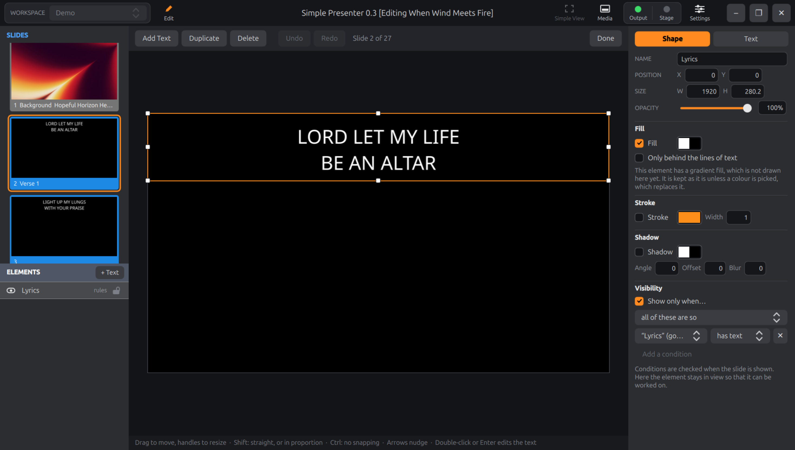

# Simple Presenter

**A fun in-progress EXPERIMENT: A vibe coded "ProPresenter" clone for Linux that works natively with ProPresenter's own
files.** It can run:

- a single presentation (a `.pro` file),
- a full exported playlist,
- even an entire copied workspace.

> [!WARNING]
> A personal experiment, shared as an example of what vibe coding can do in the hands of a hobby programmer:
> **not a product for use.** Nobody supports it, it comes with no warranty, and it has nothing to do with Renewed
> Vision. It changes the files it opens: give it a copy of your ProPresenter folder, never your only one.

![The Simple Presenter operator window: a toolbar across the top, with the workspace picker and the Search, Themes, Show, Edit, Reflow and Bible buttons at its left and the buttons for Simple View, the media bin, the look that is live, the output and stage screens and the settings at its right; libraries and playlists at the top left, in their folders, with the selected playlist's presentations below them under its headers, one of them sent to the announcements and marked with a green megaphone; in the middle a line with the key the chords are shown in, a note of what was last done, the name of the presentation, the megaphone, the Slide Show button and the arrangement, over a grid of a song's slides, framed in their group colours, some marked with the hotkey that goes to them or with icons for the media and the actions they bring, and the live one ringed in orange, with the transition and the size of the thumbnails in a bar under them and the media bin under that, its Video Inputs first in its list; and down the right the preview, here of a stage screen whose layout is three Screen Previews one over another (the main projector, the stream and the rear projector with the chords) over the stage's clocks, with the name of that screen under it; beside the preview two columns of clear buttons, the tall one of the Clear All group and the layers' pictures, those with something to clear in red; under it the three tabs over the transport, the media's picked, and the transport for the video that is playing; and the show controls on their tab of macros, each macro with its coloured icon and small icons for its actions](docs/screenshot.png)

Copy a whole ProPresenter workspace onto a Linux computer and it is all there, in a window
that anyone who has used ProPresenter will know their way around: the libraries and
playlists, the slides, the media, the timers, props, stage layouts and macros. Nothing is
converted, and there is no importing to do. It reads ProPresenter's own files, saves what
is changed back into them, and writes whatever it does not understand back exactly as it
found it.

- [What it can do](#what-it-can-do): [ProPresenter's features](#propresenters-features), and [some of its own](#custom-features)
- [What's new](#whats-new), and [every version](CHANGELOG.md)
- [Installing](#installing)
- [Helping yourself, with an AI](#helping-yourself-with-an-ai)
- [About the experiment](#about-the-experiment)
- [What it cannot do yet](docs/todo.md) · [How it is made](docs/how-it-is-made.md) · [Licence](#licence)

## What it can do

### ProPresenter's features

Most of the app is ProPresenter's way of doing things, followed as closely as could be
managed, under ProPresenter's own names. Each name below leads to a page that says how it
works here, where it differs from ProPresenter, and what is a guess.

#### Running the show

- <a id="workspaces"></a>**[Workspaces](docs/features/workspaces.md)**: a ProPresenter folder, opened as it stands, with its libraries, playlists, media bin and all the rest. A playlist exported from ProPresenter can be brought in too.
- <a id="media"></a><a id="the-media-inspector"></a>**[Media](docs/features/media.md)**: backgrounds that play on under the slides, foregrounds with their sound, the media bin with ProPresenter's Next Cue, a transport for the video, the announcements' video and the music, and ProPresenter's Media Inspector for fitting, cropping, looping and effects.
- <a id="video-inputs"></a>**[Video inputs](docs/features/video-inputs.md)**: a webcam or a capture device, live on the screens on a layer of its own under the media, from the media bin, a slide or a macro, with its sound; or in a shape, beside the words or on the stage.
- <a id="playback-markers"></a>**[Playback markers](docs/features/playback-markers.md)**: points in a video or a piece of audio whose actions run as playback reaches them, made in the Media Inspector, shown on the transport and on the stage.
- <a id="audio"></a>**[Audio](docs/features/audio.md)**: the audio bin, with playlists of music and sound effects, a clear of its own and a meter of how loud it is.
- <a id="timers"></a>**[Timers](docs/features/timers.md)**: countdowns, countdowns to a time of day and elapsed timers, started from a slide, with ProPresenter's Color Triggers.
- <a id="props"></a>**[Props](docs/features/props.md)**: a logo, a lower third, a countdown, laid over everything else until it is cleared.
- <a id="messages"></a>**[Messages](docs/features/messages.md)**: something to say over everything else, such as a parent wanted at the creche, with a name or a room typed in as it is shown.
- <a id="announcements"></a>**[Announcements](docs/features/announcements.md)**: a second presentation running over the first on a layer of its own, for the notices before a service or a ticker along the foot of the screen.
- <a id="go-to-next-timers-and-the-slide-show"></a>**[Go To Next timers and the Slide Show](docs/features/go-to-next-and-slide-show.md)**: slides that go on by themselves after a time, and a whole presentation left going round.
- <a id="clear-groups"></a>**[Clear groups](docs/features/clear-groups.md)**: named sets of layers, cleared together at one click.
- <a id="actions"></a>**[Actions](docs/features/actions.md)**: what a slide or a macro does as it goes live: start a timer, clear a layer, give the stage a layout, put a prop on, run a macro, change the look, play a media or audio playlist, show a message or a video input, or send to a device.
- <a id="macros"></a>**[Macros](docs/features/macros.md)**: a named list of actions, run at one click.
- <a id="groups-and-labels"></a>**[Groups and labels](docs/features/groups-and-labels.md)**: a slide's group and label, changed from the slide's menu, in ProPresenter's colours.
- <a id="copyright"></a>**[Copyright display](docs/features/copyright.md)**: a song's copyright, from SongSelect or typed in the editor, laid over its first, last or every slide, for a church's CCLI licence, as ProPresenter's display is.
- <a id="arrangements"></a>**[Arrangements](docs/features/arrangements.md)**: verse, chorus, verse, chorus, bridge. The groups are dragged into the order a song is sung in.
- <a id="stage-layouts"></a><a id="screen-preview"></a>**[Stage layouts](docs/features/stage-layouts.md)**: what the band and the speaker see, with the stage message and Screen Previews of the other screens.
- <a id="keys"></a>**[Keys](docs/features/keys.md)**: ProPresenter's keys, the groups' hotkeys, the clears on F1 to F6, and a slide reached by typing its number.
- <a id="log"></a>**[Log](docs/features/log.md)**: a log of each run, written to be read by a person or handed to an AI model.

| [Timers](docs/features/timers.md) | [Props](docs/features/props.md) | [Stage layouts](docs/features/stage-layouts.md) |
|:---:|:---:|:---:|
|  |  |  |

#### The slides

- <a id="editing"></a><a id="quick-edit"></a>**[Editing](docs/features/editing.md)**: text boxes, shapes and pictures added, moved, sized, turned and styled, with words edited where they stand. Every change is saved as it is made and can be undone, and Quick Edit puts a slide's words right without leaving the show.
- <a id="builds"></a>**[Builds](docs/features/builds.md)**: the things on a slide coming on one after another and going again, set up in ProPresenter's Build tab. A theme's builds are run too.
- <a id="transitions"></a>**[Transitions](docs/features/transitions.md)**: an equivalent of every slide transition ProPresenter has, under its names, and eighteen more.
- <a id="themes"></a>**[Themes](docs/features/themes.md)**: ProPresenter's themes dress the slides, for good, or on one screen only through a look.
- <a id="reflow"></a>**[Reflow](docs/features/reflow.md)**: a song's words as one table, for moving words between slides, splitting a slide and joining two.
- <a id="bibles"></a><a id="how-the-words-are-flowed"></a>**[Bibles](docs/features/bibles.md)**: a passage typed and made into slides in a theme, with ProPresenter's options. It can come from the three public-domain Bibles that come with the app, from one imported from an XML file, or from api.bible.
- <a id="chords"></a><a id="the-chord-editor"></a>**[Chords](docs/features/chords.md)**: a song's chords over its words on the stage, in any key, as ProPresenter shows them.
- <a id="search"></a>**[Search](docs/features/search.md)**: Ctrl+F finds a presentation by its name or by its words, as it is typed.

| [The editor](docs/features/editing.md) | [Chords on the stage](docs/features/chords.md) |
|:---:|:---:|
|  |  |

#### Screens and connections

- <a id="screens"></a>**[Screens](docs/features/screens.md)**: up to sixteen, for the audience and for the stage, each in a window or on a display, over NDI or out of a DeckLink card, and any one of them in the operator's preview. On GNOME, an extension that comes with the app [keeps them out of Alt+Tab](docs/features/screens.md#a-screen-in-a-window).
- <a id="looks"></a>**[Looks](docs/features/looks.md)**: which layers each audience screen gets, so that the room has the words over the video while a stream has the words alone.
- <a id="masks"></a>**[Masks](docs/features/masks.md)**: a slide laid over everything else a screen shows, to give it another outline or to keep a projector off a doorway.
- <a id="ndi"></a>**[NDI](docs/features/ndi.md)**: a screen sent over the network for a vision mixer or OBS to pick up. NDI's library is not included: the app offers to fetch it, under NDI's own licence.
- <a id="blackmagic-decklink"></a>**[Blackmagic DeckLink](docs/features/decklink.md)**: a screen out through a card's output, in ten formats, keyed or not. It has been tried so far on one card.
- <a id="the-api"></a>**[The API](docs/features/api.md)**: ProPresenter's own network API, so that Bitfocus Companion's module, and the remotes made for ProPresenter, can follow the show and work it. The page says what is there and what is not.
- <a id="devices"></a>**[Devices](docs/features/devices.md)**: MIDI notes and RossTalk Custom Controls sent from slides and macros, and ProPresenter's MIDI Map, so that a MIDI device's notes work the show.

### Custom features

These are not ProPresenter's: they are ideas of my own, added because I always wished
ProPresenter had them. The list will grow.

- <a id="simple-view"></a>**[Simple View](docs/features/simple-view.md).** Hold the ~ key, or click its button, and everything round the slides gets out of the way, so that as many of them as will fit can be seen at once.
- **Two chord editors.** ProPresenter shows the chords a song came with, and has no way to put one on by hand. Here the editor has a sheet of the whole song for doing it with the mouse and the keys 1 to 7, and the same song as ChordPro text. See [the chord editor](docs/features/chords.md#the-chord-editor).
- **Importing a ChordPro file** as a new song, chords and all.
- **A Bible passage shared out evenly.** ProPresenter fills each slide and goes on to the next. Here the words can be shared out across the slides, broken at a full stop or a comma where there is one near, with no slide left holding a scrap. See [How the words are flowed](docs/features/bibles.md#how-the-words-are-flowed).
- **HTTP Requests**, a kind of [device](docs/features/devices.md) ProPresenter does not have: a slide or a macro sends a GET, POST, PUT or DELETE, with a body and headers, to a web address, for whatever on the network should be told that the show has got there.
- **How a slide's video plays on, at a glance.** A slide with a video has an icon for whether it stops at its end, loops, or loops for a count or a time. A right click on that icon changes what it does, there and then. See [Media](docs/features/media.md).
- **Playing a slide's media by itself.** The Media caption in a slide's menu plays the slide's media and leaves the slide layer as it is.
- **Dragging the clear buttons.** A clear button dropped on a slide or a macro gives it the action that clears that layer, or that [clear group](docs/features/clear-groups.md).
- **How solid the icons on the slides are** is a setting, from nearly gone to solid.

| [Simple View](docs/features/simple-view.md) | [The chord editor](docs/features/chords.md#the-chord-editor) |
|:---:|:---:|
|  |  |

<a id="built-for-modest-hardware"></a>**It is made for an old laptop.** Everything here is measured on a 2017 laptop with
integrated graphics. On it, the app starts in about a second, costs next to nothing while
a slide is up, and plays a 4K video under the words with most of the machine to spare:
see [Built for modest hardware](docs/how-it-is-made.md#built-for-modest-hardware).

<a id="todo"></a>**What it cannot do yet** is a longer list. ProPresenter does a great deal more than this:
there are no timelines here yet and no capture, nor video in from a DeckLink card or over NDI, among much else. See
[what is not there yet](docs/todo.md).

## What's new

The latest, newest first. [CHANGELOG.md](CHANGELOG.md) has every version.

- **0.106: Next Cue, and a transport for each layer.** A video in a media playlist can go on to another of its playlist when it ends, as ProPresenter's Next Cue; and tabs over the transport work the media layer's video, the announcements' video or the audio bin's music. See [Next Cue](docs/features/media.md#next-cue) and [the transport](docs/features/media.md#the-transport).
- **0.105: Video inputs.** A webcam or a capture device, live on a layer of its own under the media, with its sound: set up in Settings → Inputs, shown from the media bin's Video Inputs or by a slide or a macro, and as the fill of a shape. See [Video inputs](docs/features/video-inputs.md).
- **0.104: One preview, of any screen, with the clears beside it.** The preview shows whichever screen is picked under it, and can be dragged taller for a stage layout of several Screen Previews; the clears are two columns of pictures beside it, as ProPresenter has them. See [Screens](docs/features/screens.md).
- **0.103: Playlists and messages as actions.** A slide or a macro plays a playlist of the media bin or of the audio bin, with ProPresenter's Always Retrigger, or shows a message with words of its own for its tokens. Picked from Add Action or dragged out of their lists. See [Actions](docs/features/actions.md).
- **0.102: Devices.** A slide or a macro sends a MIDI note, a RossTalk Custom Control or an HTTP request, and a MIDI device's notes work the show by ProPresenter's MIDI Map. See [Devices](docs/features/devices.md).

## Installing

<a id="the-first-run"></a><a id="building-from-source"></a><a id="hardware-video-decoding"></a>There is a package for Ubuntu 26.04 on ordinary (64-bit Intel or AMD) computers. Download
`simplepresenter_0.106_amd64.deb` from the
[Releases](https://github.com/greyshirtguy/Simple-Presenter/releases) page and install it:

```
sudo apt install ./simplepresenter_0.106_amd64.deb
```

Anywhere else, [build it from source](docs/installing.md#building-from-source), which takes
a few minutes. [Installing](docs/installing.md) has the rest:

- what the package holds,
- [the first run](docs/installing.md#the-first-run), and how to give the app something to show,
- [what a computer needs for video to play smoothly](docs/installing.md#hardware-video-decoding), and where the firmware for an old NVIDIA card's decoder is explained.

## Helping yourself, with an AI

Nobody supports this app, and that is not going to change. But most of what goes wrong is
particular to one computer: a driver, a font, a display, a workspace that was moved. An AI
coding agent running on *your* computer can see all of that, which nobody answering a
question from far away could. It can read the app's log, build the app from this source,
run it on a copy of your workspace, and work out what is wrong. The repository is set up
for it: [AGENTS.md](AGENTS.md) tells an agent what the app is and how to keep its hands off
your files, and [docs/agent-playbook.md](docs/agent-playbook.md) is its guide.

[Helping yourself, with an AI](docs/ai-help.md) says how to start one, and what it risks.
Read the risks before you start.

## About the experiment

This is one person's quick experiment in "vibe coding": it was built entirely by
describing it to an AI model. The model never took ProPresenter itself apart (though AI
can do that scarily well too). It works from my
[ProPresenter7-Proto](https://github.com/greyshirtguy/ProPresenter7-Proto) descriptions of
the file formats and from the files ProPresenter writes. While this first experiment in
vibe coding has blown my mind, I am sharing it as an example of what vibe coding can do in
the hands of a hobby programmer: **it is not a product for use.**

### What it is trying to be

Simple Presenter is an experiment in vibe coding, and my first attempt at building
something non-trivial that way. It has three goals.

- **Linux.** A native Linux application, in Qt and C++ rather than a web page in a
  wrapper, that reads and writes ProPresenter's own files. A copy of a ProPresenter
  folder can be opened and run as it stands, and what is changed here can be opened
  there again.
- **Simple.** The essentials of running a show, kept easy to find: slides over media,
  transitions, screens for the audience and the stage, playlists, a media bin, timers,
  props, macros and an editor. And when even that is in the way,
  [Simple View](docs/features/simple-view.md) leaves the slides and nothing else.
- **Lightweight.** Above all it has to perform, even on modest and older computers. It
  is developed and measured on a 2017 laptop with integrated graphics, and the design
  choices are made for that machine first: see
  [Built for modest hardware](docs/how-it-is-made.md#built-for-modest-hardware).

> [!NOTE]
> ## How the experiment is going
>
> **I cannot believe how well Claude is doing at vibe coding this app.**
>
> So I am going to keep going, and see how far I can get, knowing full well that the
> whole experiment may yet come crashing down. There is a list of what I mean to throw
> at it next under [TODO](docs/todo.md).

[How it is made](docs/how-it-is-made.md) is for the curious: how it is kept quick, how it
works, and how it is tested.

## Licence

SimplePresenter is free software under the MIT licence: do with it what you like, and
keep the notice. See `LICENSE`. It comes with no warranty: the licence says so, and so does
the warning at the top of this page.

(Versions up to 0.6 were released under the GNU Lesser General Public License version 3,
and those releases stay under it.)

It uses, under their own licences:

- [Qt](https://www.qt.io) 6, under the LGPL version 3, linked dynamically.
- NDI's header files, under the MIT licence: everything in `third_party/ndi/include`,
  each of which says so at its top. NDI's library is not here; whoever installs it does
  so under NDI's own licence ([NDI](docs/features/ndi.md)).
- Blackmagic Design's DeckLink SDK header files: everything in
  `third_party/decklink/include`, under the licence at the top of each. Blackmagic's
  library is not here; it comes with their Desktop Video
  ([Blackmagic DeckLink](docs/features/decklink.md)).
- [ProPresenter7-Proto](https://github.com/greyshirtguy/ProPresenter7-Proto), under the
  MIT licence.
- Transitions ported from [gl-transitions](https://gl-transitions.com), under the MIT
  licence: everything in `shaders/gl-transitions`, where the licence text is. Each file
  credits its author, and says where it departs from the original.
- The pictures in `icons/`, which are the ones ProPresenter has for a look, the
  screens, the stage, a timer, a prop, a macro, the announcements and clearing a layer:
  from the icon pack of the
  [Companion module for ProPresenter](https://github.com/bitfocus/companion-module-renewedvision-propresenter-api),
  whose repository is under the MIT licence. `icons/README.md` has that licence, and
  how the files here were made from the pack's.
- Protocol Buffers, fontconfig, zlib, FFmpeg (through Qt Multimedia, and directly
  for video thumbnails) and ALSA's library (for MIDI), as provided by the system.

ProPresenter is a trademark of Renewed Vision. This project is not affiliated with or
endorsed by them.
