# Simple Presenter

**A fun in-progress EXPERIMENT: A vibe coded "ProPresenter" clone for Linux that works natively with ProPresenter's own
files.  It can run a pro file, a full exported playlist - even an entire copied workspace.**

Simple Presenter on Linux runs a show from a ProPresenter 7 folder as it is. Copy a whole
ProPresenter workspace onto a Linux computer and it is all there, in a window that
anyone who has used ProPresenter will know their way around: the libraries and
playlists, the slides, the media, the timers, props, stage layouts and macros. It reads
ProPresenter's files and allows you to edit them as well.

This is one person's quick experiment in "vibe coding": it was built entirely by describing it to an AI model. The model never took ProPresenter itself apart (though AI can do that scarily well too): it works from my [ProPresenter7-Proto](https://github.com/greyshirtguy/ProPresenter7-Proto) descriptions of the file formats and from the files ProPresenter writes. While this first experiment in vibe coding has blown my mind, I am sharing it as an example of what vibe coding can do in the hands of a hobby programmer: **it is not a product for use.**

![The Simple Presenter operator window: a toolbar across the top, with the workspace picker and the Search, Themes, Show, Edit and Reflow buttons at its left and the buttons for Simple View, the media bin, the look that is live, the output and stage screens and the settings at its right; libraries and playlists at the top left with the selected playlist's presentations below them; in the middle a line with the key the chords are shown in, the name of the presentation, the megaphone that says whether it goes to the announcements, the Slide Show button and the arrangement, over a grid of its slides, framed in their group colours, some marked with the hotkey that goes to them or with icons for the media and the macro they bring, and the live one ringed in orange, with the transition and the size of the thumbnails in a bar under them and the media bin under that; and down the right the output preview, with the words over a video that is playing, the stage preview with the words and their chords, the next slide's words and its clocks, the six clear buttons, the transport for the video and the show controls, on their tab of macros, each macro with its coloured icon and small icons for its actions](docs/screenshot.png)

> [!WARNING]
> **This is a personal experiment, not a product.**
>
> Simple Presenter is one person's hobby project, and it is *vibe coded*: I describe
> what it should do to an AI model (Claude), and the model writes the code. It exists
> to find out how far that goes.
>
> So please take it for what it is:
>
> - **Nobody supports it.** There is no one to answer questions, fix bugs or add
>   features, and no promise that anything here works, or will go on working.
> - **It comes with no warranty** of any kind. It is not made to be relied on, and
>   anything done with it is at your own risk.
> - **It has been tried on one laptop**, with one person's ProPresenter files.
> - **It changes the files it opens.** If you run it to see what it does, give it a
>   copy of your ProPresenter folder, never your only one.
> - **It has nothing to do with Renewed Vision**, the makers of ProPresenter.
>
> I am sharing it as an example of what vibe coding can do in the hands of a hobby
> programmer. It is not a product for use.

**On this page:** [what it can do](#what-it-can-do) · [what's new](#whats-new) ·
[what it cannot do yet](#todo) · [installing it](#installing) ·
[getting help](#helping-yourself-with-an-ai) ·
[how each part is used](#workspaces) · [how it is built and tested](#building-from-source) ·
[the licence](#licence)

## What it can do

It can run a show from a ProPresenter folder, on Linux, on a modest computer: that is
how far the experiment has got. At more length:

**It works on a ProPresenter workspace as it is.** Copy the folder ProPresenter keeps
everything in onto the Linux computer and pick it in the app. Nothing is converted and
there is no importing to do: the libraries and their presentations, the playlists and
their folders, the media bin, the audio bin, the timers, props, stage layouts, macros,
screens, looks and themes, and the hotkeys of the groups, are all read from the files
ProPresenter keeps them in. What is changed here (a slide edited, a playlist made, a
chord put on) is saved into those same files, and whatever is in them that this app
does not understand is written back exactly as it was found. A playlist exported from
ProPresenter can be brought into a workspace too. More under [Workspaces](#workspaces).

**It looks and works the way ProPresenter does.** That is the window at the top of this
page: libraries and playlists at the left, the slides of the presentation in the middle
in the colours of their groups, the previews, the clear buttons and the show controls
at the right, and the media bin under the slides. A click on a slide shows it; so do
the arrow keys, the space bar and the hotkeys of the groups. Slides go over
[media](#media), which is a background that plays on under them or a foreground with
its sound, and one thing gives way to the next through a [transition](#transitions):
there is an equivalent of every slide transition ProPresenter has, under the names it
gives them, and eighteen more.

**It has timers, props, stage layouts, macros, an audio bin and messages,** on six
tabs under the previews: a countdown that a slide can start, something to lay over
the slides until it is cleared, what the people on the stage are shown, a list of
things to do at one click, music and sound effects, and things to say over everything
else, with a name or a room put in as they are shown. A slide or a macro can carry [actions](#actions) that work them: start a timer,
clear a layer, give the stage another layout, put a prop on, run a macro, go over to
another look.

| [Timers](#timers) | [Props](#props) | [Stage layouts](#stage-layouts) |
|:---:|:---:|:---:|
| 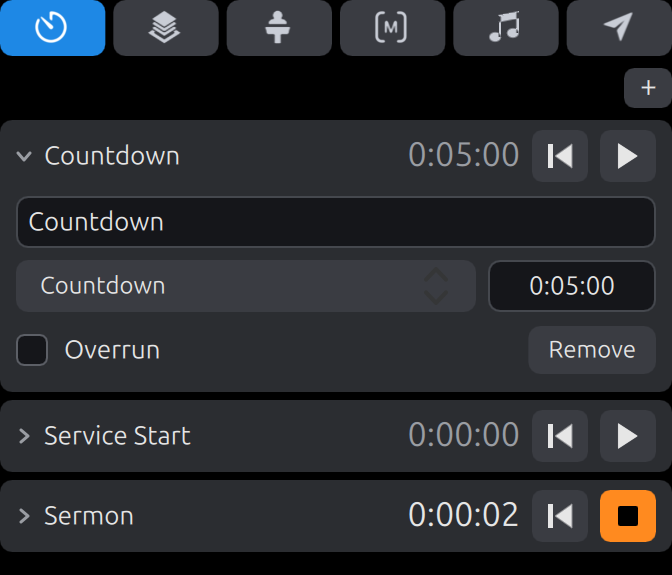 | 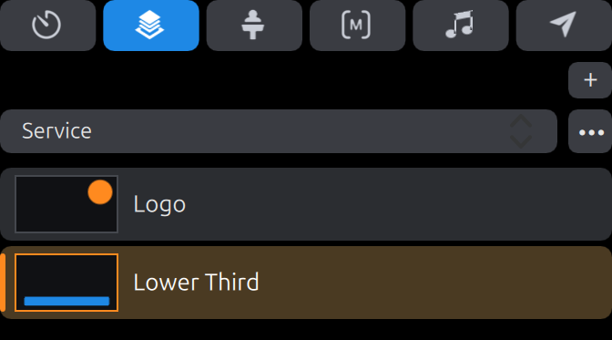 | 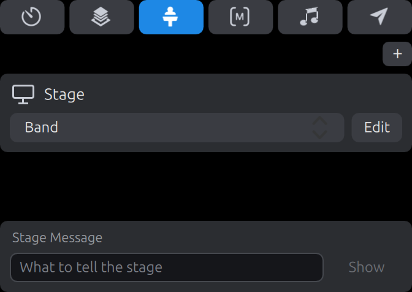 |

**It runs a second presentation over the first, and a presentation by itself.** A
presentation can be sent to the [announcements](#announcements) layer instead of the
slides', where it shows over whatever else is on: the notices before a service, a
ticker along the foot of the screen. A slide can go on to the next after a time, and
a whole presentation can go round as a slide show, which is how such a thing is left
running: see [Go To Next timers and the Slide Show](#go-to-next-timers-and-the-slide-show).

**It sends the show to as many screens as are needed.** A workspace can have up to
sixteen [screens](#screens), for the audience and for the stage, each in a window, on
one of the computer's displays, on the network as an [NDI](#ndi) source, or out of a
[Blackmagic DeckLink](#blackmagic-decklink) card, keyed or not.
[Looks](#looks) say which layers each audience screen gets, so that the room has the
words over the video while a stream has the words alone, and ProPresenter's
[themes](#themes) dress the slides, for good or on one screen only. A screen can be
given a [mask](#masks), which covers the parts of it that nothing should be shown on.

**Yes, it has an editor, and it edits ProPresenter's files.** Text boxes, shapes and
pictures are added to a slide, moved, sized, turned and styled; words are edited where
they stand; slides are added, copied and deleted. Props, stage layouts, themes and
masks are edited in it too. Every change is saved as it is made, can be undone, and touches
nothing in the file but what was changed. More under [Editing](#editing).


**And it has a chord editor, which ProPresenter has not.** A song's chords are shown
over its words on the stage, in any key, as ProPresenter shows the chords of a song
that came with them. Here they can be put on by hand as well, and quickly. The whole
song is one sheet; a bubble follows the pointer to show where the next chord will go;
and the chord is one key away (1 to 7 are the chords of the song's key) or a letter or
two typed, with the likely ones offered. Click the next place and carry on. More under
[Chords](#chords).

![The chord editor, with the hymn Amazing Grace as one sheet: its slides a grid of cards, each in a frame of its group's colour with the slide's number and the group's name on its foot, and the chords in small bubbles over the letters they belong to; over the grid the seven chords of the song's key, G, numbered 1 to 7, and in the toolbar the song's two keys and the switch between Slides, Chords and ChordPro; the first verse has its chords, and the slide before it, which has no words, the chords of an intro; over a word of the second verse a bubble in which a chord is being typed, G and a slash, with the bass notes it might be going on to offered above it; and on the line under it a bubble in outline where the pointer is, which is where a click would start the next chord](docs/chord-editor.png)

The same song can be worked on as ChordPro text, and a song can be brought in from a
ChordPro file, chords and all.

| The same song as ChordPro text | On the stage |
|:---:|:---:|
| 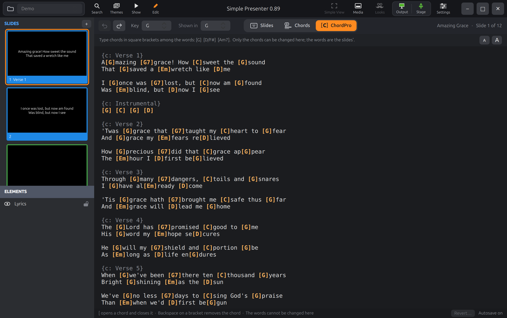 | 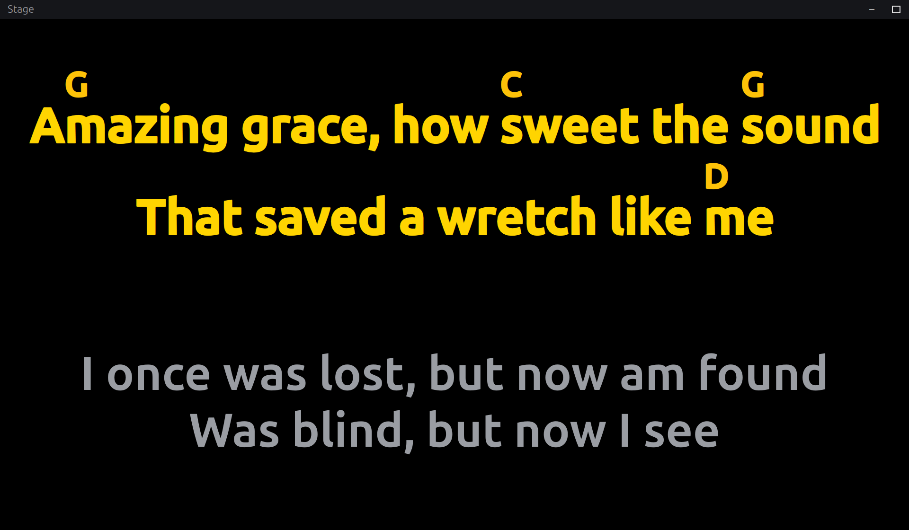 |

**It finds things.** [Search](#search) (Ctrl+F) finds a presentation by its name or by
any of its words, as it is typed.

**It makes slides of a Bible passage,** as ProPresenter's Bible view does: a passage
typed, in one of three public-domain Bibles that come with it (the KJV, YLT and BBE),
in a Bible imported from an XML file, or read from api.bible over the internet, is made
into slides in a theme, with ProPresenter's options. The words are shared out across
the slides more evenly than ProPresenter does it, and broken where they pause. See
[Bibles](#bibles).

**And one idea of my own: Simple View.** Hold the ~ key, or click its button, and
everything round the slides gets out of the way, so that as many of them as will fit
can be seen at once. The same again brings it all back. More under
[Simple View](#simple-view).

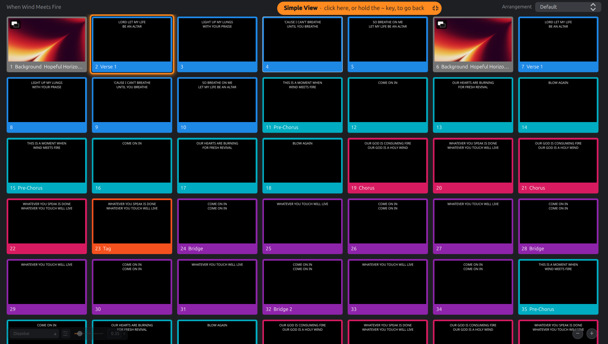

**It is made for an old laptop.** Everything here is measured on a 2017 laptop with
integrated graphics, on which it starts in about a second, costs next to nothing while
a slide is up, and plays a 4K video under the words with most of the machine to spare:
see [Built for modest hardware](#built-for-modest-hardware).

**What it cannot do** is a longer list. ProPresenter does a great deal more than this:
there are no video inputs and no network API here yet, among much else. See
[TODO](#todo).

### Custom features

Most of what is here is ProPresenter's way of doing things, followed as closely as
could be managed. These are the things that are not: ideas of my own, added because I
always wished ProPresenter had them. The list will grow.

- **[Simple View](#simple-view).** Everything but the slides gets out of the way, and
  the slides take the whole window.
- **How a slide's video plays on, at a glance.** A slide with a video has an icon for
  whether it stops at its end, loops, or loops for a count or a time, under the icon
  for its being a background or a foreground. See [Media](#media).
- **Changing a slide's media from the slide.** A right click on either of those icons
  changes what it shows, there and then, with no inspector to go to.
- **Playing a slide's media by itself.** The Media caption in a slide's menu is
  something to click: it plays the slide's media and leaves the slide layer as it is.
  (The other way about, a slide without its media, is ProPresenter's: a click with Alt
  held.)
- **Dragging the clear buttons.** A clear button dragged onto a slide or a macro gives
  it the action that clears that layer, or that [clear group](#clear-groups). See
  [Actions](#actions).
- **How solid the icons on the slides are** is a setting, from nearly gone to solid.
- **Two chord editors.** ProPresenter shows the chords a song came with and has no way
  to put one on by hand. Here the editor has a sheet of the whole song for doing it
  with the mouse and the keys 1 to 7, and the same song as ChordPro text. See
  [Chords](#chords).
- **Importing a ChordPro file** as a new song, chords and all.
- **A Bible passage shared out evenly.** ProPresenter fills each slide and goes on to
  the next; here the words can be shared out across the slides, broken at a full stop
  or a comma where there is one near, with no slide left holding a scrap. See
  [How the words are flowed](#how-the-words-are-flowed).

### What it is trying to be

Simple Presenter is an experiment in vibe coding, and my first attempt at building
something non-trivial that way. It has three goals.

- **Linux.** A native Linux application, in Qt and C++ rather than a web page in a
  wrapper, that reads and writes ProPresenter's own files. A copy of a ProPresenter
  folder can be opened and run as it stands, and what is changed here can be opened
  there again.
- **Simple.** The essentials of running a show, kept easy to find: slides over media,
  transitions, screens for the audience and the stage, playlists, a media bin, timers,
  props, macros and an editor. And when even that is in the way,
  [Simple View](#simple-view) leaves the slides and nothing else.
- **Lightweight.** Above all it has to perform, even on modest and older computers. It
  is developed and measured on a 2017 laptop with integrated graphics, and the design
  choices are made for that machine first: see
  [Built for modest hardware](#built-for-modest-hardware).

> [!NOTE]
> ## How the experiment is going
>
> **I cannot believe how well Claude is doing at vibe coding this app.**
>
> So I am going to keep going, and see how far I can get, knowing full well that the
> whole experiment may yet come crashing down. There is a list of what I mean to throw
> at it next under [TODO](#todo).

## What's new

The big things lately, the newest first.

- **Blackmagic DeckLink output**, tried so far on one card. A screen can go out
  through an output of a DeckLink card, in one of ten formats, and an output that is a
  linked pair of connectors can key, internally or externally, with ProPresenter's
  alpha settings. Screens going out through cards are drawn together and handed over
  together, so that their outputs change together. See
  [Blackmagic DeckLink](#blackmagic-decklink).
- **Copy Text Style and Paste Text Style.** A slide's menu, while showing and in the
  editor, puts the look of one slide's text boxes on another's, as a theme would,
  keeping the words. See [Editing](#editing). And a paste into a text box is a paste
  and match style, by Ctrl+V or Ctrl+Shift+V: the words come in, centred lines and
  all, in the box's own format.
- **The slide live on the announcements has a green ring**, the show's keeping its
  orange, so the two are told apart. See [Announcements](#announcements).
- **Mended:** a screen sent over NDI went out black, or as a garble, after it was
  switched off and on again; and a song dressed in a theme lost its chords.
- **Screen Preview.** A shape can be filled with a picture of what one of the
  workspace's screens is showing, which is ProPresenter's Screen Preview: on a stage
  layout, the output as the room sees it, video and all; or on a slide or a prop.
  ProPresenter's own Screen Previews in its stage layouts are drawn now, and one is
  made in the editor's Fill menu, with the screen chosen under it. The picture is drawn
  again from what the screen is told, its video's frames borrowed from the one decoder
  that plays it: see [Stage layouts](#stage-layouts) for what it costs.
- **Color Triggers.** A text box linked to a timer, or to a video's time left, changes
  colour as the time comes down to given times: orange at a minute, red at nothing,
  and red on through an overrun, say. They are ProPresenter's, read from its files and
  written back to them, set under the link in the editor's Text tab. They can be
  dragged into another order, and a list kept as the default and put on another box.
  See [Timers](#timers).
- **Three Bibles come with the app.** The King James Version, Young's Literal
  Translation and the Bible in Basic English, which are in the public domain (the KJV
  except in the United Kingdom, the BBE in the United States), are in Bible mode's menu
  under Included, from the start and with nothing to set up; the KJV is chosen until
  another is. They are eBible.org's: see [bibles/README.md](bibles/README.md).
- **Bible mode, reworked.** **← Verse** and **Verse →**, under the slides now, add a
  verse to the passage, before it or after it, within its book, and leave the slides
  up to (or from) the one that is live as they were, so nothing on the screen changes;
  a live Bible slide is ringed whatever is being browsed at the left, and the arrow
  keys go on from it. The grid in Bible mode shows only Bible slides: nothing at first,
  then the last ones made. A presentation clicked meanwhile is not shown, but is the
  one the slides are copied into and the one Show or Edit goes back to. The options are
  in a panel behind the cog, Save is under the slides at the left of the transition,
  Enter finds a passage, and a presentation's own buttons are not over Bible slides.
  Every slide's words are in the theme's size, a Single Line box runs them on as one
  line, and the boxes chosen are remembered for each theme slide. api.bible wants a key
  of one's own, typed in the settings. See [Bibles](#bibles).
- **Single Line text boxes keep their looks.** A text box set in ProPresenter to Single
  Line or Replace Line Returns used to be drawn all in the look of its first word:
  every colour and bold word after it lost, and, where the text began with a raised
  number, the whole of it small and raised. Each word keeps its own look now; only the
  line breaks go. And the menus leave room for their ticks, which were drawn over the
  first letter of a ticked row in most of them.
- **Bible mode.** **Bible** in the toolbar, or Ctrl+Alt+B, as in ProPresenter, brings
  up a bar over the slides where a passage is typed (`John 3:16-18`, `Ps 23`) and made
  into slides in a theme, with ProPresenter's Bible Slide Options, its references,
  Previous Verse and Next Verse, and Save as Presentation, Save to Playlist and Copy to
  Current Presentation. No Bible comes with the app: one is imported from an XML file
  (Zefania, OSIS, Beblia or OpenSong), or read from api.bible over the internet, a
  passage at a time and nothing of it kept. And the words can be flowed **Even, at
  Natural Pauses**: as many slides as ProPresenter would make, the words shared out
  across them, broken at the end of a sentence or a verse, or at a comma, where one is
  near. See [Bibles](#bibles).
- **The chord sheet, as the Mac and Windows chord editors have it now.** A blue line
  under the sheet says what the keys and the mouse do just now, where the pointer is:
  on a chord, that Delete takes it off and 1 to 7 change it; while one is typed, what
  Enter, Tab and Esc do; and with Ctrl held, how a line's chords are copied and
  pasted. It lights up for a moment when what it says changes. The line the pointer
  is on has its words drawn in orange: it is the line Ctrl+C copies from and Ctrl+V
  pastes to, which only the spot said before. Sharps and flats are drawn as ♯
  and ♭, F♯m7 and B♭, on the sheet and in the song's two keys; the song itself keeps
  `#` and `b`, and so does the ChordPro text. A chord's name is orange as it comes. A
  chord whose name is emptied in its bubble and then kept, by Enter or a click
  elsewhere, now comes off, where it used to come back. The settings have the line's
  colour and a switch for the signs. See [the chord editor](#the-chord-editor).
- **Masks.** A [mask](#masks) is a slide laid over everything else a screen shows, to
  cover the parts of it nothing should be shown on. They are made and drawn in the
  editor, which lists them at its left as it lists slides, and a screen is given one
  in the Looks window, where ProPresenter has it: the Masks row there is a menu of the
  workspace's masks, with **Add New Mask** and **Edit Masks…**. No clear takes a mask
  off: it is the screen's, not the show's.
- **A name typed where it stands, in the editor's list.** A click on the name under a
  mask, a prop, a stage layout or a theme's slide in the list at the left of the
  editor renames it there. The same click under a slide of a presentation gives the
  slide its label, and **Rename** is in the menu of each.
- **Go To Next timers and the Slide Show.** A slide's menu has **Go To Next Timer…**:
  after so many seconds the next slide is triggered by itself, or with **Loop to
  Beginning** the first. And a presentation has ProPresenter's **Slide Show**, a small
  button over the slides at the left of the arrangement's name: every slide goes on
  to the next after 5, 10, 15 or 20 seconds or a time of one's own, round and round.
  A slide's own timer wins over it, and nothing starts until a slide is triggered.
  See [Go To Next timers and the Slide Show](#go-to-next-timers-and-the-slide-show).
- **The announcements layer.** A presentation's menu has ProPresenter's
  **Destination**: Presentation, or Announcements. One that is sent to the
  [announcements](#announcements) goes to a layer of its own, its slides and its
  media both, over the slides and under the props, while the show itself stays at the
  slide it was at: a second presentation, running at the same time. The layer has its
  own clear button (ProPresenter's megaphone), a look says which screens get it, and a
  clear group can clear it.
- **The reflow editor.** The slides' words as a table, a row to a slide, for moving
  the words between slides: Ctrl+Enter splits a slide in two where the caret is, the
  new slide being the slide over again with those words in it, and Backspace at the
  start of a slide's words joins it to the one before. The words keep their fonts,
  sizes, colours and chords through it. It is the **Reflow** button in the toolbar,
  after Edit, or Ctrl+R: see [Reflow](#reflow).
- **The arrangement editor.** The line over the slides has ProPresenter's Arrangements
  button, which opens two thin rows under it: the presentation's groups as coloured
  labels, and the [arrangement](#arrangements) being viewed. A group is dragged down
  into the arrangement, dragged along it to another place, and taken out with the ✕ it
  has under the pointer; the picker beside it makes a new arrangement, which begins as
  a copy of Master, and opens the list of them, where one is copied, renamed or
  removed.
- **The order of a slide's elements, by dragging.** In the [editor](#editing), a row of
  the list of a slide's elements is dragged up or down to change which element lies
  over which: the top of the list is the front. A line shows where it would land. The
  right-click menu still has the same a step at a time.
- **Messages, and the stage message.** ProPresenter's [messages](#messages) are a
  sixth tab of the show controls: named things to say over everything else, each with
  its words, **tokens** among them for what is only known when it is shown (a name, a
  room, the time of day, a timer), a theme to be drawn in, and how it goes away, by
  hand or after a time. They are shown on a layer of their own, over the props, with a
  clear button of its own (F6); the clear groups and the looks have that layer too.
  And the stage tab has the **stage message**: what is typed there is shown by every
  text box linked to the stage message, which can flash as it comes
  ([Stage layouts](#stage-layouts)).
- **A chord dragged out of the strip.** In the [chord editor](#chords), each of the
  key's seven chords along the top of the sheet can be dragged down onto a word, on
  any slide, and let go there. A lit bubble shows where it would land; where there is
  none, letting go puts nothing on. The keys 1 to 7 are still the quick way: this is
  for the hand that reaches for the chord anyway. It came from the chord editor for
  the Mac and Windows, which began as a copy of this one.
- **Slide notes, and more for a text box to show.** A slide's notes are in the
  [editor](#editing), in a pane under the slide that a button at the bottom right puts
  up and away, and whose top edge is dragged to size it. They are formatted text, kept
  in the presentation's file as ProPresenter keeps them: Ctrl+B, I and U, and a right
  click for a font, a size and a colour. A text box can show the notes of the slide
  that is live, or of the next, in its own style or as they were written, which is
  what a stage layout wants them for. A text box can also show the **system clock**,
  and how long the video that is playing has left (a **video countdown**). And what a
  box shows is now picked as ProPresenter has it picked: from one menu, with what
  there is to say about the thing picked set underneath.
- **The audio bin, and how loud it all is.** ProPresenter's [audio bin](#audio) is
  here, as another tab of the show controls: its playlists and their folders, read
  from ProPresenter's own file of them, and under them the pieces of the one picked. A
  click plays a piece. A piece is music or a sound effect: music is one at a time, and
  sound effects play over it and over each other. A piece stops at its end, goes
  round, or is followed by the next of its playlist. One piece of music can be crossed
  into the next, and how long a fade is can be set. Pieces can be dragged onto a slide
  or a macro. There is a button that clears the audio (and F5), the clear groups can
  have the audio among their layers, and the preview of the output has two bars at its
  edge that show how loud what is playing is. The settings say which device sound is
  played through.
- **The chord editors, as they came back from the Mac.** The [chord
  editor](#the-chord-editor) was made into a program of its own for the Mac and for
  Windows ([Pro7 Chord Editor](https://github.com/greyshirtguy/Pro7ChordEditor)), and
  what was thought of and found in building that is now here too, so that the two work
  and look alike. The sheet's slides are a grid, as the slides of a presentation are,
  each in a frame of its group's colour, and the sheet zooms: a window that showed four
  slides of a song shows nine, or sixteen. A paste says what came of it. The song has
  two keys to pick, the one its chords are written in and the one they are shown in,
  over both editors. The way of working is a switch in the middle of the toolbar.
  Under the editors it says **Autosave on**, and **Revert…** makes the song what it was
  when it was opened. The ChordPro text has a size of its own, and the settings have
  the colour of a chord in each. A line of chords with no words that has lost its
  last chord can be given chords again; and a chord more or fewer on such a line now
  changes that line's own characters in the file and nothing else of its text box.
- **A slide by its number.** Type a slide's number while showing and it comes up over
  the slides, large; Enter takes that slide live, as a click on it would. Typing takes
  nothing live by itself, and a number left alone for a second goes away again. See
  [Keys](#keys).
- **Ctrl+, opens the settings.**
- **Video decoded by the processor alone, where a graphics driver cannot be trusted
  with it.** On a computer whose graphics driver is known to hang when its video
  decoder is tried (an NVIDIA card on the nouveau driver, without that decoder's
  firmware), the app now leaves the decoder alone by itself, says so once, and lets it
  be tried all the same from the settings. And on any computer the settings, under
  Video, can keep decoding to the processor: for one on which a video shows nothing, or
  which hangs when a video starts or is changed for another. See
  [Hardware video decoding](#hardware-video-decoding).
- **Clear groups.** Under the clears of the layers is a row of buttons for the
  workspace's [clear groups](#clear-groups): named sets of layers cleared together at
  one click, starting with ProPresenter's own, Clear All. A right click on any clear
  button leads to the window they are set up in: which layers each clears, the picture
  on its button, and a tint. An action on a slide or in a macro can clear a group, and
  F1 clears the first of them.
- **Groups and labels from a slide's menu.** A right click on a slide has **Group**,
  which puts the slide and those after it in its group into another group, as
  ProPresenter does, and **Label**, which gives the slide a [label](#groups-and-labels):
  one the workspace keeps ready, one made on the spot with a colour, or none.
- **A box that narrows the list of presentations.** Type part of a name under the list,
  in a library or a playlist, and only the presentations that have it are left.
- **Presentations renamed and deleted.** A presentation's menu has **Rename**, which
  brings the playlists that have it along, and in a library **Delete…**, which moves
  its file to the Trash.
- **Simple View can keep the right pane.** A setting leaves the previews, the clears and
  the show controls where they are while the rest goes.
- **New presentations.** The **+** beside Libraries has **New Presentation…**: give it
  a name, and it is made in the library that is open, with one slide to start on.
  Until now a presentation could only be brought in from elsewhere.
- **Chords on a slide with no words.** An intro or an instrumental is often a slide
  with nothing on it, and such a slide is now on the [chord editor](#the-chord-editor)'s
  sheet, and in its ChordPro text, to be given chords like any other. They are kept
  just as ProPresenter is given an intro's chords by Multitracks, on characters that do
  not show. Nothing is added to a slide until a chord is put on it, and taking the
  chords off again leaves the slide exactly as it was found.
- **A way to help yourself.** There is still nobody to ask, but the repository now tells
  an AI coding agent how to find out what is wrong on your own computer, and what it
  must not touch while it does: see
  [Helping yourself, with an AI](#helping-yourself-with-an-ai).
- **ProPresenter's own pictures.** The look, the screens and the stage in the toolbar,
  the buttons that clear a layer, the tabs of the show controls and the small picture
  of what each action does are now the pictures ProPresenter has for them, so that
  what is known from there is found here at a glance.
- **Looks, as ProPresenter has them.** The toolbar says which [look](#looks) is live,
  and a click there makes another live. The Looks window is laid out as ProPresenter's
  is, with the screens across the top and the layers down the side. And the live look
  is a look of its own, which can be changed for one service without the saved look
  changing, and saved as that look when it should be.
- **Chords.** A song's [chords](#chords) are shown over its words on a stage screen, in
  any key and in ProPresenter's four notations, as ProPresenter shows them. And what
  ProPresenter has not: two editors for putting chords on by hand, one for the mouse
  and the keys 1 to 7 and one that is ChordPro text, and songs brought in from ChordPro
  files. In the first, a chord goes on with one key or a letter or two, and a click on
  the next place keeps it and starts the next.
- **Screens.** A workspace can have up to sixteen [screens](#screens), for the audience
  and for the stage, where there was one of each. They are the screens ProPresenter has
  for the workspace. Each goes to a window of its own, to one of the computer's
  displays, or over the network; each stage screen has its own layout; and a video is
  still played only once, however many screens show it.
- **NDI output.** A screen can be an [NDI](#ndi) source on the local network. NDI's own
  library is not part of the app, but the app offers to fetch it, showing NDI's licence
  for you to agree to first.
- **Looks.** Which layers of the show each audience screen gets (the slides, the media,
  the props), by name, with one [look](#looks) live at a time: the room can have the
  words over the media while a stream has the words alone. They are ProPresenter's own
  looks.
- **Themes.** ProPresenter's [themes](#themes): dress a whole presentation or one slide
  in a theme slide, make and edit themes in the editor, and have a look dress a screen's
  slides in a theme as they are shown, with the presentation left as it was (what
  ProPresenter calls an alternate theme).
- **Search** (Ctrl+F): find a [presentation](#search) by its name or its words, and open
  it or add it to the playlist.
- **Actions**, on slides and in macros: start or stop a timer, clear a layer, give the
  stage a layout, put a prop on or take it off, run a macro, go over to a look. An
  [action](#actions) is added from a menu, or by dragging a timer, a prop, the stage
  screen or a macro onto a slide; and, which is Simple Presenter's own, by dragging one
  of the clear buttons onto a slide or a macro.
- **Macros**: named lists of actions, on a tab of their own, ProPresenter's and new
  [ones](#macros).
- **The screens are kept awake** while the show is on one.

Every version, with its package, is on the
[Releases](https://github.com/greyshirtguy/Simple-Presenter/releases) page.

## TODO

What is not there yet. ProPresenter does a great deal that this app does not, and not
all of it is even on this list. It is a list of ideas, not of promises: see the note at
the top of this page.

### Partly there

- [ ] **File compatibility**: draw more of what a `.pro` file can hold, such as a video
      as an element's fill, gradients of more than two colours or that run in a
      circle, and feathered edges on shapes other than the three plain ones. Drawn so
      far: text with its fonts, colours, outline, shadow, capitals, underline and
      spacing, made smaller or larger to suit its box where it is set to be; shapes,
      from their outlines, whatever they are; fills that are a colour (including one
      that is only behind the lines of the text), a gradient from one colour to
      another, a picture, or a Screen Preview of a screen; strokes, shadows and
      feathered edges; elements that show
      only when another has text, or while a timer runs; and text linked from another
      element, from a timer, or from the slide that is live.
- [ ] **Editor**: text boxes, shapes and pictures can be added, moved, resized, turned
      and removed, and their text and looks changed; slides can be added, copied,
      pasted and deleted; a song's chords can be put on. Still to do: reordering
      slides, the rest of ProPresenter's shapes, picking several elements at once,
      lists and scrolling text, builds (the things on a slide coming on one after
      another), and a
      theme for a new slide (everything that makes a new slide, which is the `+` over
      the editor's slides, New Slide in a slide's menu, media dropped between slides
      and the first slide of a new presentation, is to offer a theme's slide as well
      as a blank one).
- [ ] **Key mappings**: the hotkeys of groups are there, read from and written to the
      workspace's list of groups as ProPresenter has them, and Ctrl+S and Ctrl+E for
      show mode and edit mode. Still to do: a page of the settings for the app's other
      keys, and the rest of what ProPresenter's key mappings can go to (cues, macros,
      props, timers, clear groups, MIDI notes).
- [ ] **Playlists**: playlists and folders can be created, renamed, rearranged, removed
      and run, their rows added, reordered and removed, and playlists exported from
      ProPresenter brought in. Still to do: headers, media rows, and a continuous view
      of a whole playlist, one presentation under another.
- [ ] **Media inspector**: somewhere to see and set how one piece of media plays: how
      loud, whether it goes round again, where it starts and stops. For now that is
      settled by a rule: a background video is silent and loops, a foreground one
      plays once with its sound.
- [ ] **Show controls**: the timers, the props, the stage layouts and the macros are
      there, for as many stage screens as are wanted. Still to come: more of what a
      stage layout can show (pictures of the slides and of the output); a prop's own
      transition and clearing itself after a time.
- [ ] **Messages**: they are there (see [Messages](#messages)). Still to come: making
      an action that shows one, and what such an action gives the message's tokens; a
      message that goes when its timers have run out; setting how a timer in a message
      is written; and messages seen on the network.
- [ ] **Helping yourself with an AI**: the advice, and what an agent is told, are there
      ([Helping yourself, with an AI](#helping-yourself-with-an-ai)). Still to do, so
      that an agent or anyone else can check its own work: a workspace that can be
      published, made of nothing anyone owns, for the scripted tests to run on; a test
      that a whole workspace survives being read and written back unchanged; one
      command that runs every check there is; and the checks run by themselves on every
      pull request.
- [ ] **Clear groups**: they are there, for the layers this app has (the slide, the
      media, the props, the messages, the announcements, the audio and the audio
      effects). Still to come: the other layer a group can name (video inputs), which
      also wants a clear button of its own when the layer comes; giving a group a
      picture of one's own; and putting the groups in another order by dragging.
- [ ] **Announcements**: they are there (see [Announcements](#announcements)). Still to
      come: a key for their clear button; and a transition of their own.
- [ ] **Go To Next timers and the Slide Show**: they are there (see
      [Go To Next timers and the Slide Show](#go-to-next-timers-and-the-slide-show)).
      Still to come: a slide that goes on when its video ends; the other things
      ProPresenter lets a slide lead to (a random slide, a named one); and something
      on the slide that shows the time running down.
- [ ] **Masks**: they are there (see [Masks](#masks)). Still to come: a mask of
      another size than 1920 by 1080, to match the screen it is for; copying one; and
      a look's fade for a mask that comes or goes.
- [ ] **Actions**: a slide and a macro can be given actions for timers, clearing, the
      stage, props, macros, looks and audio, and those are run; so is one that shows a
      message, which cannot be made here yet. Still to come: the rest
      of ProPresenter's kinds (communications, capture and more, which
      are kept in the files and shown, and not done), an action's delay, putting a
      slide's or a macro's actions in another order, and the clear layer the app
      does not have yet (video inputs).
- [ ] **Bibles**: they are there (see [Bibles](#bibles)), from XML files and from
      api.bible. Still to come: searching a Bible by a word; a second translation
      beside the first; other sources online (the ESV's own, among them); and the
      flow's weights tried on real passages.
- [ ] **Blackmagic DeckLink**: a screen can go out through a card's output, keyed or
      not (see [Blackmagic DeckLink](#blackmagic-decklink)), and has not been tried
      with a card. Still to come: the video coming in (see Video input, below); sound,
      in and out, the first two channels to begin with; and more formats.
- [ ] **The audio bin**: it is there (see [Audio](#audio)). Still to come: shuffling a
      playlist; a hot key for a piece; where a piece starts and stops, how loud it
      is, and its own fades, which ProPresenter's inspector sets and which are kept
      in the file and, but for how loud, not gone by; going round a number of times
      or for a length of time, which is played and cannot be set; and a transport for
      the music (the one under the previews is the video's).

### To try, and see what happens

Bigger things, nearly all of which ProPresenter does and this does not. No order, and
no promise that any of them will turn out to be possible this way: that is the
experiment.

- [ ] **A simple help file**: the app's own features explained in one place, in the app
- [ ] **Video input**: from a Blackmagic card's input first, on a video input layer
      under the media, with its clear button and its place in the clear groups
- [ ] **Clear to logo**
- [ ] **Communication devices**: MIDI, RossTalk, custom HTTP requests
- [ ] **The API**: ProPresenter's, over the network, so that the remotes and
      controllers made for it can work this
- [ ] **Playback markers**
- [ ] **Timer markers** (an idea of my own)
- [ ] **Text formatter**
- [ ] **CCLI**: a song's details edited, and the ways of showing them
- [ ] **More to import**: PowerPoint, to begin with
- [ ] **Easy View**
- [ ] **Table View**
- [ ] **Timecode**
- [ ] **Streaming and recording** (RTP), perhaps

## Installing

Being packaged does not make it a product. The note at the top of this page holds for
the package as much as for the code: it is an experiment, shared as an example of what
vibe coding can do and passed on as it is, not something made for use. The package is
for seeing it run without building it first.

There is a package for Ubuntu 26.04 on ordinary (64-bit Intel or AMD) computers, which
is what the app is made and tested on, with the standard desktop. Download
`simplepresenter_0.98_amd64.deb` from the
[Releases](https://github.com/greyshirtguy/Simple-Presenter/releases) page and install it:

```
sudo apt install ./simplepresenter_0.98_amd64.deb
```

That also installs what it needs, from Ubuntu's own packages, and puts Simple Presenter
among the applications. `sudo apt remove simplepresenter` takes it off again.

The package holds only this program, and is about 3 MB. Qt, FFmpeg and the video
drivers are the system's own, which is why it is small, why video is decoded by whatever
the machine's drivers can do (see [Hardware video decoding](#hardware-video-decoding)),
and also why it is tied to one release: it is built against the Qt that Ubuntu 26.04
ships (6.10), and will not install where Qt is older, as on Ubuntu 24.04, or has moved
on. Anywhere else, build it from source, which takes a few minutes.

### The first run

The app keeps everything in workspaces, under `~/Documents/SimplePresenter/WorkSpaces`,
and the first time it starts it makes an empty one called `Default`. To give it
something to show, either

- copy your ProPresenter folder (`Documents/ProPresenter` on a Mac or on Windows) into
  `WorkSpaces`, and pick it from the workspace picker at the left of the toolbar (a
  copy, always: the app changes what it works on); or
- put some `.pro` files into a folder of their own inside `WorkSpaces/Default/Libraries`,
  and some images or videos into `WorkSpaces/Default/Media`.

The app works on that copy and saves its changes into it; [Workspaces](#workspaces) has
the details.

## Helping yourself, with an AI

Nobody supports this app, and that is not going to change. But the app was written by an
AI model, its source is all here, and most of what goes wrong is particular to one
computer: a driver, a font, a display, a workspace that was moved. An AI coding agent
running on *your* computer can see all of that, which nobody answering a question from
far away could. It can read the app's log, build the app from this source, run it on a
copy of your workspace, add checks of its own and work out what is wrong. So the help
on offer is this: bring your own.

The repository is set up for it. [AGENTS.md](AGENTS.md) tells an agent what the app is,
what must never be broken, and how to keep its hands off your files, and
[docs/agent-playbook.md](docs/agent-playbook.md) is its guide to finding out what is
wrong on someone's computer. Any coding agent that reads `AGENTS.md` will find them. The
one this app was built with is [Claude Code](https://code.claude.com/docs/en/quickstart):

1. Install it. In a terminal:

   ```
   curl -fsSL https://claude.ai/install.sh | bash
   ```

   It needs a paid Claude plan (Pro or above) or an API account; the free plan does not
   include it. What that costs changes, so look it up.
2. Get this source, and start the agent in it:

   ```
   git clone --recurse-submodules https://github.com/greyshirtguy/Simple-Presenter.git
   cd Simple-Presenter
   claude
   ```

3. Say what is wrong in your own words: what you did, what you expected, what happened.
   For example: *"Simple Presenter stutters when it plays a video. Read AGENTS.md and
   the playbook it points to, look at the app's latest log, and tell me what you find
   before you change anything."*

**This is not support, and it has risks.** Know them before you start:

- **It is a program that runs commands on your computer**, with your say-so. It asks
  before it runs something or changes a file: read what it asks, and say no to what you
  do not understand. Do not switch the asking off.
- **It can be wrong, and sound sure.** It may say a thing is fixed that is not. Ask it
  what it checked.
- **It sees your files.** A workspace has your songs in it and a good deal about your
  church, and what the agent reads goes to the company that runs it, under that
  company's terms and not this project's. The instructions here tell it to send nothing
  of yours anywhere else. They are instructions, not a lock.
- **It should only ever work on a copy of your workspace.** The instructions say so.
  Keep a backup of your own anyway, as you should with this app in any case.
- **It costs money, and can run out.** A plan has limits, and a long hunt can reach them.
- **If it changes the app for you, you are then running a version of your own**, which
  nobody else has. That is fine, and is what the source is for. Ask it to write down
  what it changed.
- **Nobody here checks what it does.** A fix that everyone needs can be offered back as
  a pull request, under the rules in `AGENTS.md`; that anyone will read it is not
  promised.

It is cheap to try, and may well be all the help you need. It is also the only kind
there is.

---

**The rest of this page is in two parts.** First, how each part of the app is used, from
[workspaces](#workspaces) to the [log](#log). Then, for the curious, how it is made:
[building it](#building-from-source), [why it is quick](#built-for-modest-hardware),
[how it works](#how-it-works) and how it is [tested](#tests).

## Workspaces

Everything the app shows comes from a workspace: one folder holding the libraries, media
and playlists for a setup. Workspaces sit side by side in
`~/Documents/SimplePresenter/WorkSpaces`, and the picker at the left of the toolbar
switches between them, clearing the output and reloading everything from the one chosen.
The app opens the workspace used last, and remembers what was selected in each.

A workspace is laid out the way ProPresenter lays out its own folder:

```
Libraries/<library name>/*.pro    presentations, one flat folder per library
Media/...                         images and videos, in any depth of folders
Playlists/Library                 playlists and playlist folders, in ProPresenter's format
Playlists/Media                   media playlists and their folders, in ProPresenter's format
Themes/<theme name>/Theme         the themes, each in a folder of its name
Configuration/Timers              the timers
Configuration/Props               the props and their collections
Configuration/Stage               the stage layouts
Configuration/Macros              the macros and their collections
Configuration/Groups              the groups, with their colours and their hotkeys
Configuration/Workspace           the screens, and the looks
```

All of it is in ProPresenter's own formats. So a copy of a ProPresenter folder, dropped
into `WorkSpaces`, is a workspace. It will hold more than this (presets, the rest of its
configuration), which the app leaves alone. Changes made in the app (a new playlist, a
presentation added to one, an arrangement chosen, media dropped on a slide, a timer set,
a prop made, a chord put on a song) are written to the files in the workspace.

Files are found by their path relative to the workspace first, so a workspace keeps
working when it is moved or copied from another machine; then by the path recorded for
them; then, for media, by name anywhere under `Media`.

The media bin shows the media playlists, as ProPresenter's does, not the folders on
disk. The first time the app opens a workspace with no media playlists file, it writes
one that mirrors the folders under `Media`: a playlist for each folder of media.

An exported playlist is imported from the "+" beside Playlists. Its presentations go
into the library last browsed and its media under `Media`, keeping the folders it had
below ProPresenter's own `Media` folder; files already there are left as they are.
The "+" beside Libraries makes a new presentation in the library that is open, makes a
new library, which is a folder, and brings a song in from a ChordPro file
([Chords](#chords)). **New Presentation…** asks for a name first, the name being the
file's and what playlists find it by, and gives the presentation one slide with nothing
on it, which the [editor](#editing) then puts text boxes, shapes and pictures on. A
second of the same name gets a number after it. The file starts as ProPresenter's own
presentations do, with a slide written as ProPresenter writes an empty one; but that
ProPresenter opens a presentation that was made here is a guess, and has not been
tried.

A right click on a presentation has **Rename**, which renames it in place in the list,
as a library or a playlist is renamed: the file is renamed, the name inside it is
changed to match, and every row of a playlist that is that presentation is brought
along, so that it still finds it (nothing else of a row is touched, the system it was
written on and its arrangement least of all). A name the library has already is
refused. In a library the menu also has **Delete…**, which asks first and then moves
the file to the system's Trash, where the file manager has it to put back; nothing is
ever deleted outright, and a file that cannot be moved there is left where it is. A
playlist that had it says it is missing. Renaming and deleting a presentation that is
on the output are allowed for: renamed, the show goes on from the slide it was at;
deleted, its slide is taken off the output first. In a playlist the menu has Rename and
not Delete: there, only the row is ever removed. (Whether ProPresenter offers these in
the same places, and what it does with the rows of a deleted presentation, has not
been looked at: that is a guess.)

Under the list of presentations is a box that narrows it. What is typed there leaves
the presentations whose names have every word of it, in any order, as a word or part of
one, with capitals, accents and punctuation aside, as [Search](#search) has them. It
works on whichever is being browsed, a library or a playlist; in a playlist a heading
stays for the rows under it that are left. The box says how many are left of how many.
**Enter** opens the first of them, **Esc** or the cross empties the box, and opening
another library or playlist empties it too. Only the list is narrowed: the arrow keys
still step through every presentation, in the order the library or the playlist has
them. (ProPresenter has such a box under its list; how it matches names, and what its
keys do, is a guess here.)

`--workspace <dir>` opens a particular workspace folder, wherever it is; the folders
beside it are then the ones the picker offers. `--help` lists the other options.

## Simple View

Running a show is mostly finding the next slide and clicking it, and there are never
enough slides on the screen at once. Making the thumbnails smaller shows more of them,
until the words on them can no longer be read. Simple View goes at it the other way: it
takes away everything round the slides, which is the toolbar, the lists on the left,
the previews and controls on the right and the media bin, and gives the slides the
whole window.

Nothing about the show changes with it. Slides are clicked as ever, the arrow keys step
through them and from one presentation to the next, F1 to F6 are the clears, and media
can still be dropped on a slide or between two. A line over the slides says which
presentation this is.

It is switched on and off in three ways:

- The **Simple View** button in the toolbar.
- The small button that floats over the slides while the view is on. It is in the place
  where the toolbar's button was, so the same spot on the screen switches the view both
  ways, and a second click undoes the first.
- The **~ key, held down** for seven tenths of a second. Only pressing it does nothing:
  the key is one that is easily brushed, and a view that takes everything familiar away
  should not be one a stray key can land in. A line under the button counts the hold as
  it goes, and the view switches when the line is full, without the key being let go.

So that nobody is left stranded in it, the floating button makes itself known when the
view is entered. For five seconds it is large and bright and says in words how to go
back; then it shrinks to a small, faint button, which comes up in full under the
pointer and says again what it does.

Going in, the panes slide off the edges of the window and the slides are then laid out
afresh to fill it; coming back, the slides make room first and the panes slide in.
Only the panes are animated. Moving them costs next to nothing, where laying the slides
out again for every frame of the way would cost more than all the rest, and the app is
meant to stay quick on a slow machine. The editor and the settings screen need the
toolbar, and bring it back for as long as they are up.

**Keeping the right pane.** The settings have a part for Simple View with one box in
it: *Keep the previews and controls at the right*. With it ticked, Simple View takes
the toolbar, the lists and the media bin away and leaves the pane at the right where it
is, with the previews of the output and the stage, the clears and the show controls,
for whoever wants the room without losing sight of what is live. The pane then has the
height of the window, and can still be made wider or narrower by its edge.

## Media

Media is triggered with a slide, when the slide's cue has some, or by a click in the
media bin. How it then behaves is one of two things, as in ProPresenter:

- A **background** stays. It plays on under whatever slides come next, and a video
  starts again when it reaches its end. Triggering it while it is already what is
  playing leaves it playing; it is not started again. So every slide of a song can
  carry the song's background. (That holds for a video that is going round. One set
  to stop at its end is started again each time it is triggered, there being nothing
  of it to play on; and so is one that has been set to play another way since it was
  started, which is how such a change takes effect.)
- A **foreground** is for the moment. A video plays once and stops on its last frame,
  and the next slide that is triggered takes it off, whether or not that slide has
  media of its own.

Either gives way to the next media that is triggered, of either kind.

A click on a slide with **Alt** held shows the slide, and does its actions, without
the media it brings, as in ProPresenter; while Alt is held the thumbnails are drawn
without their media, to say so. And the other way about, which is the app's own: the
**Media** caption in a slide's right-click menu can be clicked, where the slide has
media, and plays that media by itself, as a click on the file in the media bin would,
leaving the slide layer as it is.

Which of the two it is belongs to the place the media is used, so a slide's media and
the same file in the media bin are set separately. A right click on the slide, or on
the file in the bin, sets it, and the icon on the thumbnail shows which it is: two
layers, the one behind solid for a background, the one in front for a foreground.

**How a video plays on from its end** is a setting of its own, as it is in
ProPresenter: it **stops** on its last frame, or **loops** for good, or loops for a
**play count**, or loops for a **length of time**, after which it stops where it is. A
slide with a video has a second icon for this under the first: a square for stop, an
arrow going round for loop, with the count or the time after it. Media dropped on a
slide starts out as ProPresenter would have it, a background looping and a foreground
stopping.

Each of the two icons is its own thing to right-click, and its menu changes what it
shows, with the way it is now ticked: Background or Foreground for the one; Stop,
Loop, Loop for Play Count or Loop for Time for the other, the last two leading to a
few counts and times to pick from. Changing the one leaves the other as it is. A
plain click on an icon is a click on the slide, as anywhere else on it. (This is the
app's own shortcut. In ProPresenter these are set in the media inspector, which is
not here yet.)

In the files this is what ProPresenter keeps: the layer a media action is on, and how
its video plays on. Media set up there behaves here as it was set there.

**Sound.** A foreground video is played with its sound, through the system's audio
output or the device chosen for sound in the settings (see [Audio](#audio)), at the
volume ProPresenter has for it (full, unless it was turned down there).
A background video is silent, whatever sound its file has: it is there to be looked at
behind the words. The sound follows the picture through a transition, fading in or
out with a dissolve and starting or stopping at once with a cut. There is nowhere yet
to set this for one piece of media (see the TODO list); until there is, making a video
a foreground or a background is what gives it its sound or takes it away.

**Bringing media in.** Media gets onto a slide by being dragged there, out of the media
bin or, as files, straight out of the file manager. Where it is dropped settles what it
becomes, whichever of the two it came from:

- **On a slide**, it is the media that slide triggers, as a background: something to go
  behind the slide's words. If the slide already triggers media, the new file takes its
  place and plays as the old one did, so this week's video dropped on last week's is
  still the foreground that was.
- **Between two slides** (or before the first, or after the last), it gets a slide of
  its own there, with nothing on it, that triggers it as a foreground. That is how a
  video takes its turn in the run of a presentation, and it is what ProPresenter makes
  of media dropped between slides. Several files dropped together get a slide each.

A white outline on the slide, or a white line in the gap, shows which it will be.
Files dragged from the file manager into the media bin are added to a media playlist:
the one they are dropped on in the list, or the one being browsed, at the place among
its thumbnails where they are dropped. Files are referred to where they are on disk,
never copied or moved, and anything in a drag that is not an image or a video the app
can show is left out.

A video's thumbnail is a picture from about five seconds into it (or from the middle of
one shorter than ten seconds), and a little later than that if the picture there is
nearly black: a great many videos fade in from black, and their first frame says
nothing about which video it is.

Under the previews are the **clears**, in two rows. The first is the layers: the slide
(F2), the media (F3), the props (F4), the audio (F5) and the messages (F6), each red
while there is something there for it to clear. The second is the workspace's
[clear groups](#clear-groups), a button each, the first of which is what F1 clears: to
begin with that is Clear All. Under those is
the **transport**, for the video on the output: how far in it is and how much is left, a
slider that can be dragged to move it, and buttons to go back to the start, to play or
pause, and to skip fifteen seconds back or on.

## Audio

The **audio bin** is ProPresenter's: playlists of sound files, for the music before a
service, a track to sing to, a sound effect. It is a tab of the show controls, the one
with two joined notes, and what it shows is read from the file ProPresenter keeps it in
(`Playlists/Audio`), where what is changed here is saved.

At the top, on the lighter ground, are the playlists and the folders they are kept in;
under them, on the darker, the pieces of the playlist picked. The line between the two
is dragged to share out the height. Over the pieces it says how many there are, and at
the right of that a **+** browses for sound files to add. Sound files can also be
dragged in from the file manager, onto a playlist or among the pieces. They are
referred to where they are on disk, not copied. The **+** under the tabs adds a
playlist or a folder; a right click on one renames or removes it, and one can be
dragged onto another to move it.

**A click on a piece plays it.** What it is says how:

- A piece is **music** (two joined notes at its left) or a **sound effect** (a jagged
  line). Music is one at a time: a piece of music takes the place of the one that is
  playing. Sound effects do not stop anything: they play over the music and over each
  other, as many at once as are clicked, the same one twice if it is clicked twice.
- At its end a piece **stops** (a square at its right), **loops** (an arrow going
  round) until it is cleared or other music takes its place, or is followed by the
  **next** of its playlist (an arrowhead against a bar), so that a playlist of music
  plays through. A piece whose file is not on this computer says "missing", is not
  played, and is passed over by the one before it. It is music that the next follows:
  a sound effect set to Next plays once, and nothing follows it.

A right click on a piece sets those: **Stop**, **Loop** or **Next**, and **Music** or
**Sound Effect**. They are the piece's own, kept in ProPresenter's file as ProPresenter
keeps them. What is playing is marked orange, and the music counts down what it has
left.

**All of it is the audio layer**, which has a clear button of its own beside those of
the slide, the media and the props, with ProPresenter's picture of clearing the audio:
red while anything is playing, and **F5** does the same. Clearing everything clears it
too, and a [clear group](#clear-groups) can have it among its layers.

Along the bottom of the bin:

- a switch, two lines that cross, for **crossing** one piece of music into the next.
  On, music that takes the place of music comes in as the other goes out, and a piece
  that the next follows hands over a fade's length before its end, so that the two
  cross. Off, the one stops and the other starts.
- a box that **narrows the list** to the pieces whose names have what is typed in it.
  Esc empties it.
- **how long a fade is**, as a slider and as a number of seconds, a second unless it is
  changed. It is how long a crossing takes, and how long the audio takes to go out
  when it is cleared. With no length, clearing stops it at once.

**A piece can be dragged** onto a slide, which gives the slide an [action](#actions)
that plays it when the slide goes live; and onto a [macro](#macros). To get to the
macros with a piece in hand, hold it over their tab: the tab comes forward after a
moment. There it is dropped on a macro, which is given the action, or on the strip
along the bottom, which makes a macro of its own for it, called what the piece is
called. An action that plays audio is a copy of the piece as the bin had it then, and
has its own Stop or Loop and Music or Sound Effect, in its menu; it has no playlist, so
nothing follows it.

**How loud it is** is shown in the preview of the output: two bars up its right edge,
the left and the right, there while anything is sounding (a piece of audio, or a video
with its sound) and gone when nothing is. They go by decibels as a sound desk's do:
green, yellow for the top 12, red for the top 3. They show the sound as the app plays
it; the system's own volume, and whatever comes after the app, is not in them.

**Where sound goes** is in the settings, under **Audio**: the system's own choice, which
is wherever this computer sends sound, or one of the devices it has. It is for
everything the app plays, the audio bin and a video's sound alike, and is this
computer's, kept with the app's own settings; ProPresenter's file of the workspace
names a device too, one of the computer it was written on, and that is left as it is.
A device that was chosen and is not there now (unplugged, say) is said to be gone, and
sound goes wherever the system sends it until it is back.

What is a guess, ProPresenter's own audio bin having been described and not looked at,
and one file of its own having been read (version 21.4, six pieces):

- How the bin is laid out is as it was described by the person this was made for.
- A file added here is set to be followed by the next, as five of that file's six
  pieces are, and is given what those pieces have but for which outputs their channels
  go to, which was plainly that user's own doing.
- Where the file says a piece goes round is known from the one piece of that file that
  does; that the next following a piece is the cue's "completion target" is known from
  the five that have it. An action has a second place that could say it goes round,
  which that file never uses: it is read if it is there, and never written.
- That ProPresenter stops at a playlist's last piece and does not begin again at its
  first.
- That nothing follows a sound effect. ProPresenter may well play the next after one
  that is set to Next, as it does after music: that has not been looked at, and here
  it is not done.
- What ProPresenter's fade applies to and how long its crossfade is. Here one length
  does for both, and a new piece of music cuts in unless crossing is on.
- That clearing the audio stops the sound effects as well as the music, and that the
  "audio effects" a clear group can name are the sound effects.
- That F5 is ProPresenter's key for clearing the audio. It is believed to be, and has
  not been checked there.
- What ProPresenter gives a slide's or a macro's action that plays audio: here it is a
  copy of the bin's own action for the piece, with the piece's name on it.
- How many bars ProPresenter's meters have, where their colours change and how fast
  they fall.

Not done: see [TODO](#todo).

## Timers

Under the transport are the show controls: a row of tabs, pictures and not words, of
which the one showing is blue. Timers are the first; [props](#props), the
[stage screens](#stage-layouts) and the [macros](#macros) are the other three. The `+`
under the tabs adds to whichever is showing.

A workspace's timers are ProPresenter's, and a workspace with none starts with one, a
five-minute countdown. There are three kinds:

- a **countdown** runs from a length of time down to nothing;
- a **countdown to a time** runs down to a time of day. It needs no starting: it shows
  how long it is until then, and stopping it holds it where it is. A time that went by
  less than six hours ago counts as gone by; any other is the next time it is that time;
- an **elapsed time** counts up, from nothing or from a time, to an end if it is given
  one.

Each stops when it gets there, unless it is set to overrun. Then it runs on past its
end: a countdown carries on below nothing, as a negative time, in red.

A timer is a row: its name, its time, and buttons to put it back at its start and to
start or stop it. A click on the row opens it, to change its name, its kind, its time
and whether it overruns. The `+` adds a timer;
Remove, or a right click, takes one away. Lengths of time are typed as hours, minutes
and seconds and read from the right, so `90`, `1:30` and `0:01:30` are all a minute
and a half; a time of day is typed on the 24-hour clock, as `10:30`.

The audience sees a timer through a text box that is [linked to it](#editing): the box
shows the timer's time, in the box's own font and colour, on the output, in the
thumbnails and in the editor. The link finds its timer by the id ProPresenter gave it
and, failing that, by its name, which is what still holds when a presentation was made
on another machine.

**Color Triggers.** A text box linked to a timer, or to how long a video has left,
can change colour as the time comes to given times: ProPresenter's Color Triggers,
under the link in the editor's Text tab. Each is a time and a colour. The time's words
take a trigger's colour when a countdown comes down to it (a countdown to a time
likewise), keep the colour of the last one through an overrun, and are in the box's
own colour while the time is above them all; the colour of the one the time has come
to last is the one shown. ProPresenter's own example is orange at 1:00, yellow at 0:30
and red for the last ten seconds, and its stage layouts come with a red one at 0:00.

- **+** adds one: the first at nothing, in red, each after it half a minute before the
  latest, in yellow. A time is typed as ProPresenter writes it, minutes, seconds and
  hundredths (`1:00.00`), with hours before them if wanted (`1:01:00.00`); `1:00`,
  `90` and `:30` are read too, and what is not a time is not kept. The colour is
  picked from its swatch, and **×** takes a trigger away.
- The handle at a row's left drags it to another place in the list, which
  ProPresenter cannot do. The order does not change which colour is shown (each time
  is compared); it is kept in the file as it is.
- **⋯** has **Save as Default**, which keeps the list in the app's own settings, the
  same in every workspace, and **Recall Default**, which puts that list on the box
  being edited in place of its own: a quick way to give any new box the usual ones.

They are kept on the link in ProPresenter's file, a stage layout's or a
presentation's, where ProPresenter keeps them, and whatever else is there stays as it
was. What is a guess, its help saying nothing of it: that an elapsed time changes
colour as it goes up past each time; that the time is kept in seconds; and what +
adds. An audio countdown's link has triggers in the file too, which are kept but not
shown or set here, the app having no such link of its own yet.

A slide can also work a timer when it is triggered: start it, stop it, put it back,
and set it up first, which is how one timer is a minute's countdown on one slide and
three on another. Presentations made in ProPresenter that do this, such as a slide
that starts its own countdown, do it here too. What a slide sets a timer up as is not
written to the workspace until the timers are next changed by hand. Such an action is
given to a slide, and changed, as any [action](#actions) is.

An action finds its timer as a link does: by id, and failing that by name. One that
finds none either way does nothing, and a text box whose timer is not there shows a
time of nothing; neither is treated as an error.

## Props

A prop is a slide laid over everything else on the output: a logo in a corner, a
countdown, a name. Props are the second tab of the show controls. A click on one turns
it on, and it stays on, over whatever slides and media come and go under it, until it
is turned off by another click or cleared (F4, or the third of the clear buttons; a
[clear group](#clear-groups) that has the props clears them too). Any number can be on
at once, one over another in the order they were turned on: the latest is in front.

Props are kept in named collections, one level of them, as ProPresenter keeps them,
and the tab shows one collection at a time: the one chosen from the drop-down over the
list. The `…` beside that has what can be done with the collection itself: rename it,
remove it, and set it to show **one at a time**, when turning one of its props on
turns off whichever other of them was on. Props of different collections are never in
each other's way. The `+` adds a prop, to the collection being shown, or a collection.

A prop is dragged up or down the list to put it somewhere else in its collection. A
right click on one offers Edit, Rename, Duplicate, **Move to** another collection, and
Remove.

A prop is edited in the same [editor](#editing) as a slide, with everything a slide's
text box can do, including showing a timer. A prop that is on while it is edited is
shown as edited once the editor is left. Props come and go with a dissolve, over the
length of time ProPresenter has for it in the workspace (half a second where it says
nothing). A workspace's props are ProPresenter's own, in `Configuration/Props`.

## Messages

A **message** is something to say on the screens over everything else: a parent wanted
at the creche, a car with its lights on. Messages are the sixth tab of the show
controls, the one with ProPresenter's paper plane on it. They are shown on a layer of
their own, over the props, any number at once; and they are ProPresenter's own, kept
in its file of them (`Configuration/Messages`).

At the top of the tab are the workspace's messages, by name; under them, with a line
between that is dragged to share out the height, what the one picked is made of; and at
the bottom right the button that shows it and hides it. The `+` makes a message, with
its name ready to be typed over. A right click on one shows or hides it, renames it or
removes it.

What a message is made of, from the top:

- **Its words**, in a box. Among them can be **tokens**: places where something is put
  in when the message is shown. A token is a small rounded label in the box, which is
  moved over and deleted as one thing. The words are saved a moment after the typing
  stops.
- **The box that adds a token.** Its arrow has the tokens there are to pick from:
  **Name**, **Room** and **Message**, which are given words by whoever shows the
  message; and **System Clock** and **Timer** (which leads to the workspace's
  [timers](#timers)), which need nothing typed and go on changing while the message is
  shown. A name typed into the box, and Enter, makes a token of that name. A token goes
  in where the caret is. One the message has already is used again, so that one typing
  fills every place it stands in.
- **A box for each token that is given words**, to type them in before the message is
  shown. They are kept with the message.
- **Theme**: the slide of a [theme](#themes) the message is drawn in, from the menu of
  themes a slide's own menu has. The theme slide is shown as it is, with the message's
  words in its first text box, in that box's font and colour. With no theme, the words
  are white on a dark band across the foot of the screen.
- **Hide**: how the message goes away. **Manually**, or **After Time**, which leads to
  5, 10, 15, 20, 30, 45 or 60 seconds.

**Show** puts the message on the screens, and the button then says **Hide**. What is
on the screens is the message as it was when it was shown: words typed while it is
shown are not there until it is shown again, and while the message is other than what
is being shown the button says Show, which does that. Its time, if it has one, starts
again then.

The messages have a clear button of their own, the fifth of the layers', and **F6**. A
[clear group](#clear-groups) that has the messages clears them, as Clear All does; an
action on a slide or in a macro that clears the messages, or shows one, is done; and a
[look](#looks) says which screens get the messages, as it does for the props.

What is a guess, or not done:

- ProPresenter's own pane was described, not looked at. The order of things in it and
  what each is called are as described. That a token is used again where one of its
  name is asked for twice, that a message which is shown is not changed by typing into
  it, where the tab stands among the others, and that F6 is the key that clears the
  messages, are guesses.
- How a theme is used for a message is a guess: its first text box takes the words
  (the first thing on the theme slide with words in it, which is how dressing a slide
  in a theme takes a theme's text boxes; or, on a slide where nothing has words, the
  first thing on it), and the rest of the theme slide is shown with it.
- The file was learnt from its format and from one file of someone else's: no
  workspace here had a message in it. Where this writes what that one file has no
  example of (what a text token was given, a clock), it is a guess that ProPresenter
  writes it so.
- A timer in a message shows the timer as it stands. ProPresenter keeps a setting of
  the timer with the token, and how its time is written: the first is kept and not
  gone by (the timer is not set going), and the second is gone by and cannot be
  changed here. A timer put in here is written in minutes and seconds.
- A message set in ProPresenter to go when its timers have run out stays until it is
  hidden.
- An action that shows a message cannot be made here, only run; and what such an
  action says the message's tokens are to be given is not read. The message is shown
  with what they were last given here.
- Whether a message can be seen on the network (ProPresenter's web notifications) is
  kept as the file has it, and nothing is done about it.
- The tab has little room in a small window, and what a message is made of scrolls.

## Announcements

The **announcements** are a layer of their own, over the slides and their media and
under the props, for a second presentation that runs at the same time as the first:
the notices that go round before a service while a countdown is up, a line along the
foot of the screen during the songs. They are ProPresenter's, and work as its do.

A presentation goes there by its **Destination**. A right click on a presentation, in
a library or a playlist, has it: **Presentation**, which is where every presentation
goes unless it says otherwise (the slide layer and the media layer), or
**Announcements**. The same two are behind the small megaphone over the slides, at
the left of the arrangement's name, which is grey for the one and green for the other,
as ProPresenter's is; and in the lists a presentation that is sent to the
announcements has the green megaphone for its icon.

A slide of such a presentation, triggered, goes to the announcements layer, and so
does the media it brings: the two are one layer there, the slide over its media, with
the same rules the slide and media layers have between them (a background plays on
under the slides that follow, a foreground goes with the next slide that brings none).
The show itself is left where it was. Its slide stays on the slide layer under the
announcement, its media plays on, and the arrow keys and the space bar step whichever
presentation is being viewed: the announcements, if it is theirs. So two
presentations are live at once, each marked in its own list of slides: the slide that
is live on the announcements with a green ring, the green of the button that sends a
presentation there, and the show's with the usual orange.

The layer is cleared by its own button, the sixth of the clears of the layers, with
ProPresenter's megaphone on it; by **Clear All**; by a [clear group](#clear-groups)
that has the announcements among its layers; and by a slide or a macro with the
[action](#actions) that clears them (Add Action, Clear, The Announcements, or the
button dragged onto a slide). A [look](#looks) says which screens get the layer, and
the operator's preview shows it as the first screen has it.

To leave a set of notices running by itself, give the presentation a Slide Show, or
its slides Go To Next timers: the next section.

The destination is the presentation's own, kept in its file; ProPresenter writes it on
each row of a playlist that is that presentation as well, and so does this, on every
such row at once.

What is a guess, or not done:

- Which of the two ProPresenter goes by where a playlist's row and the presentation's
  file disagree is not known (where ProPresenter wrote both, they agreed). This app
  goes by the file.
- Changing a presentation's destination leaves what is on the output as it is: a
  slide of it that is live stays on the layer it went to, and the next one triggered
  goes to the new one. Whether ProPresenter does the same has not been looked at.
- A look's theme is for the slides of the presentation layer, and is not put on the
  announcements.
- The announcements' clear button has no key: which key ProPresenter gives it is not
  known here.

## Go To Next timers and the Slide Show

Two things of ProPresenter's make a show go on by itself.

A slide's **Go To Next Timer** is in its menu (a right click on a slide, **Go To Next
Timer…**), which puts up a small panel: the number of seconds, and a tick box, **Loop
to Beginning**. A slide that has one triggers the next slide when its seconds are up,
or with the box ticked the first slide of the presentation. Its thumbnail then has a
small badge with the seconds, an arrowhead against a bar for the next and an arrow
going round for the first, and a right click on that badge opens the panel too, where
**Remove Timer** takes it off again.

A presentation's **Slide Show** gives every one of its slides the same time, without a
timer on any of them: each goes on to the next, and the last to the first, round and
round. It is the small button with the arrow going round over the slides, at the left
of the arrangement's name, which opens ProPresenter's menu of them: **None**, 5, 10, 15
or 20 seconds, and **Custom…** for any other time. With a Slide Show the button is lit
and says the seconds.

- **A slide's own timer wins.** In a presentation with a Slide Show, a slide that has a
  Go To Next Timer goes by its own: a longer or a shorter stay, or, on the last slide
  with no Loop to Beginning, a place to stop.
- **A slide has to be triggered.** Neither starts anything by being set. The time
  starts when a slide goes live, by a click, a key, an action or the timer before it.
- **Clearing stops it.** Clear the slide (or the announcements, or everything) and the
  show stays where it is. So does triggering another slide by hand, which starts that
  slide's time instead.
- **The show and the announcements each go on by their own time**, so a set of notices
  can go round on the [announcements](#announcements) layer while the songs are
  worked by hand under it.
- **No seconds at all** is allowed for a slide's timer: it goes on at once, which is
  how a slide is made that only leads back to the first. A presentation all of whose
  slides did that would never stop, so one that has gone the whole way round without
  any time passing is stopped, and the log says so.

Both are kept in the presentation's file as ProPresenter keeps them, the timer as what
the slide's cue does when it is done and the Slide Show as the presentation's time for
it, so they are there in ProPresenter too, and ones made there work here.

What is a guess, or not done:

- That a timer of no seconds goes on at once in ProPresenter too is read from its
  files, not seen.
- A timer taken off leaves the cue as ProPresenter's files have a cue that has had
  one, with its time still written in it and nothing to act on it; one that was put on
  in the same run of the app and taken off again leaves the file exactly as it was.
- The words of the Slide Show's menu, and the five seconds a new timer starts at, are
  this app's.
- ProPresenter's files can also send a slide on to a random slide or a named one, and
  when a piece of media ends. Those are kept in the file and not acted on.

## Clear groups

A **clear group** is a named set of layers that are cleared together, at one click.
They are ProPresenter's, kept in the workspace where ProPresenter keeps them
(`Configuration/ClearGroups`), and a workspace starts with the one ProPresenter starts
it with: **Clear All**, which clears every layer. A workspace that has no such file is
shown that group too, and the file is not written until something is changed.

Each group has a button, in a row of its own under the clears of the layers, in the
order the groups are in. The buttons share the width between them, so the one group a
workspace starts with has a button as wide as the six above it, with its picture and
its name; several have room for their pictures alone. A button is red while any of the
group's layers has something on it, and a click clears them. **F1 clears the first
group**, which is Clear All unless the list has been put in another order. A group's
button can be dragged onto a slide or a macro, as the clears of the layers can, to give
it the action that clears that group: see [Actions](#actions).

A right click on any of the clear buttons has **Configure Clear Groups…**, which puts
up the window they are set up in: the groups down the left, and on the right what the
one picked has.

- **The layers it clears.** ProPresenter's eight, in its order: audio, audio effects,
  messages, props, announcements, the slide, the media and video inputs. This app has
  seven of them (all but the video inputs), and those are ticked and unticked. The
  audio is the whole of the [audio](#audio) layer, its music and its sound effects;
  the audio effects are the sound effects alone, so that a group can stop those and
  leave the music playing. The video inputs are greyed: they are shown as the group
  has them in the file, are kept exactly so, and cannot be changed here, there being
  nothing here yet for them to clear.
- **The picture** on its button, one of the thirty-two ProPresenter has to choose from.
  For the two that ProPresenter's icon pack has (the one called All, and the message)
  it is ProPresenter's own picture; the digits are digits; and the rest are this app's
  own drawings of what each is called (a bell, a star, a cupcake), not ProPresenter's.
  A group that was given a picture of the user's own in ProPresenter shows that
  picture and keeps it; one cannot be given here.
- **A tint**, switched on or off, and its colour, chosen from the app's colour picker.
  The picture is drawn in it, fainter while the group has nothing to clear.
- **Whether its button is shown.** A group kept out of sight has no button and is
  otherwise as it was: an action that clears it still does, and so does F1 if it is
  the first.

The **+** makes a group, which clears nothing until it is given layers. A right click
on a group in the list renames it, moves it up or down the list, or deletes it; a
double click renames it too. Every change is written to the file as it is made, and a
change of mind (a layer unticked and ticked again, a tint switched on and off) leaves
the file exactly as it was.

What is a guess, ProPresenter's own window for this not having been looked at: how
that window is laid out; the order the layers are listed in, which is the order
ProPresenter's own group has them in; that its "audio" stops the sound effects as well
as the music; that F1 is for the first group of the list; what
a new group is given (here a name, no layers, and for its picture the first digit that
no group has); and that any group, the one a workspace starts with among them, can be
renamed, moved and removed. What it rests on is one file of ProPresenter's own, with
its one group in it, and one presentation with an action that clears that group.

## Actions

A slide can do more when it is shown than show itself and its media. In ProPresenter's
files a slide's cue is a list of **actions**, and the app runs the ones it knows as
the slide goes live: the slide first, and then its actions, in the order the cue has
them. (So an action that clears the slide clears that slide, which is how a cue is
made that shows nothing of its own. Such a slide is still the one the show is at: it
is marked as the live one, and the arrow keys go on from it.)

- **Timer**: start, stop or reset a [timer](#timers), or reset and start it, and
  optionally set it up anew first (as a countdown of so long, a countdown to a time of
  day, or an elapsed time).
- **Clear**: everything, the slide, the media, the props, the messages or the
  [announcements](#announcements). (And the audio, by dragging its clear button onto
  the slide.)
- **Clear Group**: clear one of the workspace's [clear groups](#clear-groups), which is
  to say those of its layers that there are here.
- **Stage**: give each stage screen one of the workspace's [stage layouts](#stage-layouts),
  or leave it as it is.
- **Prop**: put a [prop](#props) on (Trigger) or take it off (Clear).
- **Macro**: run a [macro](#macros).
- **Audience Look**: make one of the workspace's [looks](#looks) the live one.
- **Audio**: play a piece of the [audio bin](#audio), music or a sound effect. It is
  made by dragging the piece onto the slide.

Each action a slide has is a small icon in the top left corner of its thumbnail, after
the icons for its hotkey and its media. A right click on a slide offers **Add Action**,
which leads to the kinds above: Clear, Clear Group, Prop, Macro and Audience Look to
lists to pick from (a prop by its collection, then Trigger or Clear; a macro by its
collection), Timer and Stage to a small panel to fill in. Under it is **Remove Action**,
which lists the actions the slide has. A right click on an action's icon says what the
action is and offers to change it, for a timer or a stage action, or to remove it;
for one that plays audio it has Stop or Loop, and Music or Sound Effect.

A row of a menu that leads to a menu of its own has an arrowhead at its right, and its
menu opens beside it when the pointer rests on the row (or on a click). The menu it
came from stays where it is, and each is kept inside the window.

Whatever is listed in the show controls can also be **dragged onto a slide**: a timer
or the stage screen, which bring up their panel; a prop, which asks whether it is to
be triggered or cleared; a macro, which needs nothing more; a piece of audio, which
needs nothing more either. So can the **clear
buttons** under the previews, each of which gives the slide the action that clears its
layer, or its group; and those can be dropped on a macro as well.

An action that shows a [message](#messages), which a slide or a macro may have from
ProPresenter, is run too: the message is shown, with what its tokens were last given
here. One cannot be made here yet.

ProPresenter has many more kinds of action than these (communications, capture and so
on). A slide or a macro that has one keeps it: it is shown as a
fainter icon, said for what it is, written back untouched and not done. An action for
a timer, a prop, a macro, a layout, a look or a clear group that is not in the
workspace does nothing, and the [log](#log) says so; so does one that plays a sound
file that is not on this computer.

A stage action names the stage screens it is for, and its panel has a line for each
stage screen of the workspace: the layout that screen is to be given, or that it is to
be left as it is. An action made here names every stage screen, as ProPresenter's do.
One that names no screen of this workspace at all (it was made where the screens were
others) is taken to be for the first stage screen.

## Groups and labels

A right click on a slide has two rows for what the slide is called and belongs to.

**Group** lists the workspace's groups, which are ProPresenter's list of them
(`Configuration/Groups`), each with its colour, and the slide's own ticked. In a
workspace that has no such list it offers the groups set up on the settings screen.
Choosing one works as it does in ProPresenter: it sets the group of that slide **and of
the slides after it that are in its group now**. So on the first slide of a group the
whole group becomes the one chosen (it is still the same group of the presentation,
and keeps its place in every arrangement); on a later slide the group is split there,
the slides before staying as they were and the slide and those after it becoming a new
group straight after. The new group is written as ProPresenter writes one given from
its list: its name, its colour, and the id of the list's group.

Two things there are guesses. When a group is split, the new group is put after the old
one wherever an arrangement has it, so that every arrangement goes on showing the same
slides in the same order. A new group that no arrangement had would vanish from all of
them. And a slide that is in a group of the chosen name already is left as it is, with
nothing written. Whether ProPresenter does either has not been looked at.

**Label** gives the slide a label, which is a few words and, if wanted, a colour, shown
in the slide's caption: plain words after the group's name, or, if the label has a
colour, a tag of that colour at the end of the caption. Its menu is ProPresenter's:

- **Edit…** puts up a panel with a box for the words and the colours to pick from: one
  for no colour, eighteen ready, and **Other…** for the system's own colour picker.
- **None** takes the label off, and out of the file.
- The **labels the workspace keeps ready**, which are ProPresenter's list of them
  (`Configuration/Labels`): a click gives the slide that label, words and colour.

The labels kept ready are looked after in the settings, under **Labels**: made, changed
and removed. Changing one there does not change the slides that were given it, each of
which has its own copy of the words and the colour. A workspace that has no list gets
the file with the first label made.

A label is kept where ProPresenter keeps it, on the slide's action in its cue, and
written as ProPresenter writes one. A guess: how ProPresenter draws a label's colour on
a thumbnail (the tag is this app's own), and which colours its swatch has.

## Arrangements

An **arrangement** is an order to go through a presentation's groups in: verse, chorus,
verse, chorus, bridge, chorus. A group can come up as often as is wanted, or not at
all, and the slides are shown as the arrangement has them, with nothing copied. A
presentation can have several, and they are ProPresenter's own, kept in the
presentation's file. With none chosen the groups run once each in the order the
presentation has them, which ProPresenter calls **Master**.

The line over the slides, which has the presentation's name in its middle, has the
**Arrangements** button at its right, with ProPresenter's picture for it. It opens the
arrangement editor under that line, two thin rows, and shuts it again; whether it is
open is kept from one start of the app to the next. (Neither the button nor the editor
is in [Simple View](#simple-view).) While a presentation is viewed in an arrangement,
the arrangement's name is beside the button, on its left, so that the button is always
in the one place. (ProPresenter says it to the right of the title.)

- **The top row is Master**: every group of the presentation, in its order, each a
  small rounded label in the colour its slides' frames have below. It is what
  arrangements are made from, and is not changed here: which slides are in which group
  is changed from a slide's menu ([Groups and labels](#groups-and-labels)).
- **The row under it is the arrangement being viewed.** At its left is the picker,
  which says which that is. Its menu has **Master** and the presentation's
  arrangements, to view another; **New Arrangement**, which makes one that begins as a
  copy of Master, every group once, and views it; and **Edit Arrangements…**. Beside
  the picker are the arrangement's groups, the same labels, in its order. For Master
  there is nothing beside it: Master is the row above.
- **A group is dragged** down from the top row into the arrangement, and is put where
  it is let go: its label goes with the pointer, held where it was picked up, and a
  line shows the gap it would land in. A group of the arrangement is
  dragged along its row to another place the same way. Let go anywhere else, nothing
  is changed. A row with more groups than there is room for is moved along with the
  wheel, and moves by itself under a group held near one of its ends.
- **The pointer over a group of the arrangement brings up an ✕** on it, which takes
  that one coming up of the group out of the arrangement. The group is still the
  presentation's, and its slides are still in Master.

Every change is saved in the presentation's file at once, and the slides below are laid
out again as the arrangement now has them. If the presentation is what is live, the
show stays on the slide it is on.

**Edit Arrangements…** puts up a window that lists the presentation's arrangements by
name. After each name is what it goes through, as a row of narrow marks, one for each
place, in the group's colour and with the first letter of the group's name (that row
is on trial). A click picks one. **New** makes one,
with its name ready to be typed over; **Duplicate** makes a copy straight after the one
picked; **Delete…** removes it, after asking; and a double click on a name renames it. A
right click on a row has the same. Removing the arrangement that is being viewed leaves
the presentation viewed as Master.

Which arrangement a presentation is viewed in is its own in the library, kept in its
file, and a playlist's row has one of its own, kept in the playlist: the picker sets
whichever is being viewed, as the **Arrangement** rows of a right click on a
presentation's name always did. A playlist names its row's arrangement by id as well as
by name, so one that is renamed is still the row's.

What is a guess, where neither the maintainer's description nor ProPresenter's help
says: that a new arrangement is called New Arrangement and a copy by the name of what
it is a copy of, each with a number after it if the name is taken; that two
arrangements of a presentation cannot have one name here; that a group with no name is
labelled "(no name)"; and what the window that lists them looks like. How a label looks
while it is being dragged is this app's own.

## Macros

A **macro** is a named list of actions, of the kinds a slide can have. Running it does
them all, in order. So something many slides should do (give the stage the singing
layout and clear the props, say) is set up once, as a macro, and each of those slides
has the one action that runs it.

The fourth tab of the show controls, the **[M]**, lists the workspace's macros by
collection. A macro has its picture at the left, on a rounded block of its colour
(royal blue unless it has been given another), as ProPresenter draws one, and two
lines beside it: its name, and under that a small icon for each of its actions, in
their order, so that what it does can be seen at a glance. A click on a macro runs it.

Everything else is in its menu, on a right click: Run; **Add Action** (as for a
slide); **Remove Action**, which lists its actions; a row for each action that has
anything to change (a timer action, a stage action), leading to Edit and Remove;
Rename; Colour; Duplicate; Move to another collection; and Remove. The `+` over the
list adds a macro or a collection. One of the clear buttons dragged onto a macro
gives it that clear action, a layer's or a group's; a piece out of the [audio
bin](#audio) dragged onto one gives it the action that plays that piece. A macro can run another macro; two that run each other
are stopped after eight turns.

The macros are ProPresenter's own, in `Configuration/Macros`, read and written as
they are: a workspace ProPresenter has used comes with its macros, and the slides that
run them now do so here. A macro's picture is the M in brackets, or the letter or
digit it has in ProPresenter; the rest of ProPresenter's set of pictures, and a
picture of the user's own, are kept in the file and drawn as the M for now. Actions of
kinds not understood here are kept too.

## Stage layouts

The third tab lists the workspace's stage [screens](#screens), each with what it
shows: either the plain view the app has of its own (the words of the live slide over
those of the next) or one of the workspace's **stage layouts**, chosen from the
drop-down in its row. The choices are remembered for each workspace.

A stage layout is a slide whose boxes are linked to what is going on, and it is made
and changed in the same [editor](#editing) as a slide. A text box of one can show:

- the words of the slide that is live, or of the one after it: all of the slide's
  text boxes that show, one after another in the order the slide has them (the back
  one first, which is the reverse of the editor's list), as plain words in the box's
  own font and colour;
- those words with the song's chords over them, in the key picked for it
  ([Chords](#chords));
- the notes of the slide that is live, or of the one after it: their words in the
  box's own font and colour, or the notes as they were written;
- the time of a [timer](#timers);
- the time of day, and the date;
- how long the video that is playing has left;
- what the stage is being told: the stage message.

[Editing](#editing) has how each is set, under Linked text.

### Screen Preview

A shape on a stage layout can be filled with a **Screen Preview**: a picture of what one
of the workspace's screens is showing, kept up to date as it changes. Of an audience
screen it is everything the screen shows (the media, with a video moving in it as it
plays, the slide, the announcements, the props, the messages and the mask, in what the
live look gives that screen); of a stage screen, the layout it has. It is chosen in the
editor's Fill menu, with the screen under it, and slides and props can have one too.
ProPresenter's own stage layouts come with some, which are drawn as they are.

The picture is not a copy of the screen's pixels, which one window cannot read from
another without a trip through the computer's memory that would cost more than
drawing it again. It is the screen drawn again, at the picture's size, from what the
screen is told: the slide's words again, a still picture at the picture's size, and a
video's frames borrowed from the one decoder that plays it for the screens, every one
of them. Each borrowed frame is a frame the stage screen draws as well, which is the
whole of the cost. On the laptop this is made on, with a 1080p video playing under the
words and the stage showing a picture of the output most of its size, the app used
about a quarter of one of the processor's cores, where with the stage showing its plain
view it used a tenth: a stage drawing every frame of a video costs about what the
output itself does. Nothing else was held up, and no frame of the output was late. A
picture that took fifteen frames a second instead, tried for comparison, used a sixth.
(The benchmark measures this: see [Built for modest hardware](#built-for-modest-hardware).)

Guesses at ProPresenter, and choices of this app's own: the screen is fitted into the
shape whole, on black where it shows nothing, and the shape is empty around it; a slide
coming or going is a cut in the picture, without the transition the screen makes; its
slides have shadows only where the shape is a quarter of the screen's height or more;
a picture's own slides have no pictures in them, so that a screen with a picture of
itself shows it once and not without end; a screen the link names that the workspace
does not have shows nothing; and the thumbnails show nothing for it, nor does the
editor, where the shape has the fill ProPresenter keeps beside the link (black, in its
own) and a yellow mark that says which screen. ProPresenter's stage editor also adds a
Screen Preview with its `+`; here a shape is added and its fill made one.

Along the bottom of the tab is the **stage message**: a box to type in what the people
on the stage are to be told, and a button that shows it and hides it. Enter in the box
shows it too. Shown, it is what every text box linked to the stage message shows, on
whichever layout has one; ProPresenter's own layouts have one, which is there only
while a message is. Such a box can be set to **flash** when a message is shown: its
fill is the colour chosen for that, on and off four times a second, for two seconds.
Words typed while a message is shown wait to be shown, and the button says Show again
for them. What is in the box is kept from one start of the app to the next; that a
message is being shown is not. (Guesses at ProPresenter: that the box is one line and
Enter shows it; the beat of the flash; and that a box which ProPresenter's file marks
hidden, with a rule that it shows when it has text, is shown while a message is.)

The `+` makes a layout to start from, with a box for each of the two slides, gives it
to the first stage screen and opens it in the editor. The editor's own list of layouts has a `+`
too, and a right click there renames, copies or removes one.

ProPresenter's own layouts, in `Configuration/Stage`, are read as they are and can be
given to the stage. What they have that is shown here: boxes for the words of the live
and the next slide, including those that take only the text of the slide's elements of
a given name (and nothing at all of a slide that has no element of that name, which is
how ProPresenter has it and is made use of), and with a song's chords over them where a
box has those switched on; a slide's notes; timers; the clock; the time left of a
video; the stage message; and boxes that show only while a timer is running, or has
run out; and Screen Previews (above). What they have that is not shown yet (pictures of
the slide that is live or of the next) is left empty on the stage, and in the editor is
marked with what it is; the links themselves are kept, so the layouts still work in
ProPresenter.

## Editing

The window is in one of two modes, and the two buttons at the left of the toolbar say
which: **Show** (the triangle) and **Edit** (the pencil). **Edit**, or Ctrl+E, or Edit
in the right-click menu of a presentation or of a slide, swaps the slides for the
editor, at that slide if it was a slide's menu. **Show**, or Ctrl+S, or Edit again,
goes back to showing, from whichever editor is up. The output carries on as it was
while a presentation is edited, and shows a slide as edited the next time that slide
is shown.

On the left are the presentation's slides and, under them, the elements of the slide
being worked on, the one in front first. In the middle is the slide. On the right are
the properties of the element that is picked, in two parts, as ProPresenter has them:
**Shape** and **Text**.

The same editor works on the workspace's [props](#props), [stage layouts](#stage-layouts),
[themes](#themes) and [masks](#masks), which are slides too: the list on the left is
then of those, and has a `+` to add one and a right-click menu to rename, copy or
remove one.

A click on the name under one of them in that list renames it where it stands (Enter
keeps the name typed, Esc gives it up). Under a slide of a presentation the same click
is for the slide's **label**, which is what stands there: typed, it is the slide's
label, in the colour the label had, and typing nothing takes the words away. **Rename**
in a slide's right-click menu does the same, and it is undone like any other change.

With a presentation in the editor, three buttons at the right of the editor's toolbar
choose between three ways of working. **Slides** is everything described here.
**Chords** and **ChordPro** are for a song's chords, and have a section of their own:
[Chords](#chords).

- **Picking and arranging.** Click an element on the slide or in the list. Drag it to
  move it, or drag a handle to resize it; both snap to the slide's edges and middle and
  to the other elements, and show the line they have snapped to. The eye and the
  padlock in the list hide and lock an element, a double click there renames it, and a
  right click, there or on the slide, offers the rest: duplicate, delete, bring forward
  and send back.
- **Which is in front.** Where elements overlap, the one higher in the list is the one
  seen: the list is the pile, its top the front. A row of it is dragged up or down to
  another place, and a line between two rows shows where it would land; let go there,
  the element is at that place in the pile, on the slide and in the file. Held near the
  top or the bottom of a list too long to see whole, it scrolls the list. Let go where
  it was, or off to one side of the list, nothing is moved. The right-click menu's
  **Bring to Front**, **Bring Forward**, **Send Backward** and **Send to Back** do the
  same without dragging. (How it looks while a row is held is this app's own, after its
  other lists.)
- **Text.** Double-click an element to edit its text where it stands, drawn as it will
  be shown. Font, size, colour, bold, italic, underline, capitals, spacing and outline
  apply to the text that is selected, or to all of the text when none is. A paste is a
  paste and match style, whether by Ctrl+V or Ctrl+Shift+V: only the words of what was
  copied come in, in the format of the text where they go, each new line a paragraph
  like the one the caret was in. (There is no paste that keeps the copied text's own
  formatting.)
- **Adding.** The first three buttons over the slide add a text box (the T), a shape
  from a short list (a rectangle, a rounded rectangle, an ellipse or an arrow, each
  filled with a plain colour to begin with), and a picture or video from a file. The
  buttons are glyphs; what the one under the pointer does is said in words along the
  bottom of the editor. Underneath, the three are one kind of thing, as they are in
  ProPresenter's files: any of them can be given words by double-clicking it, and any
  of them any fill.
- **Turning.** An element is turned about its middle by the **Rotation** field, in
  degrees clockwise, or by dragging one of its corner handles with Ctrl held, as
  ProPresenter has it with the Command key. Dragged, it settles on upright and on the
  quarter turns when it is near one, and with Shift goes by fifteen degrees at a time.
  The frame and the handles turn with the element, and a turned element is resized
  along its own sides. Over a corner handle the pointer says which a drag would do: the
  arrows for resizing, or with Ctrl down a curved arrow for turning. (Ctrl held from the
  start of a drag is what turns; to resize by a corner without snapping, press Ctrl
  once the drag is under way.)
- **Shape.** Position and size, opacity, fill, stroke and shadow. A fill is a colour
  (optionally only behind the lines of the text), a gradient from one colour to another
  along an angle, a picture, which is made to fit inside the element, to fill it and
  be cut off at its edges, or stretched to it, or a [Screen Preview](#screen-preview) of
  one of the workspace's screens, chosen under it. A rounded rectangle has one handle more
  than the others, a round one on its top edge, which is dragged to make its corners
  more round or less. A rectangle, a rounded rectangle and an ellipse can have their
  edges feathered, which fades them out. A picture is referred to where it is on disk,
  not copied; a video can be chosen as a fill, and is kept in the file, but only
  pictures are drawn so far.
- **Slides.** The `+` over the list on the left adds a slide with nothing on it after
  the one being worked on. A right click on a slide in the list offers **New Slide**,
  which does the same after that slide; **Copy** and **Paste**, the copy
  going after the slide whose menu Paste is chosen from, in that presentation or
  another; and **Delete Slide…**. A slide's menu while showing has Copy, Paste and
  Delete Slide… too. A pasted slide is a slide of its own, and so is everything on it.
  None of these can be undone with Undo, and each takes with it what could be undone
  before; deleting asks first.
- **Text style.** A slide's menu, in the editor's list and while showing, has **Copy
  Text Style** and **Paste Text Style**: the look of one slide's text boxes put on
  another's, in this presentation or another. It is the copied slide taken as a
  [theme](#themes) would be, for its text boxes alone. The text boxes of the two that
  have words are matched as a slide's are with a theme's (by name, then by size, then
  in order), and each of the slide's takes everything of its match's: its name, place,
  size, fill, outline, shadow, and the one format of its text. It keeps its words and
  the chords over them. Nothing else of the slide changes, and nothing else of the
  copied one comes with it: not its shapes or pictures, not a text box left over, not
  its background. In the editor it is a step that can be undone; while showing it is
  for good, and the file as it was is kept with the editor's backups first, as for a
  theme. (What "text style" covers is a choice of this app's, from taking the copied
  slide as a theme: ProPresenter's own has not been looked at.)
- **Visibility.** An element can be set to show only when other elements of the slide
  have text, or have none: all, any or none of a list of conditions.
- **Linked text.** A text box can show something other than text of its own, in its
  own font and colour. What it shows is picked from the one button beside **Shows**,
  which opens a menu, as ProPresenter's does; where there is more to say about the
  thing picked, that is set under the button.
  - **Another Element** leads to the slide's other elements: the box shows that one's
    text, as it is or run together onto one line, or broken into a word or a letter to
    a line.
  - **Current Slide** and **Next Slide** show something of the slide that is live, or
    of the one after it, which is what the boxes of a stage layout mostly do. A picker
    under the button says what: **Text**, all of the slide's words; **Notes**, the
    slide's notes, with a tick box for keeping their formatting (their own fonts,
    sizes and colours, in place of the box's); or **Match Element Name**, the words of
    the slide's elements of the name typed under it.
  - **Timer** leads to the workspace's [timers](#timers): the box shows that one's
    time. How the time is written is set as ProPresenter sets it, a part at a time:
    the hours, the minutes, the seconds and the hundredths of a second are each
    hidden, or shown as one digit or as two, or shown that way but hidden while they
    are nothing. A part that is hidden is counted in the next one shown, so seconds
    alone count past sixty. Under it are the timer's **Color Triggers**, the colours
    its words change to as the time comes to given times (see [Timers](#timers)); a
    video's time left has them too.
  - **System Clock** shows the time of day, the date, or both. Each is written one of
    five ways, by the names ProPresenter has for them (None, Short, Medium, Long,
    Full), in the words and the order this computer is set to; a tick box has the
    time on the 24 hour clock.
  - **Video Countdown** shows how long the video that is playing on the output has
    left, written a part at a time as a timer is, and nothing (`00:00`, say) while no
    video plays. A tick box has videos that loop left out.
  - **Stage Message** shows what the stage is being told
    ([Stage layouts](#stage-layouts)), and nothing until it is told something. A tick
    box has the box flash when a message is shown, in the colour beside it: to begin
    with, the red ProPresenter's own layouts flash.

  A linked box has a yellow outline in the editor, and in small yellow print at its
  foot what it is linked to. Some of this is a guess at ProPresenter, whose own menu
  was described and not looked at: the order and the names of the menu's rows; how a
  date and a time are joined when both are shown; what a video's time is when no video
  plays, and that a looping video that is left out counts as none; and that notes
  shown with their formatting kept are drawn at their own sizes, which on a layout as
  big as a screen are small unless the notes were written large.
- **Notes.** A slide of a presentation has notes: words for whoever runs the show or
  stands on the stage, which the audience never sees. **Notes**, at the bottom right
  of the editor, puts up a pane for them under the slide, and puts it away again; the
  pane's top edge is dragged to make it taller or shorter. It is a plain box of
  formatted text with no controls of its own, as ProPresenter's is: Ctrl+B, Ctrl+I
  and Ctrl+U make what is selected bold, italic or underlined (or all of the notes,
  with nothing selected), and a right click puts up a small panel with a font, a size
  and a colour. What is typed is saved a moment after the typing stops, and when the
  pane is left or another slide turned to; Undo takes it back. Notes start out as
  ProPresenter's do, in Helvetica Neue at 24 points, in white. They are kept in the
  presentation's file where ProPresenter keeps them, so each program shows what the
  other wrote; and notes typed onto a slide that had none and taken out again leave
  the file as it was. Props, stage layouts and themes have no notes, and their
  editors have neither the button nor the pane. (That the keys are these three and
  the panel has these three things is a guess at ProPresenter.)
- **Scale.** Text can be set, as in ProPresenter, to be made smaller until it fits its
  box, larger until it fills it, or either. Presentations that have this set in
  ProPresenter are drawn that way here.

Every change is saved to the presentation file as it is made, and Undo takes it back
out. Only what was changed is touched: everything else in the file, including whatever
this app does not understand, is written back as ProPresenter wrote it. The first
change made to a presentation in an editing session is preceded by a copy of the file
as it was, in `~/.local/share/SimplePresenter/SimplePresenter/Edit Backups`, where the
twenty most recent for each presentation are kept.

Fonts are recorded by name, so text set in a font that is not installed here keeps its
font unless another is chosen for it; the editor marks such a font as missing, and a
substitute is used to draw it.

## Reflow

Getting a song's words spread well over its slides (two lines a slide, a verse to a
slide) is most of the work of setting it up. The **reflow editor** is for that alone.
It is the editor in another of its ways of working: the **Reflow** button in the
toolbar, straight after Edit (a T over a wave), or **Ctrl+R**, brings it up on the
presentation being viewed, from the show or from the editor proper; the button again
goes back to the show, and Edit leads to the editor proper on the same presentation.

At the left the slides' words are a table, a row to a slide, in the order the
presentation has its slides: each row has its slide's number, its group's colour down
its edge and the group's name where the group begins, and the words, which are typed in
as a page is. At the right are the slides themselves, as they will be shown, the one
whose row the caret is in ringed; the slider under them sets their size.

- **Ctrl+Enter**, or **Insert Slide Break** over the table, splits the slide where the
  caret is. What is after the caret goes to a new slide straight after, in the same
  group. The new slide is the slide over again, the same text boxes and everything
  else in the same places and set the same, with those words in it. The spaces or the
  line break the caret was among go to neither slide.
- **Backspace** at the very start of a slide's words joins the slide to the one before
  it: its words go after that one's, on a new line. **Delete** at the very end of a
  slide's words joins the next slide to it the same way. The slide that was joined is
  taken out of the presentation, with whatever else it had.
- **Enter** is a line break within the slide, and words are typed and corrected as
  anywhere. What is typed is saved a moment after the typing stops, and the slides at
  the right follow.
- **Up** and **Down** go from the first and last line of a row to the row before and
  after, and Tab to the next row. A click on a slide at the right puts the caret in
  its row.
- **Undo** (Ctrl+Z) takes back a split, a join or what was typed, a step at a time, and
  Redo does it again.

The words keep their fonts, sizes and colours through all of it, and a song's chords
stay over their words, though none of that is shown or set here: the table is in one
plain face that is easy to read. ProPresenter's reflow editor shows the words in their
own fonts, and can set them; here that is left to the editor proper, and this is for
reflowing.

What a row is: the slide's first text box that has words of its own, or, on a slide
whose boxes are all empty, the first of those. A slide with several text boxes that
have words is a row for the first, and the others go with the slide as they are. A
slide with no text box of its own (a picture, or text that is another element's or a
timer's) is a row that says so and takes no typing.

It is for presentations only: the props, the stage layouts and the themes are not
reflowed.

What was a guess when it was made, ProPresenter's own having been described and not
looked at: what becomes of the spaces at a split; that joined words begin a new line;
that the new slide of a split does not take the first slide's label, its notes, or
whatever else its cue did when it was shown (media it started, a timer), which would
otherwise be done twice; which text box a slide with several is a row for; and the keys
that go from row to row. The maintainer, who knows ProPresenter, has since said that
each is as wanted, and that the third is as ProPresenter does, as far as they know.

## Bibles

ProPresenter's Bible view, under ProPresenter's names: a passage is looked up and made
into slides in a theme. **Bible** in the toolbar, after Reflow (an open book), or
**Ctrl+Alt+B**, which is ProPresenter's key for it, brings a bar up over the slides; the
button again, Show, or Edit goes back to the presentation that was being viewed, or to
the one clicked in the list at the left since. The grid under the bar shows only what
Bible mode makes: nothing at first, and after that the slides it made last (until the
app is closed). A presentation clicked in the list is marked there but not shown: it is
the one Copy to Current Presentation puts the slides into, and the one leaving Bible
mode goes to. A presentation's own buttons over the slides (Destination, Slide Show,
Arrangements) are not there for Bible mode's slides.

Nearly every translation is someone's copyright, and ProPresenter's are licensed
through Renewed Vision, which is nothing to do with this app. Three are in the public
domain and come with it; others are had the two ways FreeShow has them:

- **Included**, first in the Bible menu: the **King James Version** (1769), **Young's
  Literal Translation** (1898) and the **Bible in Basic English** (1949, 1964), taken
  from eBible.org, which has them as public domain: the KJV except in the United
  Kingdom, where the Crown's letters patent apply, and the BBE in the United States
  (it says no more of the BBE than that). The KJV is the one chosen until another is.
  [bibles/README.md](bibles/README.md) says where they are from and what was done to
  them; they cannot be taken out.

- **An XML Bible, imported.** **Import XML Bible…** is at the foot of the Bible menu,
  and in the settings under Bibles. Four kinds of file are read: Zefania, OSIS, Beblia
  and OpenSong, which between them are how most Bibles are passed about as files. The
  file is copied into the app's own folder
  (`~/.local/share/SimplePresenter/SimplePresenter/Bibles`), so that it stays whatever
  becomes of the one imported; the settings list what has been imported and take one
  out again. Whether a file may be used is for whoever imports it. The words of Jesus
  are red where the file marks them (Zefania's red, OSIS's `<q who="Jesus">`).
- **api.bible**, the American Bible Society's service, asked over the internet. It
  gives a key to whoever registers an app there, free for use that is not commercial,
  and gives that key the Bibles its publishers allow; their terms are that a passage is
  fetched when it is wanted and not stored, that the copyright is shown with it, and
  that what was shown is reported back (their "FUMS", which is told the passage, a
  random number for the computer and one for the run, and nothing else of who looked).
  So a passage is asked for every time it is looked up, nothing of it is kept but the
  slides made of it, its copyright is said under the bar, and the report goes as it
  comes. The app comes with no key: whoever wants api.bible's Bibles registers there
  for a key of their own, asks there for the Bibles they want, and types the key in the
  settings, under Bibles, where it is kept with the app's settings. (One can be built
  into a copy of the app: [Building from source](#building-from-source).)

The bar has three lines. The first finds the passage, and has the options:

- **The Bible**, and **Book**: ProPresenter's Book menu, the Old Testament and the New
  (and any other books a file has), each book with its chapters.
- **The passage**, typed as it is usually written and found with Enter:
  `John 3:16`, `jn 3 16-18`, `Psalm 23`, `Gen 1:1-2:3`, `Ruth 1-2`,
  `1 Cor 13:4-7`, `John 3:16, 18, 20-21`, `Jude 3`. A book's name can be cut short
  while it is still only one book's, and a file in another language is found by its
  own names for the books as well.
- **The cog** opens a panel of how the slides are made: ProPresenter's four Bible Slide
  Options, **Show Verse Numbers** (small and raised), **Break on New Verse** (each
  verse begins a slide), **Display Translation** (its short name after the reference)
  and **Preserve Font Color** (the red); its references, **Verse References** (each
  slide its own verses), **Passage Each** (the whole passage on every slide),
  **Passage Last** (on the last only) and **No Reference**; and **Flow**, how the words
  are shared out across the slides (below).

The second line is the theme:

- **Theme**, and its slide: each slide is a copy of the theme slide, with everything
  on it. **Verse** is the text box the words go in (one called Verse, Scripture,
  Bible, Text or Lyrics is taken to begin with), and **Reference** the one the
  passage's reference goes in, or **With Verse**, on a line of its own after the words
  in the same box (or run on after them, in a Single Line box). A box called Copyright gets the translation's copyright; the
  theme's other text boxes are left empty. **Plain (no theme)** is white words on
  black. The boxes chosen are remembered for each theme slide, by the box itself
  rather than its name, so a box with no name, or with another box's name, can be
  chosen, and going to another theme and back keeps the choice.
- The box the words go in is used as the theme has it, but that it never scales its
  font up or down: the words are laid out at the theme's size, and every slide's are in
  it. A **Single Line** or **Replace Line Returns** box keeps that: a theme can run
  verses on as one line (a lower third, say), and a reference With Verse then runs on
  after the words instead of starting a line of its own. A box that puts each word or
  each letter on a line of its own does not, here.

The third line says what was found, on how many slides, and its copyright. The slides
are in the grid under it, a presentation of their own, and are clicked, stepped through
and taken live as any are, ringed when live whatever is being browsed at the left.
Each is labelled with its own verses, and they are one group, named for the passage.
Until they are saved they are kept in a folder that goes when the app is closed. Which
theme, which boxes and the options are remembered from one start to the next.

Under the slides are two more things of Bible mode's:

- **← Verse** and **Verse →**, midway between the transition and the thumbnails' size:
  the passage grows by the verse before it or the one after, on into the chapter
  before or after, but not out of its book (the bar says when it is at the book's
  start or end, and the passage stays as it was). Of api.bible only the verse added is
  asked for. If a slide of the passage is live, the slides up to it (Verse →) or from
  it (← Verse) stay exactly as they were, and it stays the live slide, ringed as such;
  only the rest are flowed again, with the verse added among them. With nothing live,
  the whole passage is flowed again, as it would be had it been typed.
- **Save**, at the left of the transition: **Save as Presentation**, into a library,
  under the passage's name; **Save to Playlist**, the same, with a row for it at the
  foot of a playlist; and **Copy to Current Presentation**, which puts the slides into
  the presentation that was being viewed or has been clicked since, after the slide
  that is live in it, or at its end.

### How the words are flowed

ProPresenter fills each slide with as much as fits in the box and goes on to the next:
that is **Fill Each Slide** here. It leaves two things that look wrong on a screen: the
last slide is often a few words after full ones, and a slide ends wherever the box is
full, in the middle of a phrase, when a comma or a full stop a word away is where anyone
reading it aloud would have paused. **Even, at Natural Pauses** is this app's own, and
what it starts with. It makes as many slides as Fill would, never more, and chooses
where they break so that:

- they break where the words pause: best at the end of a sentence that is also the end
  of a verse, then the end of a sentence, the end of a verse, a semicolon, colon or
  dash, a comma, and only last between two words with nothing between them;
- a break inside a sentence does not leave a word or two of a phrase on their own
  ("… and" at the foot of a slide, "him." at the top of the next);
- the slides hold about as much as each other, so that a slide's worth of words too
  many goes two or three ways rather than full, full and a scrap.

Those pull against each other, and all of them are weighed together for every place
the passage could break: a comma near the middle can win over a full stop at the far
end, and a phrase is broken between words only where it is longer than a slide or where
keeping it whole would leave the slides far from even. Nothing goes on a slide that
does not fit its box, which is measured as it will be drawn. With Break on New Verse,
each verse is flowed the same way by itself.

Where it cannot find the pauses (the maintainer asked where this way of doing it
fails):

- A phrase longer than a slide with no comma in it (a list of names, a translation
  sparing with commas) has to be broken between words; it is broken at the place
  nearest even that leaves no word or two on their own.
- A word wider than the box overflows it, whatever is done.
- A full stop that ends no sentence ("St.", "v. 3", initials) is taken for one.
- A quotation is not followed: a break inside one is weighed as any other, and the
  opening quote mark is not carried over to the next slide.
- Poetry breaks at its lines, which an XML file seldom keeps, so the Psalms in most
  modern translations are flowed as prose.
- The marks differ between translations, so the same passage breaks in different
  places in each.
- Languages written without spaces between words (Chinese, Japanese, Thai) have no
  words to break between, and nothing is tried for them.
- Even leaves each slide a little emptier than Fill: a passage that just overflows one
  slide is two about half full. That is the point of it, but some will prefer Fill.

The weights are a first setting, tried on made-up passages in the unit tests
(`tests/unit/tst_bibleflow.cpp`) and not yet on real Bible text: they are what to change
if a passage breaks where it should not, and they are said in `src/bibleflow.h`.

### What is a guess, or not done

ProPresenter's help says what its Bible view has, and not how it is laid out: the bar
and its three lines are a guess (rearranged as the maintainer asked: the options
behind the cog; Save, ← Verse and Verse → under the slides; no Find), and so are the
names Even and Fill and where they sit, the red (a soft red, `#ff5a4f`), the slides'
labels and their group's name, Passage Last to begin with, Verse References being
there without Break on New Verse, the text boxes picked by their names to begin with,
a box called Copyright, where Copy to Current Presentation puts the slides, and which
Bible is chosen until one is (the first imported, else api.bible's NIV, NKJV or KJV,
else its first in English). As the maintainer asked or agreed: ← Verse and Verse →
growing the passage and stopping at its book; the slides round the live one kept;
Single Line kept and font scaling not; a presentation clicked in Bible mode not shown
but gone to after; and no presentation buttons over Bible mode's slides.

Not here yet, of ProPresenter's: searching the Bible by a word, and a second
translation beside the first. The ESV is not on api.bible (Crossway has a service of
its own, which this does not ask). No other online source is asked.

## Chords

A song can have chords over its words, for a stage screen to show the band. They are
ProPresenter's: it gets them with a song imported from Multitracks, keeps them in the
song's file, and shows them on a stage layout. This app reads and shows them the same
way, and adds what ProPresenter has not: a quick way to put chords on by hand, and a
way to bring a song in from a ChordPro file.

### On the stage

In a stage layout, a text box that shows the current or the next slide's text has
**Chords** in its Text tab: **Show**, a colour, and how they are written, which are
ProPresenter's four: **Chords** (C#m7/E), **Numbers** (6m7/1), **Numerals** (vi7/I) and
**Do Re Mi** (Do#m7/Mi). The chords are drawn over the syllables they belong to. So that
they stay there, a line of words with chords is never broken in two: text too wide for
its box is made smaller instead. A slide that is chords and no words (an intro, a
turnaround) is shown as its chords.

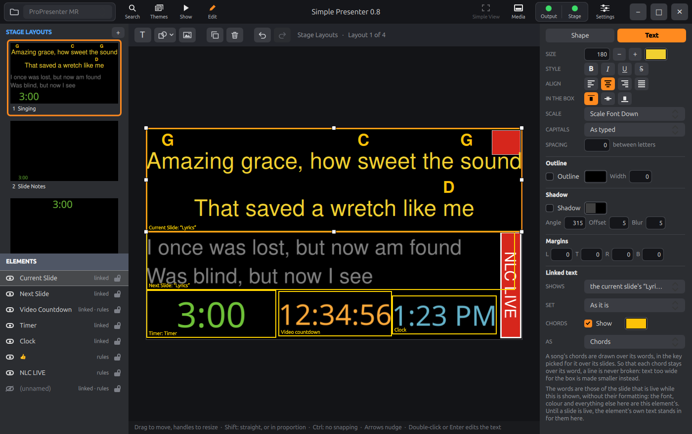

**The key.** A song's chords are written in the file in its original key. Over the
slides of a song that has chords, at the left of the line that has the song's name in
its middle, there is a **Key** to pick, starting at the key the file says the song was
last shown in, and the stage shows the chords in the key picked.
Picking a key changes nothing in the file and lasts while the app is open.

### The chord editor

With a presentation in the editor, the switch in the middle of its toolbar gives three
ways of working: **Slides** (the editor as it always was), **Chords** and **ChordPro**.
The last two are for a song's chords, and are this app's own: ProPresenter shows the
chords a song came with and has no way to put one on.

The same two editors are a program of their own for the Mac and for Windows, [Pro7
Chord Editor](https://github.com/greyshirtguy/Pro7ChordEditor), which began as a copy
of this one. What was thought of and found in building that has come back here, and the
two are meant to work and look alike. (Where they cannot: there, Ctrl+1 and Ctrl+2 show
the two editors and Ctrl+S says that there is nothing to save; here those keys are
ProPresenter's, for the screens and for showing, and stay so.)

Putting chords on a song by hand is usually a chore. **Chords** was made so that it is
not, and it has turned out to be the part of this app that is most fun to use. The
whole song is one sheet, because chording a song a slide at a time would be slow going.
(Each chord is still kept with its own slide's words, in ProPresenter's file.) Its
slides are a grid, like the slides of a presentation in the operator window, but each
is its words at a size to be read, with room over every line for its chords: a card in
a frame of its group's colour, with the slide's number on the frame's foot and, on the
first slide of each group, the group's name. They go across the sheet in the order of
the song, as many to a row as fit.

| Point at a letter, and press 1 to 7 | Or type a chord, and take what is offered |
|:---:|:---:|
| 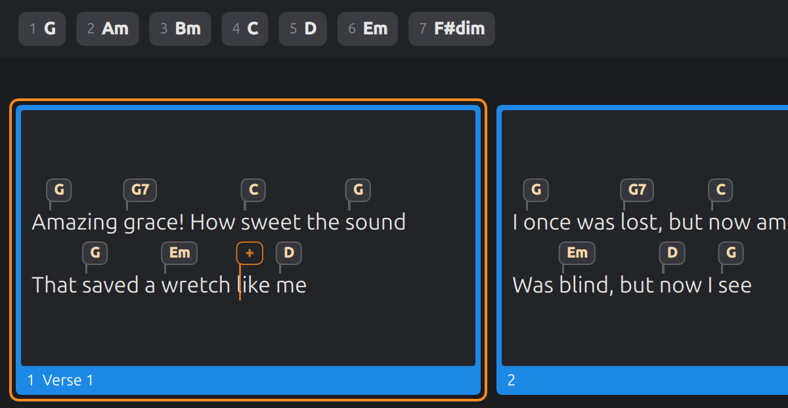 | 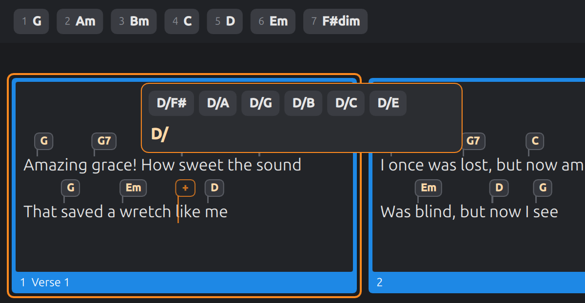 |
| **Drag a chord to where it belongs** | **Or type the lot as ChordPro** |
| 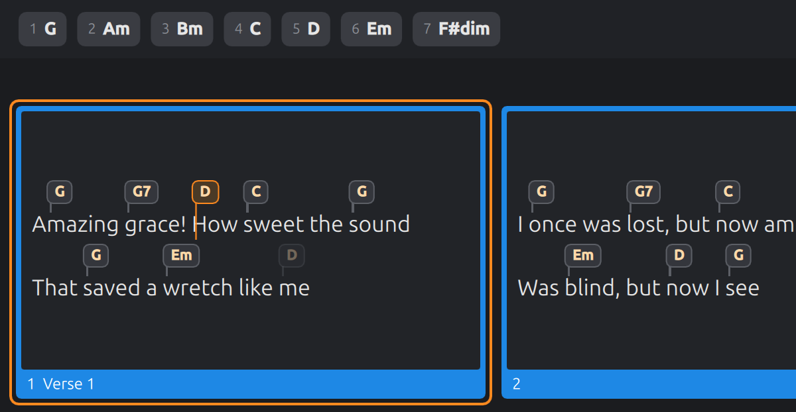 | 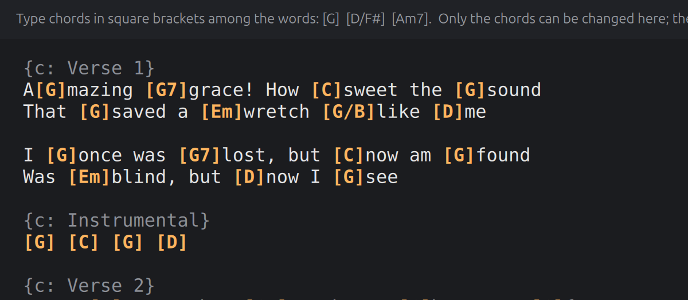 |

What makes it quick:

- **A spot shows where the next chord will go.** It is a bubble in outline that follows
  the pointer from letter to letter (and the arrow keys from word to word), with its
  tail on the letter the chord will stand over. Any letter will do: chords fall in the
  middle of words as often as at their start.
- **Most chords are one key.** The song's key is in the toolbar, and its seven chords
  are along the top of the sheet, numbered. Point at a letter and press **4**, and the
  key's fourth chord is there: in G, that is C. Most of most songs is those seven.
- **Or one of the seven is dragged onto a word.** Each of them is a button, which puts
  its chord on the spot when clicked; and it can be picked up and carried down to a
  word, on any slide, which is slower than a key and is what a hand does unasked. Its
  picture goes with the pointer, and over a word a lit bubble shows the chord where it
  would land, in place of a chord that is there. That bubble is the whole of the
  promise: let go between two slides, on a frame's foot or back on the strip, or press
  Esc, and nothing is put on. Held near the bottom of the sheet, or its top, it scrolls
  the sheet to slides that are out of sight. One can be picked up while another chord
  is being typed, which is kept.
- **Typing is helped along.** A letter from A to G opens a bubble to type the chord in.
  It takes only what could be a chord, and offers what it might be going to be: the
  chords the song already has, then the key's own, then the usual kinds on that note,
  and after a slash the likeliest bass notes. Down and Up pick one.
- **Nothing has to be pressed to say a chord is done.** While one is being typed the
  spot goes on following the pointer. Click the next place, and the chord is kept and
  the bubble opens there: click, type, click, type, down the song. Enter keeps a chord
  too, and Tab keeps it and moves on to the next word. Only Esc throws one away. A
  bubble emptied and kept so, by Enter or a click, takes off the chord that was there.
- **A line under the sheet says what the keys do, where you are.** On a chord: that
  Delete takes it off, 1 to 7 change it, it can be dragged, and a click types over
  it. On a word with none: 1 to 7, or a letter. While a chord is typed: Enter, Tab,
  Up and Down, Esc. While one is carried: where letting go puts it, and that Ctrl
  leaves a copy. Over the strip: that its chords can be dragged down. And with **Ctrl**
  held, how the lit line's chords are copied and pasted, and whether a paste there
  would replace chords; where the window is too narrow for that side by side, it goes
  on two lines. It is blue, to be seen, and lights up for a moment when what it says
  changes. Under it, the line along the bottom says how much there is of the song
  ("24 slides, 94 chords."), and for a few seconds what was just done.
- **The line you are at is lit.** The words of the line the pointer is on are drawn
  in orange, and so are those of the line a chord is being typed on, wherever the
  pointer has gone. It is the line Ctrl+C copies from and Ctrl+V pastes to. Over the
  bare sheet between the slides, or off the sheet, no line is lit; the arrow keys
  light the spot's line again. A line of chords with no words has its rule lit
  instead, twice as thick.
- **Sharps and flats are drawn as ♯ and ♭**: F♯m7, B♭, C7♭9, E♭/G, in the bubbles,
  the strip, what is offered and the bubble a chord is typed in (where F# becomes F♯
  as the # is typed), and in the song's two keys. Only those that are clearly a sharp
  or a flat: the root's and the bass's, and one before a digit. It is only how they
  are drawn: the song's file, what is copied and the ChordPro text keep `#` and `b`.
- **Chords are things to pick up.** Drag one to another word, on any slide; hold Ctrl
  to leave a copy behind. A name that is no chord, which some files have ("N.C."), is
  picked up, copied and pasted like any other; only what is newly typed has to be a
  chord.
- **A verse's chords go onto the next verse in one go.** Ctrl+C copies the chords of a
  line, or with Shift of a whole group, and Ctrl+V puts them on other lines word for
  word. A paste says what came of it, on the line along the bottom: how many chords
  went on how many lines, how many had no word to go on, and why a line was passed
  over (chords copied from a line of words go only onto a line of words). And since
  the natural thing to do before pasting onto a line is to click it, a click on a line
  and then Ctrl+V pastes there: the bubble the click opened gives way, so long as
  nothing has been typed in it and nothing has been copied anywhere else since.
- **As much of the song in sight as the window has room for.** The slides go across as
  well as down, and the sheet zooms. Every card of a song is one width, that of its
  widest slide and no wider, and the shape of a screen, though never taller for that
  than four lines need; a row of the grid is taller only where a slide of it has more
  lines. No room is kept for what might be put on a line later: a line that comes to
  need more, for a chord at its end, is given it then. The empty lines a text box's
  words end with get no row. The **−** and **+** at the right of the strip make the
  words smaller and larger, in nine steps from half the size to half as large again;
  so do Ctrl with minus and plus, Ctrl with the wheel, and two fingers spread or closed
  on a trackpad. Ctrl+0 is the usual size, which is eight tenths. The size is kept
  from one start of the app to the next.
- **A slide with no words takes chords too.** An intro, an instrumental or an ending
  is often a slide with nothing on it. It is on the sheet as a card with one empty
  line: point at it and put chords on, one after another, as anywhere else. They are
  kept as Multitracks keeps the chords of an intro, on characters that do not show, so
  the slide shows no more than it did.
- **And nothing is added to a slide that is not needed.** A slide with no words is not
  touched until a chord is put on it. The characters its chords hang on go into the
  text box it has, empty as that is; only a slide with no text box at all is given
  one, a copy of the song's own, set and placed as the song's words are. A change of
  mind leaves nothing behind: take the chords off again while the song is still open
  in the editor, and the slide's file is exactly what it was, an added text box gone
  with them.
- **A line of chords with no words that loses its last chord takes chords again.** It
  is left one character that does not show, and is still on the sheet with the spot on
  it. (It was left with none, and under a verse such a line was then gone for good but
  for undo.) Where the chords of such a line are only renamed, or put in another
  order, nothing of the text box's words is written; and a chord more or fewer changes
  the line's own characters in the file and leaves the rest of the text box as
  ProPresenter wrote it, byte for byte.
- **Nothing is lost.** Every change is saved at once, into the song's own file, and
  Ctrl+Z takes it back. The words are never changed here, only the chords.

All of it, key by key:

| Do this | And |
| --- | --- |
| 1 to 7 | The key's own chord on that note of its scale goes on the spot: in C, 1 is C, 4 is F, 6 is Am. The strip along the top shows them, and they can be clicked there |
| Drag one of the strip's seven | Puts it on the word it is let go on, on any slide, where the lit bubble shows; with Shift held, on the start of the word. Let go anywhere else, or with Esc pressed, nothing happens |
| A to G | Starts a chord by name. Only what could be a chord can be typed, and over it are the chords it might be going to be: the song's own first, then the key's, then the usual kinds |
| Down, Up | Pick one of those; Right puts it in the box to go on from (for a bass note, say) |
| Enter | Keeps the chord. Tab keeps it and moves the spot on to the next word. Esc throws it away. A bubble emptied and kept takes off the chord that was there |
| Click | On a place: type a chord there, or change the one that is there. While a chord is being typed, a click on another place keeps it and starts on the next; a click anywhere else on the sheet keeps it too |
| Drag a chord | Moves it to another word, on any slide. With Ctrl held it is copied |
| Delete | Takes off the chord at the spot |
| Right, Left | The spot goes a word along its line, and from the end of a line on to the next line of the song |
| Down, Up | The spot goes to the line under or over it on the screen: from a slide's last line, to the slide below it in the grid (the next slide of the song is beside it, and Right goes there) |
| Shift | Under the pointer, the spot keeps to the starts of words. With Right and Left, it goes a letter at a time |
| Ctrl+C, Ctrl+Shift+C | Copies the chords of the spot's line, or of its whole group |
| Ctrl+V | Puts them on the lines from the spot's on, word for word: a second verse gets the chords of the first |
| Ctrl+Z, Ctrl+Shift+Z | Undo and redo |
| Ctrl with −, + and 0 | The words a step smaller, a step larger, and their usual size. Ctrl with the wheel does the first two |

**The song's two keys** are in the toolbar, over both chord editors. **Key** says what
key the chords are written in, which is what 1 to 7 go by and what the stage transposes
from; it changes no chord. A song that names no key shows **None**, and is taken to be
in C until one is set. **Shown in** is the key ProPresenter shows the song in, moving
the chords there itself, and the key this app's own stage starts from. It follows the
first while the two are the same; where someone has had a song shown in another key, a
tone lower for a singer say, saying what key its chords are written in leaves that
alone. A change of key is undone like any other change.

**ChordPro** is the same song as text, each chord in square brackets where it is played:
`[G]Amazing [C]grace`. Chords are typed, changed and deleted among the words, and the
words themselves cannot be typed over. `[` brings its `]` with it, and Backspace on a
bracket takes the whole chord. It is for someone who thinks in ChordPro, or has a chart
to copy from. A line of chords with no words is its chords with spaces between,
`[C] [G] [Am]`, and a slide with no words is an empty line, which chords can be typed
on: the one after the empty line that parts it from the slide before. (The two look
alike. With the caret on the slide's own, that slide is the one picked in the list at
the side, and what is typed on the other does not stay.) What is typed is saved a
moment after the typing stops, to the text boxes that were typed in and no others, and
all of one saving is one thing to undo. A name the song already has that is no chord
is left as it is. The two letters **A** over the text, and Ctrl with minus, plus and 0,
change its size, which is kept apart from the sheet's.

**Nothing is saved by hand**, and under the two chord editors the line along the bottom
says so: **Autosave on**, where a Save button would be. Beside it is **Revert…**, which
makes the song what it was when it was opened in the editor, taking back every change
made since, of whatever kind, whichever of the three ways of working made it. It asks
first, since its name alone could be taken for Undo's. The song as it was just before
is kept as a copy with the others the editor keeps, and for a few seconds the line
offers **Undo**, which puts it back.

**The colour of a chord** in each of the two editors can be chosen in the settings,
under **Chords**, and so can that of the sheet's lit line, each with a way back to the
colour it came with; and the same section has the switch for drawing sharps and flats
as signs, on as it comes. They are only how the editors draw a song. Nothing in a
song's file says any of them: the stage shows chords in the colour its layout gives
them, with `#` and `b`.

### Importing a ChordPro file

The **+** beside Libraries has **Import ChordPro File…**, which makes a new song of a
ChordPro file in the library that is open: a group for each part the file marks
(verses, choruses, a bridge, or a line that only says "Verse 2:"), two lines of words
to a slide unless another number is asked for, the chords over the words, and the
song's key. The same **+** has **New Presentation…** and **New Library**.

### What is a guess, or not done

- How the chords are kept was worked out from songs ProPresenter imported from
  Multitracks, and what is written here is in the same form, down to the stretch of
  characters a chord is written over: up to the next chord or the end of its line
  where there are words, and its own character and no more where there are none.
  (Counted in 22 of those songs: all 290 chords with no words are written so, and all
  but 60 of the 1,009 over words, the 60 being in two songs that another program had
  saved since.) A song with chords put on here has not been opened in ProPresenter
  yet; nor has a song imported here.
- Chords put on a slide with no words are hung on characters written in that text
  box's own font and size, which the file keeps for an empty text box too. That
  ProPresenter then shows the slide's chords as it shows a Multitracks intro's is a
  guess until it has been seen there. Whether anything in ProPresenter that asks if a
  slide has text counts such characters is not known either: a slide from Multitracks
  with chords and no words has them just the same.
- A text box added for the chords of a slide that had none is a copy of the nearest
  text box of the song that has words, with those words taken out. That ProPresenter
  is content with it is a guess too. (A song with no text box anywhere gets one as
  the **T** in Slides makes one.) What was made for a slide's chords is only unmade
  while the song is open in the editor: chords taken off another day leave the text
  box, with one character in it that does not show.
- A line of chords with no words that has lost its last chord is left one zero-width
  space, whatever its chords hung on, as the Mac and Windows editors leave it. That
  ProPresenter makes nothing of such a line is a guess: a line of the kind with chords
  on it has been seen there, and one with none has not.
- A chord more or fewer on a line of chords with no words changes that line's own
  characters where they stand in the text box's RTF, and not another byte of it, as
  the Mac and Windows editors do it and by the same rule, held to the same cases
  (`src/rtfstandins.h`). What comes of it is read back before it is kept. Where that
  cannot be done cleanly, the text box's words are written again whole, as this app
  writes text, and the log says so; the other two editors, which have no writer of
  RTF, refuse there instead. One kind of RTF is known to want that: one that has a
  character follow each numbered one to stand in for it, which Apple's text system
  never writes. What ProPresenter on Windows writes is not known.
- With such a line made longer or shorter, what its text box says of a range of its
  words and is not a chord ("these are in capitals", a gradient over some of them)
  has its range go with the words: one that ended with the line or went on past it
  still does, and one over all the words is over all of them still. That is what a
  text system does when characters are typed after others, and what ProPresenter is
  taken to do. The other two editors have done the same since 2026-10-13; until then
  they left such ranges as they were. It matters in real songs: of 164 text boxes
  with a line of chords alone in the libraries looked at, 96 say of all their words
  that they are in capitals, and with a chord taken off, that range left alone would
  end past the last of the words.
- The first chords of a slide with no words are still written with this app's own
  writer, in the font the text box keeps for what is typed into it. The other two
  editors take the opening of a neighbouring text box's RTF instead.
- A song whose file names the key its chords are written in and not the one it is
  shown in is taken as shown in its own. No file looked at is like that.
- Two fingers spread or closed on a trackpad are meant to zoom the sheet, as on the
  Mac. No test can make the gesture and it has not been tried by a hand.
- Numbers, numerals and Do Re Mi are written the way musicians write them.
  ProPresenter does not say exactly what it writes, so they may differ in the corners.
- A song imported or chorded here is not marked as a Multitracks song, which is a mark
  for songs licensed from them.
- The chord editors do not change words; the Slides editor does, and the chords of
  the rest of the text box stay on their words when it does.
- ProPresenter's other chord thing, a chord chart shown as a picture, is not shown.

## Transitions

The transition is chosen at the left of the thin bar under the slides (the buttons for
the size of the thumbnails are at its right), and applies to every change on the
output, slides and media alike; the slider beside it is how long it takes. The
menu has them by category, as ProPresenter does: Dissolves, Wipes, Movements, Objects,
Color and Blurs, and then More, for the ones ProPresenter does not have.

Some transitions can be adjusted: the direction a wipe or a push travels, the colour of
a burn, the size of the squares. For those, the button with the sliders on it, beside
the transition, opens a panel with what there is to adjust: a slider for a number, a
swatch for a colour, and a pad of nine places for a direction, which is where what is
coming comes from. A change takes effect with the next transition and is remembered for
that transition; Reset puts it back as it came.

The names, the categories and what can be adjusted are ProPresenter's, so that what is
known from there is found here. The shaders are not: ProPresenter's are its own. Each
transition here is either written for this app to give the same kind of change, or
ported from [gl-transitions](https://gl-transitions.com), from which ProPresenter
adapted several of its own. So they are equivalents and not copies, and will not match
ProPresenter's frame for frame.

On the laptop in [Built for modest hardware](#built-for-modest-hardware), with a slide
and its media changing at once on a full-screen 1080p output, all of them keep sixty
frames a second but one, Cross Zoom, which manages fifty-seven.

## Screens

A **screen** is somewhere the show is drawn for. An **audience** screen gets the slides,
the media and the props; a **stage** screen gets a stage layout. A workspace can have
sixteen, of both kinds together, and the pair of buttons at the right of the toolbar
(or Ctrl+1 and Ctrl+2) switch all the screens of a kind on and off together.

The screens are set up under **Settings → Screens**: a line for each, with its name and
what it is sent out through, and **+ Add** for another of either kind. Where a screen
goes is chosen from a menu, as in ProPresenter, and is one of five things:

| It is sent to | What that is |
| --- | --- |
| **A window of its own** | A small window that floats over the operator window, and can be made to fill whatever display it is on (see below). What the one output and the one stage display always were, and what the first screen of each kind is until it is set to something else |
| **A display** | One of the computer's displays, by its name (`HDMI-A-1`, say), filled. While that display is not plugged in the screen is not shown, and the settings say so; plugged in again, it is back |
| **NDI** | The local network, as an NDI source: see [NDI](#ndi) |
| **A Blackmagic output** | An output of a DeckLink card, as Blackmagic's Desktop Video Setup names it, in a format chosen from its own menu, and keyed or not: see [Blackmagic DeckLink](#blackmagic-decklink) |
| **Nothing** | The screen is there for things to name (a stage action, say), and is not drawn. What a screen ProPresenter made is until it is set to something here |

Two things are known of a screen, and they are kept in two places.

- **What it is** (its name, its kind, and the id other things know it by) is the
  workspace's, and is in ProPresenter's own file of how the workspace is set up
  (`Configuration/Workspace`). So the screens ProPresenter has for a workspace are the
  screens here, a stage action made there finds the screen it names, and a screen added
  here is in the file for ProPresenter to find, written the way it writes one that is
  connected to nothing. (That last has not been tried in ProPresenter itself.)
- **What it is sent out through** is this computer's, and is in the app's own settings.
  The same workspace on another computer has the same screens and other things plugged
  in. What ProPresenter says each screen is connected to (a display, a video card) is
  left in its file exactly as it was found, and not gone by here.

Every audience screen shows the same thing unless the [look](#looks) that is live says
otherwise (a look gives each screen its layers, and can dress its slides in a theme),
and every stage screen shows what is live through its own layout (each has its own,
chosen on the Stage tab of the show controls; a stage action gives any of them one).
Each screen is drawn by itself, at its own size. A video is still played only once
however many screens show it, by the first audience screen, and the others are handed
its frames, so they cannot drift apart and its sound is heard once.

### A screen in a window

The small window with a slim title bar that floats over the operator window, or
fills a screen. The small window is moved by dragging any part of it, and resized by
its edges; double-click its title bar to have it fill the screen it is on, and move
the mouse over it there for the control that brings it back. The output starts
out filling a second screen if there is one (`--screen`, with a screen's number or
name, says which; `--list-screens` says what there are), and each window comes back
the way it was left.

A Wayland desktop does not let an application place its own windows, so these windows
come back wherever the desktop puts them. The settings screen has a switch, under
Windows, to run the app through X11 instead, where their places are remembered; it says
what that costs.

**Alt+Tab.** The output window and the stage window are there to be looked at, not
switched to, so they are kept out of the desktop's window switcher, its overview and its
dock, and switching to Simple Presenter always lands on the window that works the show.
How that is done depends on what the app is run through:

- **Through X11** the app sees to it itself, and there is nothing to do.
- **Through Wayland**, which is the default, an application cannot: the desktop alone
  decides what is in its lists. GNOME leaves the two windows out when a small extension
  of its own, which comes with the app, is switched on. The package puts the extension
  where GNOME looks for it; log out and in again once so that GNOME finds it, and then
  switch it on:

  ```
  gnome-extensions enable simple-presenter-windows@greyshirtguy.github.io
  ```

  From a copy built from source, put it in place first:

  ```
  mkdir -p ~/.local/share/gnome-shell/extensions
  cp -r packaging/gnome-shell-extension/simple-presenter-windows@greyshirtguy.github.io \
      ~/.local/share/gnome-shell/extensions/
  ```

  The extension is written for GNOME 50, the one Ubuntu 26.04 has, and does only this:
  it finds the two windows by their application and their titles and tells GNOME to
  leave them out. On other desktops run through Wayland, and on GNOME without it, the
  two windows are in Alt+Tab as any window is. (So, through Wayland, is the window of
  any screen after the first of its kind: the extension knows only the first two.)

### Kept awake

**The screens are kept awake.** A desktop left alone blanks its screens after a few
minutes, and a presenter's computer is left alone for as long as a sermon lasts. So
while the audience screens or the stage screens are switched on, the app asks the
desktop not to count the time as idle, the way a video player does while a film plays;
with both switched off, or the app closed, the desktop goes back to its own settings.
The [log](#log) says when the asking starts and ends, and says so once if the desktop
does not answer to it (GNOME and KDE do).

## Looks

A **look** says which layers of the show each audience screen gets. The room can have
the slides over the media while a stream has the slides alone, to lie over a camera's
picture; a lobby screen can have the props and nothing else. A workspace has as many
looks saved as are wanted, by name. They are ProPresenter's own, and work as its do.

**The live look.** What the screens are showing is a look of its own, the *live look*,
apart from the saved ones. Making a saved look live copies it into the live look, which
takes its name. After that the two go their own ways: the live look can be changed by
itself (a layer switched off for this service only) without the saved look knowing, and
a saved look can be changed without the screens changing until it is made live again.
The toolbar's **Looks** button has the live look's name under it.

A saved look is made live in three ways: from the menu a click on the **Looks** button
gives, where the look the live one came from is ticked; with **Make Live** in the Looks
window; or by an **Audience Look** action on a slide or in a macro, which is how a
service moves from one to another by itself. Making the same look live again puts the
live look back as that look has it. When the look changes, each layer comes or goes
over the time the look says. (An action that goes over to the look that is live
already, and unchanged, costs nothing; one that changes the look is on the screens at
once, and in the file a moment after, so that it never holds a slide up.)

> [!NOTE]
> That an action puts the live look back is worth knowing before changing the live
> look by hand. Songs whose first slide runs a macro that goes over to a look will undo
> a change made to the live look as soon as the next song starts; what was meant to
> last should be saved (below). The log says when a change went this way.

The preview at the top right of the operator window stands for the first audience
screen, and shows what the live look gives that screen: a layer the look keeps from it
is not in the preview either, and its slide is in that screen's theme.

**The Looks window** (the Looks button, then **Edit Looks…**; its ✕, Esc or a click
outside it puts it away) is laid out as ProPresenter's is. On the left are the looks: the live look first, and under it
the saved ones, with a green dot beside the one the live look was made from. On the
right is what the look that is picked gives each audience screen, as a table: the
screens across the top, and the layers down the side in the order they lie on a screen,
the top one first.

| Row | What it is |
| --- | --- |
| Masks | Not a tick box but which [mask](#masks) the screen is given: a circle with a line through it for none, or the mask's name. A click gives the masks to choose from, and the way to the editor they are made in |
| Messages, Props, Announcements, Slide, Media | A tick box for each screen: whether that screen gets the layer |
| Video Input | ProPresenter's layer that this app has not yet. It is shown greyed, as the look has it in the file, cannot be changed here, and is kept as it is |
| Presentation | Not a layer but the **theme** that screen's slides are dressed in as they are shown: a circle with a line through it for none, or a theme slide, chosen from the same menu of themes a slide's own menu has |

Picking a look in the list shows it, to be read and changed; it does not make it live.
At the top right is what is done with the look that is picked. For a saved look that is
**Make Live**. The live look is live already; a change to it is seen on the screens at
once, the list then says it has been "changed" (it is no longer what the look it was
made from is), and in the same place there is **Save**, which keeps the live look as
the saved look it was made from. The **+** makes a new saved look as a copy of the one
that is picked, so that picking the live look and pressing it keeps the live look, as
it has been changed, as a saved look of its own instead. A double click on a saved look renames it, and a right click offers Make
Live, Rename, Duplicate and Delete. The live look cannot be removed: there is always
something the screens are showing.

**A theme for a screen.** A look can give a screen a theme slide, and every slide shown
on that screen is then dressed in it as it is shown: the same words, large and central
in the room and a line across the foot of the stream. Nothing about the presentation is
changed, and the next look can dress it another way.

The looks, and the live look with them, are the workspace's, the ones ProPresenter has
for it, and are read from and written to its file of how the workspace is set up
(`Configuration/Workspace`), with the screens. So a workspace opened here shows what it
was showing in ProPresenter, and one taken back there shows what it was showing here.

## Masks

A **mask** is a slide laid over everything else an audience screen shows: the top
layer of all, over the messages. Whatever is drawn on it covers what is under it, and
where it has nothing the output shows through. A mask of black shapes round the edges
gives a screen another outline; one black box keeps a projector off a doorway.

Masks are made, and a screen is given one, in the [Looks](#looks) window, as in
ProPresenter. The **Masks** row there has, for each screen, the mask the look gives
it, and a click on it has the menu: **None**, the workspace's masks by name, **Add New
Mask** and **Edit Masks…**. Choosing one for the live look puts it on that screen at
once; a saved look keeps its own choice, for when it is made live. The operator's
preview has the mask of the first screen over it, as that screen has.

**Add New Mask** and **Edit Masks…** bring up the [editor](#editing) on the masks,
which are edited as slides are: the list at the left is of the masks, each with its
name under it, and the `+` over it makes another. A shape added to a mask starts
black, and a mask is drawn on grey there so that what is black on it can be seen.
A click on the name under a mask renames it, as **Rename** in its right-click menu
does; **Remove…** takes the mask away, and with it every look's giving of it to a
screen.

There is no clear button for a mask and no clear takes one off, Clear All included:
it is part of how a screen is set up, not of the show.

Masks are ProPresenter's, kept where it keeps them, in the workspace's set-up file
(`Configuration/Workspace`) with the screens and the looks.

What is a guess, or not done. No workspace this was made with had a mask in it, so
more of this than usual is read from the file's format and not seen in a file:

- That a look names a mask by the id of the mask's slide, which is the only id a mask
  has.
- That what is drawn on a mask covers the output in the colour it is drawn in.
  ProPresenter's own words are that the layer "is used to mask parts of the
  presentation, creating a custom shape or transparent areas".
- What a new mask is given: a slide of 1920 by 1080 with nothing on it. ProPresenter
  lets a mask's size be set, to match its screen; that is not here yet.
- That removing a mask takes it out of the looks, and that a new shape on one is
  black.
- A mask comes and goes at once, not over the look's time as the layers do.

## Themes

A **theme** is a set of slides built to show how slides should look: where the words go,
in what font and colour, over what shapes and pictures. They are ProPresenter's own, kept
under the workspace's `Themes` folder, each in a folder of its name (a folder there with
no theme in it is a folder of themes).

The toolbar's **Themes** button lets them down to be browsed: folders as folders, a theme
as its first slide; a click on a theme shows its slides. A theme is used in three ways.

- **On a presentation.** With a presentation open, a click on a theme slide dresses
  every slide of the presentation in it.
- **On one slide.** A slide's menu has **Theme**, which leads through the folders and the
  themes (each by the look of its first slide) to the theme's slides.
- **On a screen, for as long as a look says** ([Looks](#looks)), with the presentation
  left alone.

The first two change the presentation's file; a copy of it as it was is kept first,
beside the editor's backups.

**What dressing a slide does.** ProPresenter does not say how it decides, so this is
this app's reading of it, and may differ from ProPresenter's in the corners.

- The slide's text boxes that have words are matched with the theme slide's text boxes
  (the things on it with words in them, which stand for the words to come: "Verse",
  "Lyrics"): **by name** first, whatever the capitals; then **by size**, the largest
  into the largest, since a theme moves boxes about but the big one is the main one in
  both; and boxes much of a size **in the order** they come.
- A matched text box takes everything from the theme's: its name, place, size, fill,
  outline, shadow, and the one format the theme's text is in (font, size, colour,
  alignment, capitals, how it fits its box). It keeps its words, and the chords over
  them. (The name is worth having: a [stage layout](#stage-layouts) can show only the
  text boxes of a given name, and a song whose boxes were called something else, or
  nothing, is brought into line by being dressed in a theme, however its boxes were
  matched.)
- What else the theme slide has (shapes, pictures, text boxes that get no words) comes
  with it, the text boxes empty.
- **Words are never thrown away**: a text box of the slide that has no box in the theme
  stays as it was.
- Things of the slide's own that are not words (a picture someone put on it) stay.
  Things an earlier theme brought are taken away again, so that going from one theme
  to another leaves nothing of the first. (They are known by having the ids of things
  in the workspace's themes; what a theme put on a slide in ProPresenter itself is not
  known that way, and stays.)
- The slide's background colour becomes the theme slide's. The media and the other
  actions of its cue are not its look, and are not touched.

**Making and changing themes.** In the Themes panel, **+ New Theme** makes one, with a
slide to start from; inside a theme, **+ Slide** adds another, **Edit** opens the theme in
[the editor](#editing), which edits its slides as it edits any (a right click on a theme
slide opens it there, or deletes it), and **Delete Theme…** removes it. A theme's text is
meant to be in one format: where a theme slide's text has several, the first is the one
slides are dressed in.

Not yet: making folders of themes here (ProPresenter's are shown, and a theme can be
put in one in the file manager), the pictures a theme keeps in its own folder being
found from there, and choosing a theme for a new slide.

## Search

**Search** (the magnifying glass at the left of the toolbar, or **Ctrl+F**) finds a
presentation in the workspace's libraries by its name or by its words, as it is typed.
Capitals, punctuation and accents make no difference, and the words can be in any order.
Those found by name come first; one found by its words has the line that has them under
its name. Beside the list is the one picked, as its words or, with **Slides**, as its
slides look.

| Key | Does |
| --- | --- |
| Up, Down | Pick another |
| Enter | Open the one picked, in its library |
| Ctrl+Enter | Add it to the end of the playlist that is open, and stay, to add another |
| Esc | Put the search away |

The libraries are read for it once, off the thread that draws, when the workspace is
opened, and afterwards only the files that change are read again, so searching a large
library is as quick as a small one. Only the libraries are searched (not SongSelect or
the Bible, which ProPresenter's search also has).

## NDI

[NDI](https://ndi.video) sends video between programs and computers on a local network.
A screen set to **NDI** (Settings → Screens) is announced on the network under the name
given it there, after the computer's name, and anything that takes NDI can pick it: a
vision mixer, OBS, NDI's own Studio Monitor on another computer. It is the screen as a
display would show it, at the size and the frames a second set for it; it needs no
display, and a screen can go nowhere else.

The screen is drawn out of sight by the graphics card, read back and handed to NDI's
library to compress and send, all on this computer, which is work for it: 1920 × 1080 at
30 frames a second is a fair place to start, and on a modest laptop a good place to
stay. The work is only done while something is taking the source. With nothing taking
it, one picture goes out a second, enough for it to be found and looked at. The
settings say, for each such screen, whether it is on the network and how many are
taking it.

**NDI's library is not part of this app**, and does not come with it. It is NDI's own
and is not open, though it is free to have, under NDI's licence, which whoever has it
has to have agreed to themselves. Everything else in the app works without it.

**Getting it.** The first time a screen is set to NDI without the library, a panel comes
up with the two ways:

- **Let the app fetch it.** *Download NDI's Library* downloads NDI's own installer for
  Linux from NDI's site (about 60 MB), shows NDI's licence, and, if you agree to it,
  takes the library out and puts it where the app looks. Nothing is put anywhere if you
  do not. The screen is then on the network without the app being started again.
- **By hand**, on a computer that is not on the internet, or if you would rather:
  1. Get the *NDI SDK for Linux* from
     [ndi.video](https://ndi.video/for-developers/ndi-sdk/) and run the installer it
     gives you (`sh Install_NDI_SDK_v6_Linux.sh`), which shows NDI's licence and
     unpacks a folder.
  2. Copy `lib/x86_64-linux-gnu/libndi.so.6.x.x` from that folder to
     `~/.local/share/SimplePresenter/SimplePresenter/ndi/libndi.so.6` (the panel names
     the folder exactly, and has a button that opens it).
  3. Press *Look Again* in the panel, or start the app again.

A screen still without the library has a *Get NDI's Library…* button on its line in
the settings, which brings the panel back.

The app looks for `libndi.so.6` in the folder the environment variable
`NDI_RUNTIME_DIR_V6` names, which is what NDI's own installers set; then in its own
folder above; then wherever the system keeps its libraries.

The few header files that say how the library is talked to are in
`third_party/ndi/include`; those are NDI's under the MIT licence, as each says at its top.

Plain NDI is what is sent (full frames, lightly compressed, a good deal of network), not
NDI|HX. There is no sound in it yet, and nothing is received.

NDI® is a registered trademark of Vizrt NDI AB.

## Blackmagic DeckLink

**Tried so far on one card.** What follows was built from Blackmagic's SDK and from what
ProPresenter does, and tested against outputs the app pretends, on a computer with no
card. It has since been tried on one computer with a card (a DeckLink Duo 2, with
Desktop Video 15.0), sending three screens through its outputs; keying has not been
seen to work yet.

A screen can go out through an output of a Blackmagic DeckLink card (a DeckLink Duo 2 is
the one it was made for), as an SDI signal, for a vision mixer, a recorder or a monitor.
Video only, for now.

**The outputs** are the ones Blackmagic's *Desktop Video Setup* has made of the card's
connectors, by the names it gives them; the app does not change how they are arranged,
and nor does ProPresenter. A pair of connectors linked there for fill and key is one
output, and the connector it takes for the key is not offered by itself while it is.
In a screen's menu of where it goes (Settings → Screens), each output is under
**Blackmagic**, and is a menu of the formats it can send: 1080p at 24, 25, 29.97, 30,
50, 59.94 and 60 frames a second, and 720p at 50, 59.94 and 60. Choosing a format is
choosing the output. The outputs are looked for again each time that menu is opened,
so a card arranged otherwise in Desktop Video Setup is seen without the app being
started again.

**Keying.** An output that can key, which a linked pair can, has ProPresenter's alpha
settings on the screen's line:

| Setting | What it does |
| --- | --- |
| **Alpha: None** | The screen goes out as it is, on black, as on any display. What an output that cannot key always sends |
| **Alpha: Premultiplied** | What nothing is drawn on is see-through, and the colours are as the app draws them, already darkened by how see-through they are |
| **Alpha: Straight** | The same, with the colours as they would be if they were not darkened: for a mixer that wants them so |
| **Key: Internal** | The card itself lays the screen over the video coming into it, and sends the two together |
| **Key: External** | The card sends the screen (the fill) out of one connector, and its opacity in black and white (the key) out of the other, for a vision mixer to key with |
| **Blend** | How strongly the card lays the screen over, from 0% to 100% |

Which alpha type a mixer wants is the mixer's to say; ProPresenter's help on alpha
keying explains the difference. That the app asks the card for the key after starting
its output, and the blend as a share of 255, is how Blackmagic's SDK reads, and has not
been seen to work.

**How it is sent.** The screen is drawn out of sight by the graphics card, as for NDI,
read back into a frame the DeckLink card made, and handed to it. Only when something
has changed: the card goes on showing the last frame it was given, so a still slide
costs nothing, and a moving one costs a picture read back for each frame that changes.
A frame goes out on the card's next frame after it is ready rather than being timed to
the frame, which is a choice of less work over exact timing.

**Together.** Every screen going out through a card is drawn in the same passes: each
that has changed is drawn, then each is read back, then all are handed to their cards
at once. (Drawn one after another, each read back before the next was drawn, three
outputs on an older computer were seen to change one by one.) That they then go out on
the same frame of the cards depends on the cards' frames being lined up, which is not
known. Blackmagic's SDK can line outputs up exactly, but only for frames sent a few
frames ahead, at every frame, which would cost a delay and work on a still slide: that
is not done. The log's line for a screen that stops says how long its drawing took.

**Blackmagic's library is not part of this app.** It comes with *Desktop Video*, the
drivers for the card, from Blackmagic Design, which a computer with a card has installed
already; version 14.3 or later. The app looks for it the first time a screen's menu is
opened or a screen is set to go out through a card, and never otherwise, so on a
computer with no card it costs nothing. Without it, the settings say so.

The header files the app is built against are in `third_party/decklink/include`, under
Blackmagic's licence at the top of each.

DeckLink and Desktop Video are Blackmagic Design's. This app has nothing to do with
them, or with Renewed Vision.

## Keys

| Key | Action |
|---|---|
| Right, Space / Left | Next / previous slide |
| Down / Up | Next / previous presentation |
| F1 | Clear the first [clear group](#clear-groups), which to begin with is Clear All |
| F2 / F3 / F4 / F5 / F6 | Clear the slide layer / media layer / props / audio / messages |
| ~, held for most of a second | [Simple View](#simple-view) on or off |
| A letter or a digit | The hotkey of a group, if a group has been given it: goes to the first slide of that group |
| A number, then Enter | Goes to the slide with that number |
| Ctrl+E | Edit mode: the editor, for the presentation being viewed |
| Ctrl+R | The [reflow editor](#reflow), for the presentation being viewed |
| Ctrl+Alt+B | [Bible mode](#bibles) on or off |
| Ctrl+S | Show mode: out of the editor, whichever one is up |
| Ctrl+F | [Search](#search) |
| Ctrl+V | Show or hide the media bin |
| Ctrl+1 / Ctrl+2 | Switch the audience screens / the stage screens on or off |
| Ctrl+, | The settings, from the editor as well |
| Esc | Close a menu |

A group's hotkey is set on the settings screen, under Groups, where each group has its
colour: click the box after the group's name and press the letter or digit. Pressed
while showing, it puts the first slide of that group on the output, from where the
group first comes up in the presentation if it comes up more than once.

The hotkeys are kept with the workspace, in its list of groups (`Configuration/Groups`),
which is where ProPresenter keeps a group's hotkey beside its name and its colour. So a
workspace that ProPresenter has used comes with ProPresenter's own: **A** for the first
verse, **S** for the second, **C** for the chorus, **B** for the bridge and so on. Every
hotkey in that list works, whether or not its group is one of those on the settings
screen, and the settings screen says which others there are. A hotkey changed on the
settings screen is written into the list, and nothing else in the file is touched. A
workspace with no list of groups goes by **C** for the chorus, **V** for the verse
(which is "Verse 1", where the verses are numbered) and **B** for the bridge until a
hotkey is changed, which makes the list, of the groups on the settings screen.

ProPresenter has a second file, `Configuration/KeyMappings`, for the key mappings a
user has made beyond the ones it starts with. That file is only read: a plain letter
or digit mapped to a group there works as a hotkey too. Nothing is written to it. The
groups' names and colours on the settings screen are the app's own, and the same in
every workspace.

The slide a key goes to has the key in a small orange icon at its top left corner,
beside the icon for its media if it has any. How solid these icons are is set on the
settings screen, under Slides, from nearly gone (5%) to solid; they start at 80%, so
that the slide shows through them a little. That setting is the app's own.

**A slide by its number.** The slides wear their numbers in the grid, from 1. Typing
a digit while showing takes nothing live: it puts the number up over the slides, in a
panel that lets them show through. More digits go on with it, Enter takes the slide
with that number live, as a click on it would, and the panel fades away. A number left
for a second without a key goes away by itself, with nothing done.

That much is as it was asked for. The rest is this app's own, and a guess at what is
wanted: Esc gives a number up at once, and Backspace takes its last digit off; any other
key (an arrow, say) gives it up and then does what it always does; a number no slide
has, or one of more than four digits, does nothing; and a digit that is a group's hotkey
stays that hotkey and does not begin a number, though it is a digit like any other once
a number has been begun. ProPresenter's own hotkeys are all letters, so this only comes
up where someone has given a group a digit.

In the editor:

| Key | Action |
|---|---|
| Arrows | Move the picked element by one unit, or by ten with Shift; with nothing picked, change slide |
| Page Up / Page Down | Previous / next slide |
| Enter | Edit the picked element's text |
| Esc | Finish editing text; then, let go of the picked element |
| Tab / Shift+Tab | Pick the next / previous element |
| Delete, Backspace | Delete the picked element |
| Ctrl+D | Duplicate the picked element |
| Ctrl+B / Ctrl+I / Ctrl+U | Bold / italic / underline |
| Ctrl+V, Ctrl+Shift+V | Paste the words, in the format of the text where they go |
| Ctrl+Z / Ctrl+Shift+Z, Ctrl+Y | Undo / redo |
| Shift while dragging | Move in a straight line; resize from a corner in proportion |
| Ctrl while dragging | No snapping |
| F1 / F2 / F3 / F4 / F5 / F6 | The clears, as when showing |

The chord editor has keys of its own, which are listed with it: [Chords](#chords).

## Log

Each run of the app keeps a log: a text file in `~/Documents/SimplePresenter/Logs`,
named for when the app was started. It is there for working out what happened when
something has gone wrong. It is written to be read by a person, and to be handed to an
AI model, which makes good sense of one. It is not a line to a support desk: there is
none. The twenty most recent are kept, so the one from the time it went wrong is still
there after the app has been started again. The About section of the settings says
which file is this run's, and has a button that opens the folder.

A log starts with what the app is running on: its version and Qt's, the system, the
processor and memory, the screens, and what draws the windows, which is the graphics
chip and its driver. After that there is a line for each thing that was done or that
happened, with the time and the kind of thing it is:

```
10:03:18.915  open        "Move Of God" [Default], 43 slides, from the library "Demo"
10:03:18.940  live        slide 1 of 43 of "Move Of God"; with its background video "Hopeful Horizon Bliss - 4K.mp4", looping
10:03:19.045  media       video "Hopeful Horizon Bliss - 4K.mp4": first picture after 105 ms; 3840x2160, NV12, frames arriving as textures (decoded by the graphics chip); H264, 30 frames a second, 30.0 s long
10:03:19.052  transition  media layer: Dissolve over 0.60 s, shaders/dissolve.frag.qsb
10:03:19.645  transition  media layer: Dissolve done: 36 frames in 0.59 s, 61 a second
```

So it has slides going live, media and what each video turned out to be, transitions
and how many frames each managed, clears, props, timers, the editor, files being saved,
windows shown, hidden or moved to another screen, screens connected and disconnected,
fonts that a presentation uses and the machine does not have, and whatever Qt itself
says. Every five minutes a line says how much of a processor and how much memory the
app has been using. It holds the names of files, presentations and playlists, and where
they are on the disk, and nothing of what is in them: no words of any slide.

A line whose second column is in capitals is something that went wrong:

- `WARNING`, `ERROR`: what Qt, or a library under it, has complained of;
- `PROBLEM`: something the app could not do, including every error it showed;
- `STALLED`: the app has not answered for two seconds, because it is busy or stuck.
  A `recovered` line follows when it answers again, with how long it was;
- `CRASH`: the app has stopped, with what stopped it and where it was at the time.

The case it is for above all is the app stopping dead, which leaves nothing else to
go on. A transition's shader is run by the graphics driver, and a driver that does not
agree with one can take the app down with it. So a transition goes into the log before
its shader is used, by name and by file: if nothing follows that line, it says which
transition it was. A crash writes its own last lines: what stopped the app, and where
it was at the time, as a list of places. Those in Qt, in the graphics driver and in the
other libraries come with the names those libraries give out; those in the app itself
are numbers, which the list of names made with each release turns back into names (see
[Building from source](#building-from-source)). And the next run's log begins by saying
so if the run before it crashed, was killed, or is still running.

Keeping the log costs nothing that can be noticed. It is written when something
happens, a few lines for a click, and never for a frame; each line is handed to the
system as it is made, which takes four millionths of a second and waits for no disk,
and is why the last line before a crash is in the file. What Qt says is kept within
bounds: a message that repeats is counted and not written again, and of a flood one a
second gets through. A log that grows past 2 MB carries on in a new file and keeps the
one before, so a session's log is never more than twice that. The one thing done by
the clock is the question put to the app once a second, to see that it is answering.

---

**From here on it is about how the app is made**, for anyone who wants to build it,
change it, or see how it was done.

## Building from source

Nothing here is specific to Ubuntu except the names of the packages. It needs Qt 6.9
or newer.

**1. Install the tools and the libraries.**

```
sudo apt install git cmake ninja-build g++ pkg-config \
    qt6-base-dev qt6-declarative-dev qt6-multimedia-dev qt6-shadertools-dev \
    qml6-module-qtquick-controls qml6-module-qtquick-effects qml6-module-qtmultimedia \
    qml6-module-qtquick-dialogs qml6-module-qtquick-shapes qt6-image-formats-plugins \
    protobuf-compiler libprotobuf-dev libfontconfig-dev zlib1g-dev libxcb1-dev \
    libavformat-dev libavcodec-dev libswscale-dev libavutil-dev
```

| These | are for |
|---|---|
| `git`, `cmake`, `ninja-build`, `g++`, `pkg-config` | Fetching the code and building it |
| `qt6-…-dev` | Qt 6, which the app is written with: windows, drawing, video playback, and the tool that compiles the transition shaders |
| `qml6-module-…` | The parts of Qt Quick that the app loads when it starts, such as buttons and effects |
| `qt6-image-formats-plugins` | Reading pictures in the formats Qt does not have built in, WebP among them |
| `protobuf-compiler`, `libprotobuf-dev` | ProPresenter's files are Protocol Buffers. The build turns the descriptions of the format into C++ that reads and writes it |
| `libfontconfig-dev` | Finding fonts by the names ProPresenter knows them by |
| `zlib1g-dev` | Unpacking exported playlists, which are zip archives |
| `libav…-dev`, `libswscale-dev` | FFmpeg, for taking a frame from a video as its thumbnail |
| `libxcb1-dev` | X11's own library, for keeping the output and stage windows out of Alt+Tab when the app is run through X11 |

**2. Get the code.**

```
git clone --recurse-submodules https://github.com/greyshirtguy/Simple-Presenter.git
cd Simple-Presenter
```

`--recurse-submodules` also fetches
[ProPresenter7-Proto](https://github.com/greyshirtguy/ProPresenter7-Proto), the
unofficial descriptions of ProPresenter's file formats that the app is built on. If the
build complains that `.proto` files are missing, that step was skipped:
`git submodule update --init` does it afterwards.

**3. Build it.**

```
cmake -S . -B build -G Ninja -DCMAKE_BUILD_TYPE=RelWithDebInfo
cmake --build build
```

The first line checks that everything in step 1 is there and sets the build up in a
folder called `build`; the second compiles. It takes a few minutes the first time, most
of it spent on the code generated for ProPresenter's formats. The result is one file,
`build/SimplePresenter`, with the interface and the shaders compiled into it.

A key for [api.bible](#bibles) is not in the repository: a key is for whoever
registered for it, and its use is counted against them. To build one in, so that
api.bible's Bibles are there with nothing to set up, put the key in the file
`packaging/api-bible-key.txt` (git leaves that file alone), or give it as
`-DSIMPLEPRESENTER_API_BIBLE_KEY=…` on the first line above, and build again. It can
be read out of the program by anyone who has it, and everyone who has the program
shares its allowance of requests. Without one, a key of one's own can be typed in the
settings instead.

**4. Run it.**

```
./build/SimplePresenter
```

See [The first run](#the-first-run) for giving it something to show, and
`./build/SimplePresenter --help` for its options. Video plays with or without a driver
for decoding it on the graphics hardware; [Hardware video decoding](#hardware-video-decoding)
says how to get one.

**5. Look around.** [How it works](#how-it-works) is the short version, and
`src/main.cpp` opens with a tour of the code that says where everything is. The sources
are written to be read: each file starts by saying what it is for and why it is the way
it is. To browse or change them in an editor that understands the project, open
`CMakeLists.txt` in Qt Creator. After a change, `cmake --build build` again rebuilds
only what the change touched, and the [self-test](#self-test) shows whether anything
that is drawn has moved.

**6. Make the package,** if you want one to install or to pass on:

```
cd build && cpack
```

writes the same `.deb` as on the Releases page. The program in it has had its names
taken out, which is most of what keeps it small, so a crash's account of where the app
was (see [Log](#log)) gives the places inside the app as numbers. The list that turns
those numbers back into names is made from the program as it was built, and belongs
with the package it was made for:

```
nm -C -n --defined-only SimplePresenter | xz > simplepresenter_0.98_symbols.txt.xz
```

A place such as `SimplePresenter(+0x8ae5ac)` is in the function on the last line of
that list whose number is not greater than `8ae5ac`.

## Built for modest hardware

The machine all of this is measured on is a 2017 Dell laptop: a two-core Core i5-7300U
with Intel HD 620 graphics. On it, when each of these was last measured:

| | |
|---|---|
| Starting, to the first frame on screen | about a second |
| Sitting with a still slide on the output | next to nothing: three hundredths of a percent of one processor core, which is the app being asked once a second whether it is still answering (see [Log](#log)) |
| A 4K video under lyrics, full screen at 1080p | the graphics chip a third busy (it is a quarter busy with only the desktop on screen); 5 to 7% of one processor core |
| Showing the slides of a presentation just picked | about 80 ms |
| Going into [Simple View](#simple-view) | a third of a second: the panes slide off in a fifth, at sixty frames a second, and the slides fill the window a tenth later |
| Thumbnails for 112 videos, 47 of them 4K, the first time they are seen | 2.5 seconds, while the window stays responsive |
| Putting a still on the output, even one of 8000 by 4500 | read in the background; the window is not held up |
| A 1080p video under the words, with a [Screen Preview](#screen-preview) of the output on the stage | a quarter of one processor core, against a tenth without the Screen Preview; every frame on both screens, none late (measured by the benchmark, in a desktop of its own) |
| Memory, with a workspace open | about 290 MB, of which 160 MB is what Qt needs for any window; up to 450 MB while a 4K video plays |

What gets it there:

- **Nothing is drawn twice.** A slide's text is turned into a picture once, when the
  slide is shown, and from then on costs the graphics chip one rectangle. Nothing is
  drawn while nothing changes.
- **A transition costs only while it runs.** It is one shader blending two textures.
  Between transitions nothing is blended and the output is drawn directly; going
  through the blend all the time, as the app once did, kept the graphics chip twice as
  busy for the same picture.
- **Video is decoded once, by the hardware if it can.** The graphics chip decodes it
  when a driver is installed, and the preview in the operator window borrows a few of
  the output's frames a second, and a Screen Preview every one, instead of decoding the
  file again. Drawing them is then what costs: a window that shows a moving video draws
  thirty frames a second, whatever it borrows them from.
- **Media files are never read on the thread that runs the windows.** Thumbnails are
  made on spare processor threads, one keyframe from each video, and kept on disk. A
  still put on the output is read on another thread, at no more than the size it can be
  shown at, and brought in when it is ready, so a large picture does not make a
  transition or a playing video stutter.
- **The small pictures are honest but plain.** Thumbnails are the real slides drawn
  small, without their shadows, which cannot be seen at that size and are the dear part.
- **Lists are only rebuilt when they change.** The app notices when a workspace changes
  on disk, but rebuilds what is on screen only if what it shows is different.
- **What follows something moving is drawn with it, and seldom.** A player says where
  its video has got to twenty times a second. A transport drawn straight from that
  redrew the operator window twenty times a second, and cost over half as much again as
  playing a 4K video did. So the transport looks at the player a few times a second,
  and does it when the preview beside it is about to be redrawn for a new frame: the
  window is drawn once for both, and the transport costs nothing that can be measured.
  A timer that is stopped costs nothing, and one that is running a redraw a second: a
  third of a percent of a core, or half a percent when a slide on the output shows it.
- **Text that changes fast is drawn a digit at a time.** A timer set to show its
  hundredths changes thirty times a second, which is not what slide text is drawn for:
  drawing all of it again that often, large, on a full-screen output, took over a
  quarter of a core. Such text is laid out glyph by glyph, and only the glyphs that
  have changed are cleared, drawn and sent to the graphics chip again, which brings it
  to about a tenth of a core. In the thumbnails, where hundredths cannot be read, it
  is five times a second.
- **The log is written when something happens, never when something is drawn.** A line
  of it costs four millionths of a second and is handed to the system at once: nothing
  waits for the disk, and nothing is written for a frame. See [Log](#log).

## How it works

```
  a workspace on disk                    C++ (src/)                      QML (qml/)
  -------------------          ---------------------------       --------------------------
  Libraries/*/*.pro    --->    ProDocument, proconvert    --->   Main.qml: what is open,
  Playlists/Library            PlaylistFile, Timers,             what a key or a click
  Playlists/Media              Props, StageLayouts,              does
  Configuration/Timers,        Macros, Screens, Looks,                  |
    Props, Stage, Macros,      Themes                                   | goLive(), showMedia(),
    Groups, Workspace          (parse, flatten into                     | toggleProp()
  Themes/..., Media/...        lists and maps)                          |
        ^                                                               v
        |                      Show, showstate            <---   asks for a change
        +--- changes are       (what is live, and the     --->   is told what to show
             written back      rules it changes by)                     |
             into the files                                             v
                               StrokedText, textlayout           OutputScene.qml, for each
                               (text laid out and drawn   <---   audience screen: a media
                               with its outline, once)           layer and a slide layer,
                                                                 each a TransitionLayer,
                                                                 and the props over them
                               ThumbnailProvider, videoframe
                               (small pictures, cached)   --->   thumbnails in the lists
```

The app is a window, some screens and a folder. The folder is the workspace. The operator
window is where the show is run from; an audience screen is what the audience sees, a media
layer with a slide layer over it, the props over both and the messages over all three,
in a window, on a display or sent over the network ([Screens](#screens)); a stage screen is what the
people on stage see.

The code is in two halves. The C++ in `src/` does files and pixels: it reads and writes
ProPresenter's documents, parses the RTF their text is kept in, lays text out and draws
it with its outline, and makes thumbnails. The QML in `qml/` is everything on screen:
the windows, and what a click or a key does in them. What passes between them is plain
data: a presentation crosses over as a list of slides, each a map of everything needed
to draw it, so the QML never sees a file format.

Between the two is the show itself. **What is live, and the rules by which it changes,
are in one place with nothing of the windows in it** (`src/showstate.*`): which slide
the show is at, what is on the media layer, which props are on; and what happens to
those when a slide goes live, media is put on, a layer is cleared or a macro is run.
When is a background video left to play on? What does a slide that clears itself leave
marked? What does a macro that runs a macro do? Each is a few lines there, tried by
tests that need no window ([Tests](#tests)). The operator window only asks for a change
(through `Show`, which QML can talk to) and is told what the output is then to be
handed. Anything that decides what the audience sees belongs there, and not in a
window's script.

Three rules run through all of it.

- **The files are ProPresenter's, and stay that way.** They hold far more than this app
  understands. Every change is made by parsing the whole file, altering only the fields
  the change is about, and writing the whole thing back in one step, so that whatever
  the app does not know about goes back exactly as it came.
- **One drawing of a slide.** The same component draws a slide on the output, in a
  thumbnail, in the preview and in the editor, from the same data. Layout is done in
  the slide's own coordinates and scaled, so a line of text breaks at the same word at
  every size.
- **One keeper of what is live.** Nothing but `Show` changes it, and everything that
  marks or shows it reads it from there.

Most of what a slide shows is settled when its file is read. The exception is text that
changes while the slide is on show: a timer's time, the words or the notes of the
slide that is live, the time of day, or the time a video has left. An element linked to
a timer is drawn by asking `Timers`, the one object that holds the timers and keeps
them running, what the time is now, and is drawn again when the answer changes; one
linked to the live slide asks `Show`, which is what keeps what is live; and one linked
to the clock or to a video asks `Clocks`, which goes round once a second, and is told
where the video has got to, only while some box is showing it. A stage layout is
nothing more than a slide made of such
boxes, and a prop nothing more than a slide laid over the others, so both are drawn by
what draws every slide and edited by what edits every slide.

A transition is a small fragment shader that is handed the outgoing and incoming
pictures and a number that goes from 0 to 1; `shaders/dissolve.frag` explains the
pattern. Adding one is a shader file, a line for it in the build, and an entry in
`qml/TransitionCatalogue.qml` that names it and lists what can be adjusted about it.

`src/main.cpp` opens with a longer tour, and the header of each file says how that part
works.

## Hardware video decoding

Qt Multimedia decodes video through FFmpeg and uses the graphics hardware when a driver
for it is installed. Without one it falls back to the CPU, which works but costs more,
and more so with 4K media or several videos at once. Only the Intel case has been
tested with this app; the AMD and NVIDIA notes are what should apply.

| Graphics | What to install on Ubuntu | Notes |
|---|---|---|
| Intel (Broadwell, 2014, or newer) | `intel-media-va-driver` | Tested. Decodes through VA-API. Older Intel chips use `i965-va-driver`. |
| AMD | Nothing: the driver is part of Mesa (`mesa-libgallium`), installed with the desktop | Decodes through VA-API. On older Ubuntu releases it is the separate `mesa-va-drivers` package. |
| NVIDIA, proprietary driver | The driver's own decode library, `libnvidia-decode-<version>`, which the `nvidia-driver-<version>` package pulls in | Decodes through VDPAU or NVDEC, not VA-API. |
| NVIDIA, open-source nouveau driver | Nothing: also part of Mesa | Limited: only some older cards (up to the GTX 780), and it needs firmware that has to be taken out of NVIDIA's own driver. Expect CPU decoding. Where the firmware is missing, the trying itself can hang the graphics chip, so the app does not try: see [the processor alone](#decoding-by-the-processor-alone), below. |

To see what a machine can decode, install `vainfo` and run it: it lists the codecs the
VA-API driver offers, or fails if there is no driver. That does not apply to NVIDIA's
proprietary driver.

To see what the app itself chose, run it with Qt's multimedia logging on and play a
video:

```
QT_LOGGING_RULES="qt.multimedia.ffmpeg*=true" ./build/SimplePresenter 2>&1 | grep hwaccel
```

`Checking HW context: vaapi` followed by `Using above hw context` means that method is
available, and `Selected format ... for hw` means a video is being decoded with it.
`Could not create hw context` for every method means CPU decoding.

The app's own [log](#log) has a line for each video that is played which says how its
frames arrive: as textures, which is a video decoded by the graphics chip, or in
memory, which is one decoded by the processor.

The lines FFmpeg prints at startup about VDPAU or Vulkan failing are it trying methods
the machine does not have, and are harmless.

### Decoding by the processor alone

Which decoder a video gets is Qt's choice, made anew for every video that is opened: a
hardware decoder if the graphics driver offers one, and FFmpeg's own, on the processor,
if not. A driver can offer one that does not work, and then it is the trying that does
the harm. The case this was added for: an NVIDIA card of 2012 (a GTX 670) on the
nouveau driver, whose video decoder wants firmware the system does not have. The first
video played, the next showed nothing, and the graphics chip then stopped answering;
the kernel's log spoke of the missing firmware, of a `CTXSW_TIMEOUT`, and of killing
the channel that FFmpeg's H.264 decoder had opened. With no hardware decoder tried,
none of that happened.

**The app looks for that case by itself.** As it starts, before anything is played, it
looks at the graphics chip a hardware decoder would be looked for on (the first of the
system's render nodes, which is the one FFmpeg takes). If that chip is run by nouveau,
is one nouveau has a video decoder for (the cards of 2007 to 2014, up to the GTX 780),
and the firmware that decoder needs is not in the system's firmware folders, no
hardware decoder is tried: every video is decoded by the processor. The first time
that happens a notice says so, once, with a button that leads to the settings. The
[log](#log) says near its start what was found and what was decided.

**Settings, Video** has the choice, of three:

- **Automatically**, which is the above: the graphics chip where its driver offers a
  decoder, and the processor on a computer where that decoder is known to hang.
- **By the processor only**: no hardware decoder is tried, on any computer. For one on
  which a video shows nothing, or which hangs when a video starts or is changed for
  another, whatever its graphics: switch to this, start the app again, and see whether
  that goes away.
- **By the graphics chip, whatever the app makes of this computer**: hardware decoders
  are tried even where Automatically would leave them alone. For a computer the app is
  wrong about.

A change takes effect when the app is next started, and the settings say how the run
that is up is decoding, and what the app makes of the computer. On the command line,
`--software-decoding` and `--hardware-decoding` do the same as the second and the third
for one run.

Nothing else changes, whichever it is. The pictures of a video are still drawn by the
graphics chip, through OpenGL, as textures, with the same transitions; only the working
out of them moves to the processor, which costs its time: a little over one core for a
4K video and under half of one for 1080p, measured on the 2017 laptop this is made on.

How it is done: the variable Qt's FFmpeg backend reads for the hardware decoders it may
try, `QT_FFMPEG_DECODING_HW_DEVICE_TYPES`, is given a list that names none, before
anything is played. Whoever starts the app can set that variable themselves, to nothing
or to the decoders they want tried (`vaapi`, say); the command line and the setting
come before it, and where it is set the app's own looking is left out of it. So a
version of the app that has no such setting can be tried the same way:

```
QT_FFMPEG_DECODING_HW_DEVICE_TYPES=, SimplePresenter
```

The log's line for each video says how its pictures arrived. With hardware decoding not
tried it says outright that the processor decoded it. Otherwise "in memory" leaves that
open, and the format beside it settles it for the usual kind of video: `NV12` in memory
is a video the graphics chip decoded and handed back, `YUV420P` one the processor
decoded.

**To have such a card decode after all**, its firmware has to be put in, which only
NVIDIA's own driver comes with: the nouveau project's page on
[video acceleration](https://nouveau.freedesktop.org/VideoAcceleration.html) says how
it is taken out of that driver and where it goes (`/lib/firmware/nouveau`). With it in
place the app tries the decoder again without anything being changed. That has not been
tried here, and nouveau's own page speaks of pictures that come out wrong on some
videos: if it goes badly, By the processor only is the way back.

What is a guess: that the firmware being there makes the decoder safe to try; the
names of the firmware for the oldest of those cards; and how the driver is asked which
chip it runs (if that goes unanswered, the guard still holds). It was worked out from
one computer's logs and from reading, on a laptop that has no such card.

## Benchmark

```
benchmark/run.py
```

runs the app several times over on a workspace of its own making, times what an
operator waits for (starting up, opening a presentation, a slide reaching the output
with the output full screen, the frames of a transition, a change in the editor
reaching the screen, what it costs standing by, and memory), and compares the times
with a baseline kept in `benchmark/baseline.txt`, marking whatever has got worse by
more than a fifth. It is for seeing that a change has not made the app slower. Nothing
of yours is read or changed by it. See [benchmark/README.md](benchmark/README.md).

## Self-test

```
./build/SimplePresenter --selftest <dir>
```

drives the app through a fixed sequence (a slide, a transition, the clears, a simulated
trackpad swipe, then the editor brought up on a presentation with an element picked and
its text being edited), saves frames from each window into `<dir>` as PNGs, and quits.
It changes nothing in the workspace, neither reads nor changes saved settings, and opens
the first workspace unless `--workspace` names one. Its [log](#log) goes into `<dir>`
with the pictures, and not into Documents. The timers and the transport are
held still for it, so that what they show does not depend on when it is run. Run it
before and after a change to anything that draws, and compare the frames.

With `QT_QPA_PLATFORM=offscreen QT_QUICK_BACKEND=software` in front of it, it runs
without putting windows on the screen, and every run gives the same frames; that way of
drawing leaves out shadows, transitions and video, so it checks layout and text, not
those.

## Tests

There are two kinds, and both are in `tests/` ([tests/README.md](tests/README.md) has
the whole of it).

**Unit tests** try the parts of the app that are plain rules, by themselves, with no
window and no workspace: the rules of the show (`src/showstate.*`), chords, the screens,
the looks and the masks in ProPresenter's file, how a piece of audio plays and how loud it is,
search, how a date and a time are written, the matching of themes, and Bibles, from
reading a passage as it is typed to sharing it out across slides. They are
built with the app and take a few milliseconds:

```
ctest --test-dir build
```

**Scripted tests** work the whole app as someone would, with the mouse and the keyboard,
and look at what its windows then hold and show: fifty-one scripts and over two
thousand five hundred checks. They run on a desktop of their own that shows nowhere, on
copies of workspaces, with settings of their own, so nothing of a run touches the real
desktop, settings or workspaces. The app is built for them with a door the scripts come
in by, which a release does not have:

```
cmake -B build-tests -G Ninja -DSIMPLEPRESENTER_TEST_HOOK=ON
cmake --build build-tests
tests/ui/run.py
```

The workspaces those scripts run on are not in the repository (they are not the
repository's to publish), so on another computer only the unit tests run as they are.

## Layout

| Path | What it is |
|---|---|
| `src/main.cpp` | Startup and command-line options; begins with a tour of the code |
| `src/catalog.*` | The open workspace: its libraries, playlists and media, and every change to them |
| `src/workspacefiles.*` | How documents refer to files, and how those files are found again |
| `src/prodocument.*` | Reads `.pro` files for showing, and makes the changes show mode can |
| `src/proconvert.*` | Turns a slide in a `.pro` file into what is drawn, and changes back into the file's terms |
| `src/presentationeditor.*` | A presentation, the props, the stage layouts or a theme open in the editor: its changes (a song's chords among them), undo, saving and backups |
| `src/playlistfile.*` | Reads and writes the three playlists files: of presentations, of media, and of the audio bin |
| `src/audiocue.*` | How a piece of audio plays, as ProPresenter's files say it: read from a row of the audio bin or an action, and changed there |
| `src/audiolayer.*` | What plays the audio layer: the music and the sound effects, their fades and crossing, and the device sound goes to |
| `src/audiometer.*`, `src/audiolevel.*` | The meter of what is being played, and the arithmetic of sound: how loud a stretch of it is, what a meter shows of that, how a fade goes |
| `src/audioprobe.*` | How long a sound file is, read from it as it is added to the audio bin |
| `src/timers.*` | The workspace's timers: their file, their running, and what a text box linked to one shows |
| `src/clocks.*`, `src/clocktext.*` | The time of day and the time a video has left, for text boxes linked to them, kept going only while one is shown; and how a date and a time are written |
| `src/groupkeys.*` | The hotkeys of groups: read from and written to the workspace's list of groups, where ProPresenter keeps them |
| `src/slidenumber.*`, `src/numbertyping.*` | A slide asked for by its number, typed: what the digits make and which slide that is, and what QML reaches those rules by |
| `src/groupedit.*` | Putting a slide, and those after it in its group, into another group, as ProPresenter does |
| `src/arrangementedit.*` | A presentation's arrangements made, copied, renamed and removed, and a group put into one, moved along it and taken out |
| `src/labelfile.*`, `src/labels.*` | Slide labels: a slide's own, and the labels a workspace keeps ready, in ProPresenter's list of them |
| `src/clearfile.*`, `src/cleargroups.*` | The workspace's clear groups, in ProPresenter's file of them: the layers each clears, its picture and tint, and adding to, changing and removing them |
| `src/messagefile.*`, `src/messages.*` | The workspace's messages, in ProPresenter's file of them: a message's words and tokens, its theme and how it goes away, read and changed; a message as a slide in its theme; and the words one is showing |
| `src/reflow.*` | The reflow editor's rules for a slide's words: where a slide is split for a caret, a stretch of words taken with its look, two lots joined, words typed over, and where the chords go through each |
| `src/elementorder.*` | Where an element lands when its row is dragged up or down the editor's list of a slide's elements: from a gap in the list, which has the front one first, to a place in the order drawn |
| `src/messagetext.*` | A message's words in a box they are typed in, each token a small label among them, and the pictures of those labels |
| `src/decodingchoice.*`, `src/videodecoding.*` | Who decodes video, the graphics chip or the processor alone: the rule by which that is settled as the app starts, and what QML reads it by |
| `src/decodingguard.*` | The guard on hardware video decoding: which computers have a graphics driver whose decoder is not to be tried (nouveau without its decoder's firmware) |
| `src/cursors.*` | The pointer for turning an element in the editor, and whether Ctrl is held |
| `src/actions.*` | What a slide's cue or a macro does besides: turns ProPresenter's actions into plain data and back |
| `src/macros.*` | The workspace's macros and their collections: the file, and adding to, changing and removing them |
| `src/props.*`, `src/stagelayouts.*` | The workspace's props and their collections, and its stage layouts: their files, and adding to, renaming and removing them |
| `src/showstate.*` | What is live and the rules by which it changes, with nothing of the windows in it: what a slide going live, media, a piece of audio, a clear, a prop or a macro does; the announcements, which are at a slide of their own; and a slide going on to the next by itself |
| `src/show.*` | The one keeper of what is live: the above as QML talks to it, with signals for what the output is to be handed; and the words of the live slide and the next, for the text boxes that show them |
| `src/awake.*` | Asks the desktop to keep the screens awake while the output or the stage is showing |
| `src/screenfile.*` | The list of a workspace's screens in ProPresenter's set-up file: reading it, and adding to, renaming in and removing from it |
| `src/lookfile.*`, `src/looks.*` | The workspace's looks, in ProPresenter's set-up file: the saved ones and the live look, which layers each audience screen gets, in what theme, and under which mask |
| `src/maskfile.*`, `src/masks.*` | The workspace's masks, in the same file: each a slide and a name, read, made, renamed and removed |
| `src/themefile.*`, `src/thememath.*`, `src/themes.*` | The workspace's themes: reading them, which text box of a slide goes into which of a theme's, and dressing slides in a theme, for good or for a screen |
| `src/chords.*`, `src/chordsbridge.*` | Chords: what one is, changing key, the four notations, ChordPro text; and the same for QML to call |
| `src/songimport.*` | A new presentation made of a ChordPro file |
| `src/bible.*`, `src/biblexml.*` | A Bible: its books, chapters and verses, the books' names, a passage as it is typed and as it is written; and reading one from an XML file of the four kinds |
| `src/bibleflow.*` | How a passage's words are shared out across slides: Fill, and Even at natural pauses, and where that fails; and round slides kept as they were |
| `bibles/` | The three public-domain Bibles that come with the app, as Zefania files, the list the app reads, and the script that made them from eBible.org's (its README) |
| `src/colortriggers.*` | A timer's Color Triggers: which is in force as its time comes down or goes up, and a trigger's time written and read as typed |
| `src/linejoin.*` | A text box's lines made one, each run keeping its look: ProPresenter's Single Line and Replace Line Returns |
| `src/apibible.*` | api.bible: what is asked of it and how its answers are read |
| `src/bibles.*`, `qml/BiblePanel.qml` | Bible mode: the Bibles imported and api.bible's, a passage looked up, and slides made of it in a theme; and the bar over the slides |
| `src/searchindex.*`, `src/search.*` | Search: the finding, and the reading of the libraries for it in the background |
| `src/screens.*` | The workspace's screens and what each is sent out through on this computer: a window, a display, NDI or nothing |
| `src/ndi.*`, `third_party/ndi/include/` | A screen sent over the network as an NDI source: drawn out of sight, read back, and handed to NDI's library, which is looked for when the app runs, and fetched for whoever asks. The folder has NDI's header files |
| `src/ndisetup.*`, `qml/NdiSetup.qml` | Getting NDI's library: reading NDI's installer for its licence and its archive, and the panel that offers to fetch it or says how to by hand |
| `src/playlistimport.*`, `src/zipreader.*` | Imports exported `.proplaylist` archives |
| `src/richtext.*` | Styled text as the app works with it, and formatting part of it |
| `src/rtf.*`, `src/rtfwriter.*` | Reads and writes the RTF that slide text is stored in |
| `src/textlayout.*` | Lays text out, the same for drawing it and for editing it in place, and finds the size at which text fits a box |
| `src/strokedtext.*` | Draws slide text with stroke and fill |
| `src/richtextbridge.*` | Lets a text box on the slide be typed into |
| `src/thumbnailprovider.*`, `src/videoframe.*` | Thumbnails of images and videos, made on worker threads and cached |
| `src/framerelay.*` | Feeds the preview from the output's video frames |
| `src/firstframe.*` | Says when a video has its first picture, so that it is not put on the output before |
| `src/fontresolver.*` | Finds fonts by PostScript name through fontconfig |
| `src/selftest.*` | The self-test |
| `src/benchmark.*`, `qml/Benchmark.qml`, `benchmark/` | The benchmark: what it works on and measures with, its run, and the script that repeats it and compares it with the baseline |
| `src/sessionlog.*` | The log of a run: what the app is running on, what it did, a crash's last lines, and the watch for the app not answering |
| `src/testhook.*` | The door the scripted tests come in by; only in a build made for testing |
| `tests/unit/` | The unit tests, run by `ctest` |
| `tests/ui/` | The scripted tests, the scripts' shared helpers, and the program that runs them on a desktop of their own |
| `qml/Main.qml` | The operator window: what is open, and what a click or a key does |
| `qml/Toolbar.qml`, `Sidebar.qml`, `SlideGrid.qml`, `PreviewPanel.qml`, `MediaBin.qml` | The parts of the operator window |
| `qml/AudioPanel.qml`, `qml/AudioGlyph.qml` | The audio bin, a tab of the show controls; and its pictures, which are drawn here |
| `qml/SlideNotes.qml` | A slide's notes, in a pane under the slide in the editor |
| `qml/SimpleViewToggle.qml` | The button that floats over the slides in Simple View, and leads back out of it |
| `qml/TypedNumber.qml` | The panel over the slides that shows a slide's number while it is typed |
| `qml/Transport.qml`, `ShowControl.qml`, `TimersPanel.qml`, `PropsPanel.qml`, `StagePanel.qml`, `MacrosPanel.qml` | Under the previews: the transport for the video that is playing, and the show controls with their tabs of timers, props, stage screens and macros |
| `qml/ActionDialog.qml`, `qml/PopupMenu.qml` | The panel a timer action or a stage action is set up in, and the menus, which open one out of another |
| `qml/SettingsScreen.qml` | The settings: groups, slides, Bibles, screens, looks, video, audio, windows, and what the app is |
| `qml/Editor.qml`, `EditorCanvas.qml`, `EditorInspector.qml` | The editor: its lists and its three ways of working, the slide being worked on, and the properties panel |
| `qml/OutputScene.qml`, `qml/StageScene.qml`, `qml/StageView.qml` | What an audience screen and a stage screen show, whatever they are sent out through; and the plain view a stage screen has without a layout |
| `qml/Output.qml`, `qml/Stage.qml`, `qml/AuxWindow.qml` | A screen in a window: floating, or filling a display |
| `qml/LooksPanel.qml` | The Looks window: the saved looks and the live one, and what each gives each screen |
| `icons/`, `src/iconprovider.*`, `qml/ProIcon.qml` | ProPresenter's own pictures for what this app has too, where they are from and how the files were made (`icons/README.md`, `icons/make.py`), and how one is drawn in any colour at any size |
| `qml/ThemesPanel.qml` | The themes, let down from the toolbar's button |
| `qml/SearchPanel.qml` | The search window |
| `src/rtfstandins.*` | A line of chords with no words given more stand-in characters or fewer, where it stands in a text box's RTF |
| `qml/ChordSheet.qml`, `qml/ChordProEditor.qml` | The two chord editors: the song as a sheet with its chords in bubbles, and as ChordPro text |
| `qml/EditorModes.qml` | The switch between the editor's three ways of working, in the middle of its toolbar |
| `qml/ReflowEditor.qml` | The reflow editor, a fourth way: the slides' words as a table that is typed in, split and joined, with the slides beside it |
| `qml/ChordedText.qml`, `qml/chordlayout.js` | Words with chords over them, as a stage screen draws them; and where a chord stands over its line |
| `qml/ImportSong.qml` | The panel a ChordPro file is imported from |
| `qml/NewPresentation.qml` | The panel a new presentation is named in |
| `qml/SlideLabel.qml` | The panel a label is made in: its words and its colour |
| `qml/ArrangementBar.qml`, `qml/ArrangementsPanel.qml` | The arrangement editor over the slides: Master's groups and the arrangement being viewed, as labels that are dragged; and the window that lists a presentation's arrangements |
| `qml/ClearGroupsPanel.qml` | The window the clear groups are set up in: the groups, and the layers, picture and tint of the one picked |
| `qml/DecodingNotice.qml` | The notice, shown once, that hardware video decoding is being held back on this computer |
| `qml/ClearGroupGlyph.qml`, `qml/clearglyphs.js` | The picture on a clear group's button: ProPresenter's own where the pack has it, and this app's drawings of the rest |
| `qml/ScreensSettings.qml` | The Screens section of the settings |
| `src/windowlists.*` | Keeps the windows of the screens out of Alt+Tab where the app can see to that itself (through X11) |
| `qml/TransitionLayer.qml`, `qml/MediaContent.qml` | One output layer with shader transitions, and what the media layer shows on it |
| `qml/PropsLayer.qml` | The props that are on, over the other layers; and, over those, the messages that are shown |
| `qml/AnnouncementLayer.qml` | The announcements layer of a screen: a slide over media of its own |
| `qml/GoToNextPanel.qml` | The panel the seconds of a Go To Next Timer, or of a Slide Show, are typed in |
| `qml/MessagesPanel.qml` | The messages, a tab of the show controls |
| `qml/TransitionCatalogue.qml`, `qml/TransitionControls.qml`, `qml/TransitionOptions.qml` | The transitions there are and what can be adjusted about each, the controls that choose one, and the panel for adjusting it |
| `qml/Slide.qml`, `qml/SlideElement.qml` | Draw a slide and one element of it |
| `shaders/` | The transitions: those written for this app, and in `shaders/gl-transitions` those ported from gl-transitions |
| `packaging/` | The launcher, icon and description that an installed copy has, and the GNOME Shell extension that keeps the output and stage windows out of Alt+Tab through Wayland |
| `third_party/ProPresenter7-Proto` | The descriptions of ProPresenter's file formats, as a submodule |
| `AGENTS.md`, `CLAUDE.md`, `docs/agent-playbook.md` | What an AI coding agent is told before it works here, and its guide to helping someone who uses the app |

## Licence

SimplePresenter is free software under the MIT licence: do with it what you like, and
keep the notice. See `LICENSE`. It comes with no warranty: the licence says so, and the
note at the top of this page says it at more length.

(Versions up to 0.6 were released under the GNU Lesser General Public License version 3,
and those releases stay under it.)

It uses, under their own licences:

- [Qt](https://www.qt.io) 6, under the LGPL version 3, linked dynamically.
- NDI's header files, under the MIT licence: everything in `third_party/ndi/include`,
  each of which says so at its top. NDI's library is not here; whoever installs it does
  so under NDI's own licence ([NDI](#ndi)).
- Blackmagic Design's DeckLink SDK header files: everything in
  `third_party/decklink/include`, under the licence at the top of each. Blackmagic's
  library is not here; it comes with their Desktop Video
  ([Blackmagic DeckLink](#blackmagic-decklink)).
- [ProPresenter7-Proto](https://github.com/greyshirtguy/ProPresenter7-Proto), under the
  MIT licence.
- Transitions ported from [gl-transitions](https://gl-transitions.com), under the MIT
  licence: everything in `shaders/gl-transitions`, where the licence text is. Each file
  credits its author, and says where it departs from the original.
- The pictures in `icons/`, which are the ones ProPresenter has for a look, the
  screens, the stage, a timer, a prop, a macro, the announcements and clearing a layer:
  from the icon pack of the
  [Companion module for ProPresenter](https://github.com/bitfocus/companion-module-renewedvision-propresenter-api),
  whose repository is under the MIT licence. `icons/README.md` has that licence, and
  how the files here were made from the pack's.
- Protocol Buffers, fontconfig, zlib and FFmpeg (through Qt Multimedia, and directly
  for video thumbnails), as provided by the system.

ProPresenter is a trademark of Renewed Vision. This project is not affiliated with or
endorsed by them.
