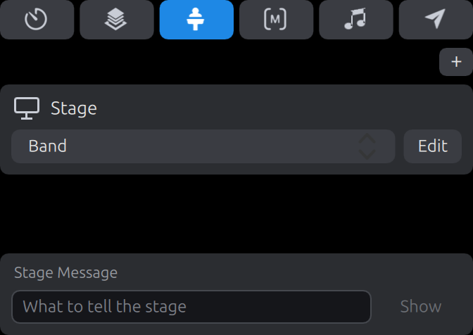

[Simple Presenter](../../README.md) › [What it can do](../../README.md#what-it-can-do)

# Stage layouts

The third tab lists the workspace's stage [screens](screens.md), each with what it
shows: either the plain view the app has of its own (the words of the live slide over
those of the next) or one of the workspace's **stage layouts**, chosen from the
drop-down in its row. The choices are remembered for each workspace.

A stage layout is a slide whose boxes are linked to what is going on, and it is made
and changed in the same [editor](editing.md) as a slide. A text box of one can show:

- the words of the slide that is live, or of the one after it: all of the slide's
  text boxes that show, one after another in the order the slide has them (the back
  one first, which is the reverse of the editor's list), as plain words in the box's
  own font and colour;
- those words with the song's chords over them, in the key picked for it
  ([Chords](chords.md));
- the notes of the slide that is live, or of the one after it: their words in the
  box's own font and colour, or the notes as they were written;
- the time of a [timer](timers.md);
- the time of day, and the date;
- how long the video that is playing has left;
- a [playback marker](playback-markers.md)'s name, or the time to it;
- the copyright of the song that is live ([Copyright display](copyright.md));
- what the stage is being told: the stage message.

[Editing](editing.md) has how each is set, under Linked text.

## Screen Preview

A shape on a stage layout can be filled with a **Screen Preview**: a picture of what one
of the workspace's screens is showing, kept up to date as it changes. Of an audience
screen it is everything the screen shows (the media, with a video moving in it as it
plays, the slide, the announcements, the props, the messages and the mask, in what the
live look gives that screen); of a stage screen, the layout it has. It is chosen in the
editor's Fill menu, with the screen under it, and slides and props can have one too.
ProPresenter's own stage layouts come with some, which are drawn as they are.

The picture is not a copy of the screen's pixels, which one window cannot read from
another without a trip through the computer's memory that would cost more than
drawing it again. It is the screen drawn again, at the picture's size, from what the
screen is told: the slide's words again, a still picture at the picture's size, and a
video's frames borrowed from the one decoder that plays it for the screens, every one
of them. Each borrowed frame is a frame the stage screen draws as well, which is the
whole of the cost. On the laptop this is made on, with a 1080p video playing under the
words and the stage showing a picture of the output most of its size, the app used
about a quarter of one of the processor's cores, where with the stage showing its plain
view it used a tenth: a stage drawing every frame of a video costs about what the
output itself does. Nothing else was held up, and no frame of the output was late. A
picture that took fifteen frames a second instead, tried for comparison, used a sixth.
The same holds for whatever else moves in the picture: while scrolling text moves on the
output, the stage draws every frame of it as well, and the app used a third of a core
against a quarter with the stage's plain view; a transition the picture makes as the
output does left the output's own frames as they were, its first frame two thousandths
of a second later. (The benchmark measures this: see [Built for modest hardware](../how-it-is-made.md#built-for-modest-hardware).)

Guesses at ProPresenter, and choices of this app's own: the screen is fitted into the
shape whole, on black where it shows nothing, and the shape is empty around it; what
moves on the screen moves in the picture: a slide coming or going by the transition the
screen makes, made again at the picture's size, its builds, scrolling text and a video
input in a shape (media coming and going, and a look giving the screen another theme,
are cuts in the picture); the same in the operator window, in the Screen Previews of a
stage layout its preview shows, unless **Screen Previews that move** is switched off in
Settings → Windows, when a change there is a cut and nothing in them moves; and the
preview itself changes by its screen's transitions, unless **The preview's transitions**
is switched off there (on, it brought the output's slides and transitions four or five
thousandths of a second later, on the laptop this is made on); its slides have shadows
only where the shape is a quarter of the screen's height or more; a picture of a screen
shows the pictures that screen shows, one level down (a picture of a stage screen whose
layout has a Screen Preview or a picture of a slide has them in it), but never a picture
of a screen it is already inside, and no deeper than that, so that a screen with a
picture of itself shows it once, with the other screens' pictures in it, and not without
end; a screen the link names that the workspace does not have shows nothing;
and the thumbnails show nothing for it, nor does the editor, where the shape has the fill
ProPresenter keeps beside the link (black, in its own) and a yellow mark that says which
screen. ProPresenter's stage editor also adds a Screen Preview with its `+`; here a shape
is added and its fill made one.

## Pictures of the slides

A shape on a stage layout can be filled with a **Slide Image**: a still picture of the
slide that is live, or of the one after it, which is what ProPresenter's stage layouts
call Current Slide and Next Slide. It is the slide as its thumbnail shows it, the media
its cue brings under it (a video by its thumbnail: the picture is a still, and does not
play), fitted into the shape whole, on black, and it changes as the slide that is live
changes. It is chosen in the editor's Fill menu, with Current Slide or Next Slide under
it. ProPresenter's own stage layouts come with some, which are drawn as they are; in
its file it is the shape's fill, which only stands in for the picture, with a link
beside it that says which slide, as a Screen Preview is kept.

Guesses at ProPresenter, which this was not watched against: that the picture is of the
slide as its presentation has it, in no theme a look gives a screen; that it has the
media its own cue brings, and not whatever is on the media layer (the second slide of a
song, which brings none, has none, as its thumbnail has none); that it is black when
there is no such slide (the slide layer cleared, the last slide live); where Slide
Image is in the Fill menu, and its name; and that the thumbnails and the editor show
the stand-in, the editor with a yellow mark that says which slide.

Along the bottom of the tab is the **stage message**: a box to type in what the people
on the stage are to be told, and a button that shows it and hides it. Enter in the box
shows it too. Shown, it is what every text box linked to the stage message shows, on
whichever layout has one; ProPresenter's own layouts have one, which is there only
while a message is. Such a box can be set to **flash** when a message is shown: its
fill is the colour chosen for that, on and off four times a second, for two seconds.
Words typed while a message is shown wait to be shown, and the button says Show again
for them. What is in the box is kept from one start of the app to the next; that a
message is being shown is not. (Guesses at ProPresenter: that the box is one line and
Enter shows it; the beat of the flash; and that a box which ProPresenter's file marks
hidden, with a rule that it shows when it has text, is shown while a message is.)

The `+` makes a layout to start from, with a box for each of the two slides, gives it
to the first stage screen and opens it in the editor. The editor's own list of layouts has a `+`
too, and a right click there renames, copies or removes one.

ProPresenter's own layouts, in `Configuration/Stage`, are read as they are and can be
given to the stage. What they have that is shown here: boxes for the words of the live
and the next slide, including those that take only the text of the slide's elements of
a given name (and nothing at all of a slide that has no element of that name, which is
how ProPresenter has it and is made use of), and with a song's chords over them where a
box has those switched on; a slide's notes; timers; the clock; the time left of a
video; the stage message; and boxes that show only while a timer is running, or has
run out; Screen Previews; and pictures of the live and the next slide (above). What
they have that is not shown yet is left empty on the stage, and in the editor is marked
with what it is; the links themselves are kept, so the layouts still work in
ProPresenter.
